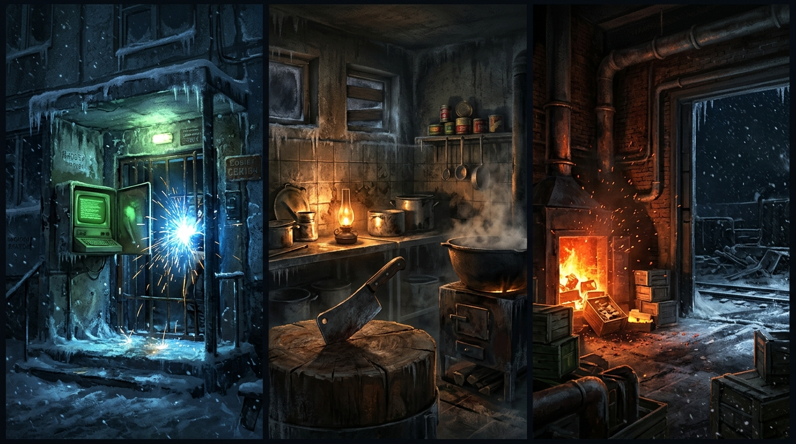
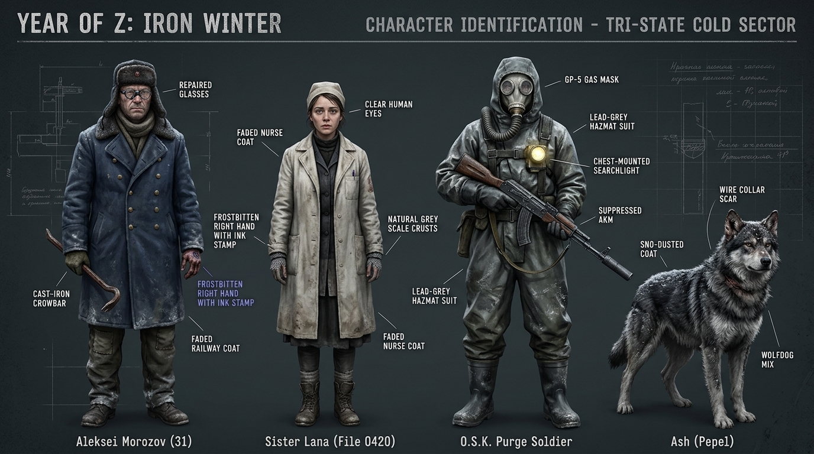
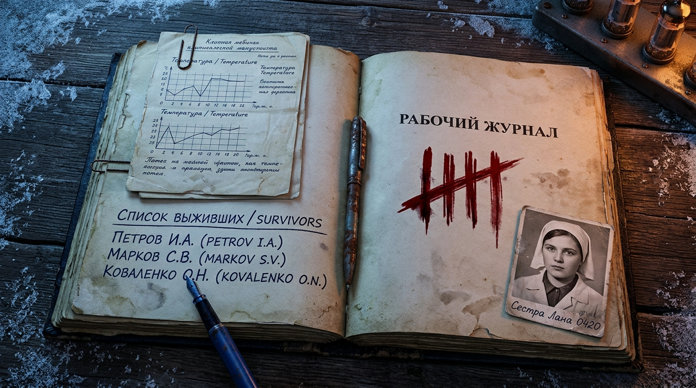
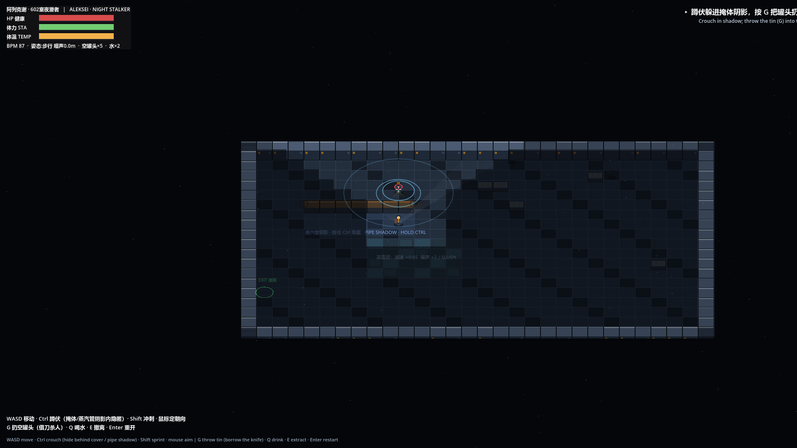
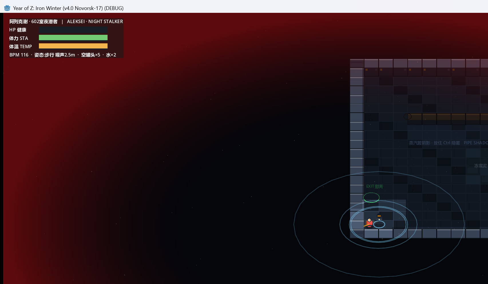

# Year of Z: Iron Winter (`Хроники Года Z: Железная Зима` / 《Z年纪事：凛冬铁轨》) — v4.0 Master Repository

[](#)
[](#)
[-10b981?style=flat-square)](#)
[-8b5cf6?style=flat-square)](#)

> **"In Novorsk-17, when the teletype terminal lights up green, everyone is fed; when a file number is crossed out, the person is zeroed."**
>
> **“在诺沃斯克-17，电传机亮绿灯即为温饱，档案号划掉即为清零。”**

---

## 📖 Overview | 项目概览

**Year of Z: Iron Winter (《Z年纪事：凛冬铁轨》)** is a 2.5D (`75°` oblique top-down) stealth survival and bureaucratic realism narrative RPG set in the fictional post-Soviet Siberian railway hub **Novorsk-17 (`Новорск-17`)** during a `-30°C` polar winter.

By day, you play as former freight dispatcher **Aleksei "Alyosha" Morozov**, accepting an indelible violet-blue observation stamp on your frostbitten hand to haul supplies for the District Rationing Committee in exchange for peritoneal dialysis fluid to keep your uremic mother (**Mama Katya**) alive in Khrushchyovka Apartment 602. By night, after welders seal the building gates, you pry open the boiler-room vent and stalk the broad-gauge tracks searching for your 22-year-old sister **Lana (`File 0420`)**, who was swept into **Carriage No. 3** of the heavy armored train *"Buran"* (`Бронепоезд «Буран»` / "The Iron Shell").

---

## 📂 Repository Structure | 仓库文件目录

```text
year-of-z-iron-winter/
├── README.md                                                     # Bilingual Project Overview & Push Guide
├── index.html                                                    # ★ Soviet Teletype Terminal GitHub Pages Portal (Bilingual ZH/EN)
├── push_to_github.sh                                             # One-click GitHub repository creation & push script
├── assets/
│   └── concept_art/                                              # Phase 0 Concept Art Visual Targets (CON_01 ~ CON_03)
│       ├── CON_01_Novorsk17_Lighting_Script.jpg
│       ├── CON_02_Character_TriState_Sheet.jpg
│       └── CON_03_Diegetic_Work_Logbook.jpg
├── docs/
│   ├── zh/                                                       # 中文核心设定与剧本 (Chinese Documentation)
│   │   ├── Z年纪事_魔幻现实主义游戏剧本.md                       # v4.0 俄式冷峻写实叙事总剧本 (Master Script ZH)
│   │   ├── Z年纪事_游戏总策划案_GDD.md                           # v4.0 游戏总策划案 (GDD ZH)
│   │   ├── Z年纪事_第一阶段灰盒原型规格书与美术资产清单.md       # v4.0 第一阶段灰盒规格书与资产清单 (Greybox Spec ZH)
│   │   ├── Z年纪事_美术资源生成Prompt规格书.md                   # ★ AI 出图生产规格：视觉宪法 / 宏 / 逐资产 Prompt (Art Prompt Spec ZH)
│   │   ├── Z年纪事_Godot4引擎迁移技术规范与架构指南.md           # ★ Godot 4.7+ 引擎迁移技术规范与架构指南 (ZH)
│   │   ├── Z年纪事_Godot灰盒5合1移植对照表.md                     # ★ 5合1 灰盒测试场移植对照表 + 61 项测试清单 (ZH)
│   │   └── Z年纪事_Godot探索循环移植对照表.md                     # ★ 探索循环（基地→地图→夜潜→结算）移植对照表 + 97 项测试清单 (ZH)
│   └── en/                                                       # English Documentation (v4.0 Russian Winter)
│       ├── Year_of_Z_Iron_Winter_Master_Script_EN.md             # Full 5-Act Master Screenplay (EN)
│       ├── Year_of_Z_Iron_Winter_GDD_EN.md                       # Game Design Document v4.0 (EN)
│       ├── Year_of_Z_Iron_Winter_Greybox_Spec_EN.md              # Phase 1 Greybox Spec & Asset List (EN)
│       ├── Year_of_Z_Iron_Winter_Godot4_Migration_Guide_EN.md    # ★ Godot 4.7+ Engine Migration & Architecture Guide (EN)
│       ├── Year_of_Z_Iron_Winter_Godot_Greybox_Gym_Port_EN.md    # ★ 5-in-1 Greybox Gym Port Report & 61-assertion suite (EN)
│       └── Year_of_Z_Iron_Winter_Godot_Exploration_Loop_EN.md    # ★ Exploration-Loop Port Report & 97-assertion suite (EN)
├── prototypes/                                                   # Interactive HTML5 Prototypes & Sandboxes
│   ├── Year_of_Z_Iron_Winter_Exploration_Demo.html               # ★★ 探索循环 DEMO：据点→地图选点→夜潜→搜刮→撤离→结算 (Bilingual ZH/EN)
│   ├── Year_of_Z_Iron_Winter_Playable_Greybox_Gym.html           # ★ Single-File HTML5 Playable 5-in-1 Greybox Gym (Bilingual ZH/EN)
│   ├── Z年纪事_结局分支与双线汇聚流程图.html                     # 俄式“卌”字划痕与五结局交互模拟器 (ZH)
│   ├── Year_of_Z_Iron_Winter_Ending_Simulator_EN.html            # Dual-Anchor & 5-Ending Tally Simulator (EN)
│   └── Z年纪事_核心关卡俯视角平面动线图.html                     # v4.0 核心关卡俯视角平面动线与战术沙盘，中英双语切换 (Tactical Blueprints)
└── godot_project/                                                # ★ Godot 4.7.2 三场景：探索循环 + 5合1灰盒测试场 + Room A 夜潜切片
    ├── project.godot                                             # 8 Physics Layers, 24 input actions, 1920x1080, main_scene = campaign.tscn
    ├── scenes/
    │   ├── campaign.tscn                                         # ★ 主场景：「一夜」探索循环（基地/地图/夜潜/结算/结局）
    │   ├── gym.tscn                                              # 5合1 灰盒测试场（Rooms A–E）
    │   └── main.tscn                                             # Room A 夜潜垂直切片
    ├── scripts/
    │   ├── CampaignData.gd                                       # ★ 24 物资 / 5 武器 / 5 伙伴 / 13 地点 / 7 剧情节拍数据表
    │   ├── CampaignSim.gd                                        # ★ 战役状态机：库存/良知/卌/真名/伙伴/节点余量/结算/次日/结局
    │   ├── RaidGen.gd                                            # ★ 程序化街区生成器（街道→扇区→建筑→容器→连通性）
    │   ├── RaidSim.gd                                            # ★ 一夜运行时：视野雾/AI/搜刮/卡门/撤离/体温/抉择A
    │   ├── Campaign.gd                                           # ★ 城市地图 + 夜潜世界 _draw() 渲染与输入
    │   ├── CampaignHUD.gd                                        # ★ 基地三栏 / 地图节点卡 / 夜潜 HUD / 结算 / 5 个模态框
    │   ├── GymSim.gd                                             # ★ 灰盒场纯逻辑（5房间/投罐/卡门/抉择A/三态嗅觉/QTE/卌）
    │   ├── Gym.gd                                                # ★ 灰盒场输入 + 等比视口 + _draw() 全画面渲染
    │   ├── GymHUD.gd                                             # ★ 顶栏/侧栏/清单/电传 + 日志/抉择A/QTE 模态框
    │   ├── Sfx.gd                                                # ★ 6 种程序化音效（启动时烘焙 AudioStreamWAV）
    │   ├── Sim.gd / Main.gd / HUD.gd                             # Room A 纯逻辑 / 渲染 / HUD（夜潜循环）
    │   ├── WolfdogAsh.gd / DoorWedgeInteractable.gd              # 伙伴与交互（后续房间使用）
    ├── autoload/                                                 # LogbookManager, AcousticRippleBus
    ├── tests/
    │   ├── campaign_smoke.gd                                     # ★ 97 项 headless 探索循环测试
    │   ├── gym_smoke.gd                                          # ★ 61 项 headless 机制冒烟测试
    │   └── room_a_smoke.gd                                       # 20 项 Room A 夜潜切片测试
    ├── screenshots/                                              # 垂直切片实机截图（gym 截图待本机首跑补拍）
    └── data/                                                      # novorsk17_campaign_data.json (L01–L10)
```

---

---

## 🗺 Exploration Loop Demo (探索循环 DEMO · `Year_of_Z_Iron_Winter_Exploration_Demo.html`)

**Single-file HTML5 · Canvas · zero art assets · zero build step.** Open it directly in any modern browser (or serve the `prototypes/` folder). Instant **中文 / EN** switching, procedurally synthesized Web Audio SFX, and a full one-day loop:

> **据点 602 室 → 地图选点 → 夜潜探索 → 搜刮 → 撤离 → 结算推进剧情 → 第二天**
> *Base (Apt 602) → Map target selection → Night infiltration → Scavenge → Extract → Report & story advance → Next day*

| 系统 | 实现要点 |
| :--- | :--- |
| **TWoM 式地图选点** | 10 个诺沃斯克-17 节点；危险度 ▲、物资提示、容器余量 %、耗时、寒冷度、解锁条件；未踏足时只给"听说"，踏足后才显示验证过的情报 |
| **75° 斜俯视 2.5D** | 正交投影 + y 轴压缩 0.62，墙体带侧立面挤出，Y-sort 排序；`1 逻辑米 = 44px`（正式资产按 64px/m 出） |
| **程序化关卡** | BSP 房间 + 走廊生成（seed 按节点与天数），门/蒸汽管掩体/铁丝网/冻雪泥/火堆；连通率 100%（已自动化验证） |
| **视野与噪声** | 90° 扇形视野 + 1.8m 近身圈；视野外仅显示三色声音波纹（暗红=狂暴者 / 灰白=回退半人 / 冷蓝=清杀队）；潜行 0.8m、步行 2.5m、冲刺 7.5m、雪泥 ×2 |
| **三方潜行** | 清杀队 45° 探照灯（1s 红外锁定后开火）、狂暴者 0.45s 起跳预警、投掷空罐头 9m 声波**借刀杀人** |
| **伙伴系统** | 灰烬（嗅觉预警/三态标记）、安娜（辨识半人 +4 格）、古丽娅（每夜救一次）、帕维尔（撬焊死门）、伊万（隐藏容器 + 省时 20%）；每夜只能带 1 名 |
| **武器 = 收集度** | 赤手 → 道钉撬棍（可长按 E 卡门 15s）→ 砍骨刀（**锁骨卡刀 1.5s 内连按 6 次**）→ 双管猎枪（3 零件 / 心率散射 / 25m 引警）→ 莫辛纳甘（2 零件）；武器架实时显示收集进度 |
| **生存压力** | 核心体温、体力、心率（影响散射）、雪泥减速、火堆与热水回温、天亮强制撤离（只保住一半背包） |
| **主线推进** | 冷库（灰烬 + 账面死人）→ 货场（编组单）→ 东街食堂（瓦西里 / PTSD 干渴幻听）→ 疗养院（安娜 0419 → 妹妹在第三节车厢）→ 黑市（抉择 C）→ 松林庄园（焦油黑雪）→ 西站（23:00 发车令）；集齐后进入 **DEMO 边界（第四幕）** |
| **《双面工作日志》** | 正面官样台账（`0 人 / 已签收`），背面真名 + 俄式五道划痕「卌」；A3 灭口 +1、误杀 +2、背叛 +1，直接影响终局能否救活拉娜 |

**Controls 操作**：`WASD` 移动（鼠标定朝向与视野）· `Ctrl` 潜行 · `Shift` 冲刺 · `E` 长按搜刮/卡门/撤离 · `G` 投掷罐头 · `左键` 攻击/开枪/连打拔刀 · `Q` 喝热水 · `F` 用绷带 · `R` 装填 · `1-5` 切换武器 · `滚轮` 缩放 · `Tab` 日志 · `Esc` 放弃

> ⚠️ **DEMO 内不含任何美术资源**——全部图形都是 Canvas 绘制的几何体，音效为 Web Audio 程序合成。
> 美术生产规格（视觉宪法、可复用 Prompt 宏、尺寸/命名/后处理规范、逐资产英文 Prompt、MJ/SDXL/Flux/ComfyUI 参数表、负向词库、一致性方案）见：
> **`docs/zh/Z年纪事_美术资源生成Prompt规格书.md`**

---

## 🎮 Playable HTML5 5-in-1 Greybox Prototype (`Year_of_Z_Iron_Winter_Playable_Greybox_Gym.html`)

Open `prototypes/Year_of_Z_Iron_Winter_Playable_Greybox_Gym.html` directly in any modern browser (no local server or build step required). Features instant **中文 / EN** switching and procedural Web Audio API sound effects:

* **Room A (Searchlight "Borrowing the Knife" & Frozen Slush)**: Hold `Ctrl` to hide in the high-pressure steam pipe's shadow from the patrolling **O.S.K. Purge Soldier** (`45°` searchlight cone), and press `G` to throw an empty sardine tin toward the Rabid Infected so the soldier eliminates them for you.
* **Room B (Railway Crowbar Door Wedge & `12cm` Fence Gap)**: Press `E` to wedge a deformed steel door shut for `15s` with your railway crowbar, and push a warm buckwheat lunchbox through a `12cm` drainage gap.
* **Room C (The Paper Dead & Choice A `卌` Tally)**: Record **Sergey & Maria**'s real names on the back of your Work Logbook when the Soviet teletype terminal reads `0 PERSONS AT COORDINATE`, and resolve **Choice A** with the Regressing Half-Human in the culvert.
* **Room D (Siberian Wolfdog "Ash / Пепел" Tri-State Olfactory AI)**: Walk past 3 quarantine cages to test Ash's automatic olfactory detection (`Bark` vs. `Whimper` vs. `Tail Wag`) and speak with self-bound **Anna (`0419`)** about Sister **Lana (`0420`)** in Carriage No. 3.
* **Room E (East Street Canteen Kitchen — Collarbone Blade Jam QTE & PTSD Thirst)**: Equip the rusty Butcher Cleaver, confront **Vasily** in `40°C` delirium, complete the **6-hit Collarbone Blade Jam QTE**, witness his eyes clear to blue as he whispers *"…Пить (Thirsty)…"*, and experience the permanent **PTSD Thirst Tinnitus** when drinking water (`Press Q`).

---

## 🖥️ GitHub Pages Portal | `index.html`

Open `index.html` (or enable GitHub Pages on branch `main`, root `/`) for the Soviet Teletype Terminal portal: it links all prototypes including the Exploration Demo, plus the Phase 0 concept art gallery below. Note: on `file://` the portal buttons only show the target path; serve over HTTP or use GitHub Pages to navigate.

## 🎨 Phase 0 Visual Target Concept Art (`assets/concept_art/`)

| `CON_01` · Color & Lighting Script | `CON_02` · Character & Tri-State Sheet | `CON_03` · Diegetic Work Logbook (`卌`) |
| :---: | :---: | :---: |
|  |  |  |
| **Khrushchyovka Blizzard / East St. Kitchen / Pine Manor** | **Aleksei / Sister Lana (`0420`) / O.S.K. Purge Squad / Wolfdog "Ash"** | **Left: Verified Real Names / Right: `卌` Tally** |

## 🎮 Godot 4.7+ Exploration Loop + Greybox Gym + Room A Slice (`godot_project/`)

`godot_project/` now ships **three playable scenes** sharing one immediate-mode architecture (a single `Node2D`, all entities as plain `RefCounted` data objects updated by hand every frame, and the entire frame rendered in `_draw()`; the HUD is the only `CanvasLayer`):

0. **`scenes/campaign.tscn` — 「一夜」探索循环（新主场景）**: the full loop of `prototypes/Year_of_Z_Iron_Winter_Exploration_Demo.html`. Room 602 with your mother on dialysis (`dial` bags, one per day, two days without her and she dies), a 900×520 city map with 13 nodes gated by intel/medicine/flags, a procedural 64×48 block per node (streets → sectors → enterable buildings → containers → connectivity repair), a 90°-FOV fog-of-war raid with warmth/BPM, rabid packs, O.S.K. purge patrols you can bait with thrown tins, half-humans and Choice A, 1.7 s container searches, crowbar door wedges, welded-door prying, then four outcomes — extracted / dawn (keep every other item, −22 HP) / downed / abort — a report screen, next-day dialysis, and the TRUE-α / TRUE-β / B / C ending resolver. Every number is lifted from the prototype's `CFG`/`LOCS`/`STORY` tables.
1. **`scenes/gym.tscn` — 5 合 1 灰盒测试场**: a 1:1 port of `prototypes/Year_of_Z_Iron_Winter_Playable_Greybox_Gym.html`. One 1100×680 arena with Rooms A–E, free walking plus `1~5` teleport, and all five signature loops live: searchlight *Borrowing the Knife* with tin cans, frozen slush and steam-pipe concealment; crowbar door wedge + 12 cm lunchbox delivery; the paper-dead teletype with Choice A and the 卌 tally; Ash's tri-state olfactory AI at three cages and Anna (0419); the East St. cleaver, Vasily's breach, the 6-press collarbone blade-jam QTE and the permanent PTSD thirst. A sidebar checklist tracks 5/5 verification; `Tab` opens the dual-sided Logbook; `L`/`F`/`M` toggle language, cracked glasses and SFX; `F5` resets.
2. **`scenes/main.tscn` — Room A 夜潜垂直切片**: the original 1:1 port of `Exploration_Demo.html`'s single-room night-stalk loop (fog-of-war hole cutting, extruded walls, steam pipes, snow, extraction). `F1` from the campaign opens the gym; inside the gym `F1` returns to the campaign and `F2` opens Room A; inside Room A `F1` goes back to the gym and `F2` to the campaign.

All three scenes draw **zero art assets** (pure `_draw()` geometry) and synthesize their own audio: `Sfx.gd` bakes six Web-Audio-style tones into `AudioStreamWAV` at startup. The campaign loop is fixed by **97 headless assertions**, the 5-in-1 gym by **61**, and the Room A slice keeps its **20**.

| 文件 | 职责 |
| :--- | :--- |
| `scripts/CampaignData.gd` | 探索循环静态数据：24 物资 / 5 武器（收集度拼装） / 5 伙伴 / 13 地点 / 7 段剧情节拍 / 中英文案 / 瓦片常量 |
| `scripts/CampaignSim.gd` | 战役状态机：库存、良知、卌 划痕、真名、flags、伙伴、节点余量、出战配置、剧情 `ops`、结算、次日透析、结局判定 |
| `scripts/RaidGen.gd` | 程序化城市生成（同 seed 同图）+ 战利品抽取 + 瓦片工具 |
| `scripts/RaidSim.gd` | 一夜运行时：移动碰撞、噪声波纹、90° 视野与探索雾、狂暴者/清杀兵/半人/伙伴 AI、搜刮、卡门、破门、撤离、体温/心率 |
| `scripts/Campaign.gd` | 城市地图与夜潜世界 `_draw()` 渲染（地面/立面/容器/火堆/雾/光锥/波纹） |
| `scripts/CampaignHUD.gd` | 顶栏 + 基地三栏 + 地图节点卡 + 夜潜 HUD + 结算页 + 剧情/抉择A/日志/帮助/放弃 五个模态框 |
| `scripts/GymSim.gd` | 灰盒场纯逻辑：5 个房间区域、玩家/灰烬/清杀兵/狂暴者、投罐声波、撬棍卡门、12cm 推饭盒、电传真名、抉择 A、三态嗅觉、砍骨刀与瓦西里破门、6 连按 QTE、PTSD、卌 划痕、验证清单、电传事件流 |
| `scripts/Gym.gd` | 灰盒场渲染：等比视口变换、`_draw()` 房间底板/网格/蒸汽管阴影/三座铁笼/砧板、探照灯与视野扇形渐变、声波波纹、弹道曳光、浮字、PTSD 闪屏、破镜遮罩 |
| `scripts/GymHUD.gd` | CanvasLayer：顶栏（区域/姿态/灰烬三态/HP/BPM/罐头/卌）+ 侧栏（体征/清单/简报/电传/按钮）+ 日志 / 抉择 A / QTE 模态框 |
| `scripts/Sfx.gd` | 程序化音效：beep / can / wedge / akm / bonejam / thirst，启动时合成 `AudioStreamWAV`（对应 HTML Web Audio） |
| `scripts/Sim.gd` / `Main.gd` / `HUD.gd` | Room A 夜潜切片：纯逻辑 / 75° 斜俯视 `_draw()` 渲染 / HUD |
| `tests/campaign_smoke.gd` | 97 项 headless 探索循环测试（成功打印 `CAMPAIGN_SMOKE_PASS`） |
| `tests/gym_smoke.gd` | 61 项 headless 冒烟测试（见下方命令；成功打印 `GYM_SMOKE_PASS`） |
| `tests/room_a_smoke.gd` | 20 项 Room A 冒烟测试（成功打印 `ROOM_A_SMOKE_PASS`） |

**Run / 运行**（with Godot 4.7.2-stable）:

```bash
# 「一夜」exploration loop (new main scene)
Godot_v4.7.2-stable_win64 --path godot_project

# 5-in-1 greybox gym (or press F1 in-game)
Godot_v4.7.2-stable_win64 --path godot_project res://scenes/gym.tscn

# Room A night-stalk slice (or press F2 in the gym)
Godot_v4.7.2-stable_win64 --path godot_project res://scenes/main.tscn

# Campaign loop: 97 headless assertions (prints CAMPAIGN_SMOKE_PASS on success)
Godot_v4.7.2-stable_win64 --headless --path godot_project -s tests/campaign_smoke.gd

# Greybox gym: 61 headless assertions (prints GYM_SMOKE_PASS on success)
Godot_v4.7.2-stable_win64 --headless --path godot_project -s tests/gym_smoke.gd

# Room A slice: 20 headless assertions (prints ROOM_A_SMOKE_PASS on success)
Godot_v4.7.2-stable_win64 --headless --path godot_project -s tests/room_a_smoke.gd
```

**Controls 操作（「一夜」探索循环）**：`WASD` 移动 · 鼠标瞄准 / 地图点选 · `Ctrl` 潜行 · `Shift` 冲刺 · `Space` / 左键 攻击（砍骨刀卡刀连按 6 次）· 按住 `E` 搜刮 / 卡门 / 破门 / 撤离 / 抉择 A · `Q` 热水（体温 +22）· `H` 绷带（+26 HP）· `G` 扔空罐 · `R` 装弹 · `Tab` 《双面工作日志》· `L` 中英切换（非夜潜）· `Enter` 开始 / 睡到明天 · `Esc` 取消 / 放弃夜潜 · `F1` 灰盒测试场。

**Controls 操作（5 合 1 灰盒场）**：`WASD` 移动 · 鼠标定朝向 · `Ctrl` 蹲伏（蒸汽管阴影 100% 免疫探照灯）· `Shift` 冲刺 · `G` 投掷空罐头（借刀杀人）· `E` 交互 / 撬棍卡门 / 门底推饭盒 · `Space` / 左键 挥刀（锁骨卡刀 6 连按）· `Q` 喝水（PTSD 耳鸣）· `Tab` 《双面工作日志》· `1~5` 传送 Room A–E · `L` 中英切换 · `F` 破眼镜 · `M` 音效 · `F5` 重置 · `F1` 回探索循环 · `F2` Room A 夜潜切片 · `Esc` 关闭模态框。

**Controls 操作（Room A 夜潜切片）**：`WASD` 移动 · 鼠标定朝向 · `Ctrl` 蹲伏隐匿 · `Shift` 冲刺 · `G` 投掷空罐头（借刀杀人）· `Q` 喝水 · `E` 按住 1.5s 在绿色撤离点撤离 · `Enter` 重开 · `F1` 返回灰盒测试场 · `F2` 回探索循环。

| 借刀杀人构图（士兵黄色探照锥 + 玩家 90° 视野锥 + 蒸汽管阴影） | 出生点 HUD 与撤离点 |
| :---: | :---: |
|  |  |

> 说明：所有数值（速度、噪声半径、视野、锁定/射击间隔、掩体规则、雪泥减速、卡门时长、搜刮时长、夜长、QTE 次数等）均逐行对齐 HTML 原型，由 97 + 61 + 20 项 headless 测试固定行为；本仓库为无美术灰盒，画面全部为 `_draw()` 几何绘制，音效全部程序化合成。
> **探索循环移植细节 / 逐机制对照表 / 刻意偏差 / 测试清单**：`docs/zh/Z年纪事_Godot探索循环移植对照表.md` · `docs/en/Year_of_Z_Iron_Winter_Godot_Exploration_Loop_EN.md`
> **灰盒场移植细节**：`docs/zh/Z年纪事_Godot灰盒5合1移植对照表.md` · `docs/en/Year_of_Z_Iron_Winter_Godot_Greybox_Gym_Port_EN.md`
> **后续节点化架构规范**：`docs/zh/Z年纪事_Godot4引擎迁移技术规范与架构指南.md` · `docs/en/Year_of_Z_Iron_Winter_Godot4_Migration_Guide_EN.md`
>
> ⚠️ 本次新增的探索循环与灰盒场都已通过 gdtoolkit GDScript 解析校验，并分别附 97 / 61 项 headless 测试，但**尚未在装有 Godot 的机器上首跑**（本仓库未附新的 campaign / gym 截图）；请先运行上面的 `campaign_smoke` 与 `gym_smoke` 命令完成首次验收，再补拍截图。

---

## 🚀 Quick Push to a New Public GitHub Repository | 一键推送至 GitHub 指南

Unzip `year-of-z-iron-winter-github-repo.zip` on your machine and run either the included `./push_to_github.sh` script or the following commands:

```bash
# Option 1: Using GitHub CLI (gh) — creates a new public repo and pushes in one command
gh repo create year-of-z-iron-winter --public --source=. --remote=origin --push

# Option 2: Standard Git Remote Push
git remote add origin https://github.com/<YOUR_GITHUB_USERNAME>/year-of-z-iron-winter.git
git branch -M main
git push -u origin main
```
