# Year of Z: Iron Winter · 美术风格参考 v4.2

> 适用版本：总剧本 v4.2 Definitive Master（白·红·黑三色分区、原罪铭牌与深层人性闭环版）与背景故事 v4.2 终极完整版。
> 本文件所附 11 张概念图均为 2026-11-02 生成的设定图原图，仅重命名，未改动画面内容。旧版阿列克谢三阶段图（未修正胶布画法）已不用，以 03 号修正版为准。
> 存放位置（上传后）：`assets/concept_art/`，本文件与图片同目录，图片用相对路径引用。

## 一、风格总纲

- **基调**：冷峻写实，不是卡通平涂，不是高饱和奇幻。参考《地铁：离去》《请出示证件》《切尔诺贝利》《瘟疫》的质感。
- **色彩**：以冷灰蓝、雪白、铁锈、军绿为主，饱和度压低。暖色只用在三个地方：探照灯黄白光、电传机绿灯、松林庄园 26℃ 的暖黄室内光。暖色出现即代表权力或谎言，不是温馨。
- **光**：暴风雪漫反射 + 探照灯硬光。红区三级探照灯是主要戏剧光源：I 级黄白巡弋、II 级红外交叉锁死、III 级红光铝热剂清零。
- **材质**：雪、冰霜、铁锈、工字钢、橡胶防化服、旧羊毛、纸杯、铁皮喇叭。画面要能摸出冷和糙，不要光滑干净。
- **人物画法**：以行为表现性格，不要只站着摆姿势。阿列克谢的性格要画在推车、潜行、递饭盒、撬棍卡门这些动作里（见 06 号图）。

## 二、三色分区美术落点（v4.2 新增）

- **白区（封控居住区）**：赫鲁晓夫筒子楼、焊死的工字钢门、结霜玻璃、猫眼与举报纸条、两杯黑麦碎粒。色调最冷、最压抑，人物缩在门后和窗后。
- **红区（清杀巡逻区）**：探照灯哨塔、铁丝网、广轨货场、冷库。清杀队是视觉焦点：铅灰防化服、猪嘴面具、头盔探照灯（见 11 号图）。假人哨塔是红区的重要意象：穿防化服的塑料模特 + 录音机，远看是防线，近看是空壳。
- **黑区（除名沦陷区）**：废弃工人镇黑市、洗车库据点、地底铁笼、短波收音机。比白区更暗、更杂，但有活人气：罐头、煤水箱、旧毯子、手工修补的痕迹。
- **特权飞地（松林庄园）**：唯一暖色区。26℃、牛排、全脂奶粉、409 批腹透液、焚化炉的“焦油黑雪”。暖与冷的对比本身就是批判，不要把庄园画成普通豪宅。
- **原罪铭牌**：第四幕的关键视觉。第三节车厢门框铆接的黄铜调拨铭牌，上面是阿列克谢亲手签下的《第 004 号车皮调拨单》签名。铭牌要画得清晰可读，是全剧的视觉钉子。

## 三、角色美术规范

- **阿列克谢（31 岁，前铁路调度员）**：褪色铁路棉大衣、铸铁道钉撬棍、高度近视。早期制服整齐，中期沾雪夜潜，晚期破旧打补丁、胡茬、伤痕，同一张脸贯穿始终（见 03 号图）。
- **眼镜胶布画法（重要，已纠正未完全）**：黑绝缘胶布是缠在眼镜腿和镜框铰链上的，胶布在眼镜本身上，绝对不要画成贴在太阳穴皮肤上的黑色贴片。现有 03、06、07 号图里，生成器仍把胶布画成了镜腿处的一块黑块，远看仍像贴在太阳穴附近，这处不算完全改到位，后续作画以文字规范为准，不要照抄图里的黑块画法。
- **灰鳞病人**：灰鳞剥落、瞳孔回色、伸手求救的半人状态，不是狂暴丧尸。狂暴者与回退半人必须一眼区分：狂暴者眼白紫黑、四肢着地扑咬；半人鳞屑剥落、瞳孔回色、抱头或伸手（见 02 号图）。
- **叶莲娜**：参考冬妮娅，长辫子、皮毛帽、冬大衣，眼神叛逆坚韧（见 05 号图）。
- **卡佳妈妈**：59 岁，602 室，晚期尿毒症，双腿重度水肿发紫，轮椅 + 老式腹膜透析机，旧羊毛毯（见 08 号图）。
- **帕沙（v4.2 新增）**：18 岁清杀队农村新兵，肥大防化服、猪嘴面具摘下后是发烧 39.2℃ 的少年脸，躲在哨塔铁梯下跪求退烧药。不要画成老兵，不要画成反派脸。
- **柳德米拉大娘（v4.2 新增）**：63 岁，601 室邻居，牵着五岁外孙女佳娜，平时喷消毒水、举报邻居，大火中托孤。不要只画成恶邻居，要画出“为救孩子而举报、又被自己换来的券困住”的两面。
- **清杀队**：铅灰厚橡胶防化服、圆形猪嘴面具、AKM 微声步枪、头盔高亮探照灯。督察专员手持灭口令文件，区别于普通队员（见 11 号图）。

## 四、图片清单

### 01 · 钢铁列车“布拉风号（铁壳号）”

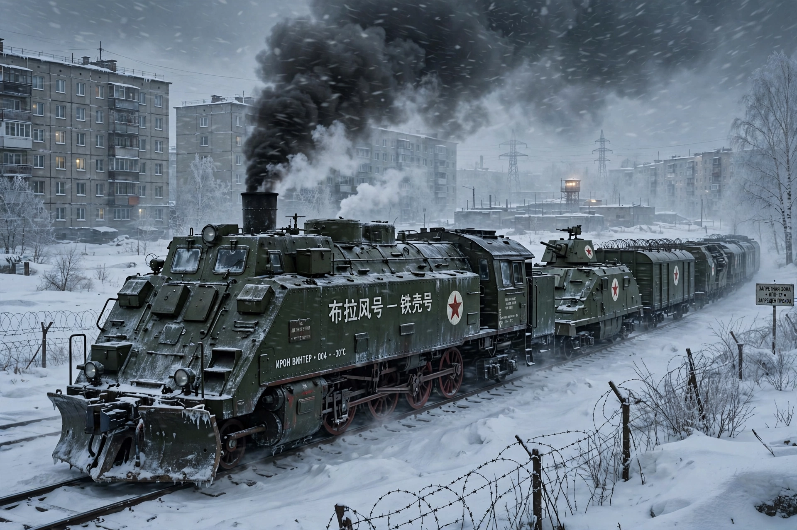

防化绿漆、白底红星、黑烟白雾、雪原铁路、赫鲁晓夫楼背景。列车是全剧的移动牢笼，不是交通工具特写。

### 02 · 灰鳞病人（回退半人）

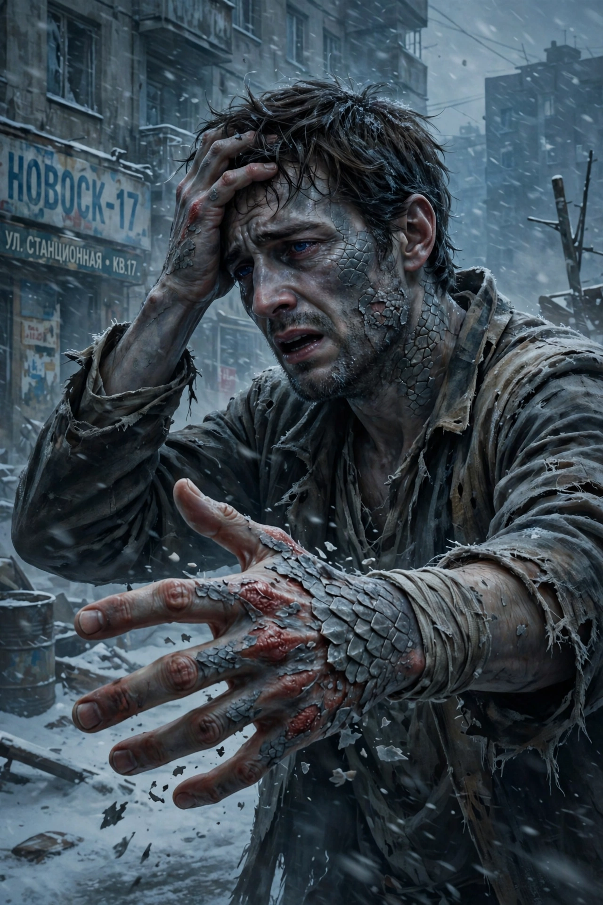

脸上手上灰鳞正在剥落，瞳孔已经回色，神情还是人。这是“会自愈”的视觉证据，画法上必须和狂暴者区分开。

### 03 · 阿列克谢三阶段（修正版）

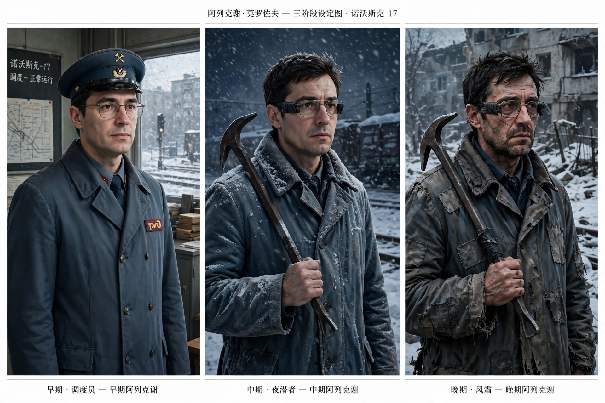

早期调度员制服、中期夜潜沾雪、晚期破旧打补丁，同一张脸。注意眼镜胶布画法见上文规范，不要照抄图里的黑块。

### 04 · 跟随伙伴

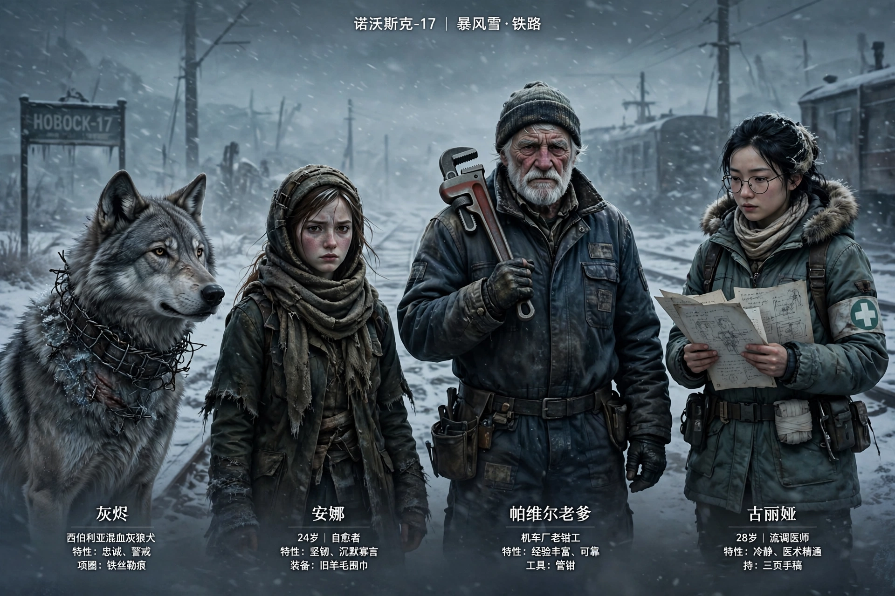

灰烬（铁丝项圈勒痕的灰狼犬）、安娜（旧围巾的自愈女孩）、帕维尔老爹（管钳）、古丽娅（三页手稿）。

### 05 · 配角：茹科夫父女、医生、黑市商贩、老轨伊万

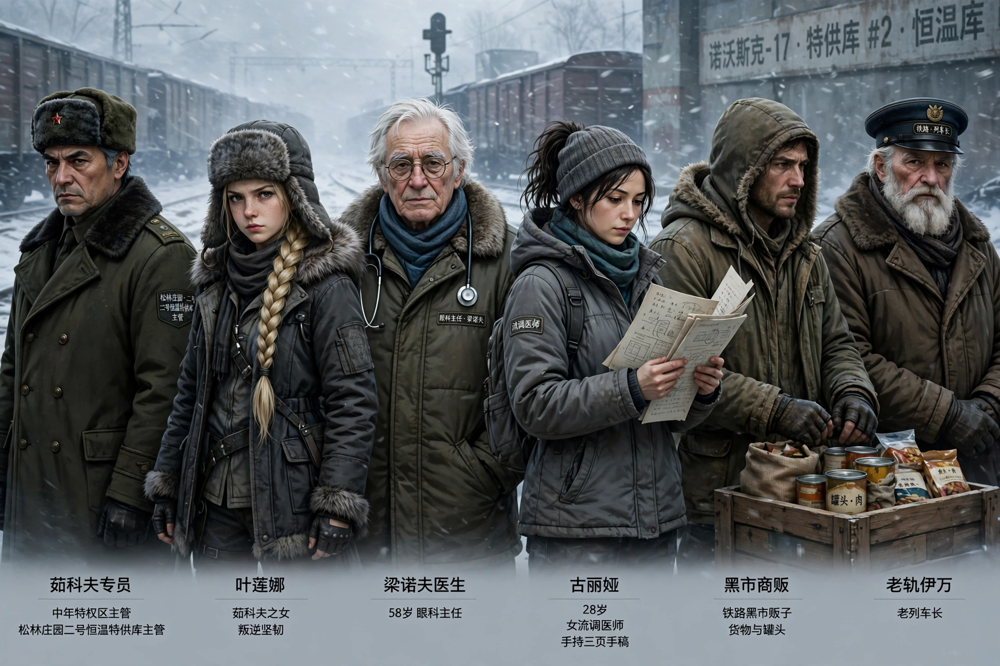

茹科夫专员、叶莲娜（长辫子、皮毛帽）、梁诺夫医生、古丽娅、黑市商贩（罐头与货物）、老轨伊万（铁路帽、白胡子）。

### 06 · 阿列克谢行为表现

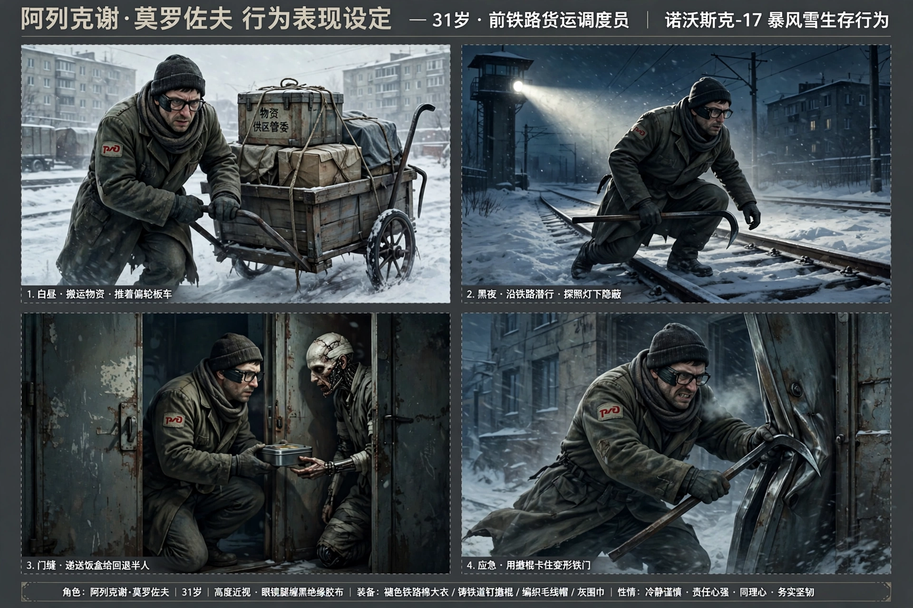

白昼推偏轮板车搬物资、黑夜沿铁路在探照灯下潜行、门缝里给回退半人递饭盒、用撬棍卡住变形铁门。主角性格画在动作里。

### 07 · 不同结局的阿列克谢

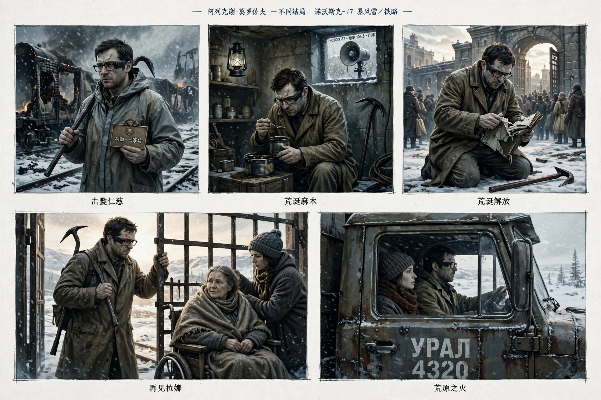

五格，同一张脸、五种结局造型：击毙仁慈（防化服、功勋表）、荒诞麻木（地下室、罐头）、荒诞解放（跪地撕日志）、再见拉娜（铁闸、轮椅上的母亲）、荒原之火（乌拉尔卡车北行）。

### 08 · 女性配角：瓦莲京娜、卡佳妈妈、莉莉亚

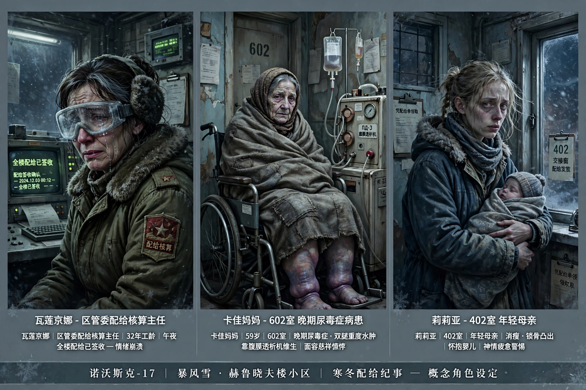

瓦莲京娜在电传终端前按下全楼已签收、卡佳妈妈 602 室轮椅透析机、莉莉亚 402 室抱婴儿站在交接窗前。

### 09 · 男性配角：切尔诺夫中士、杜布罗夫、科利亚、扎哈尔

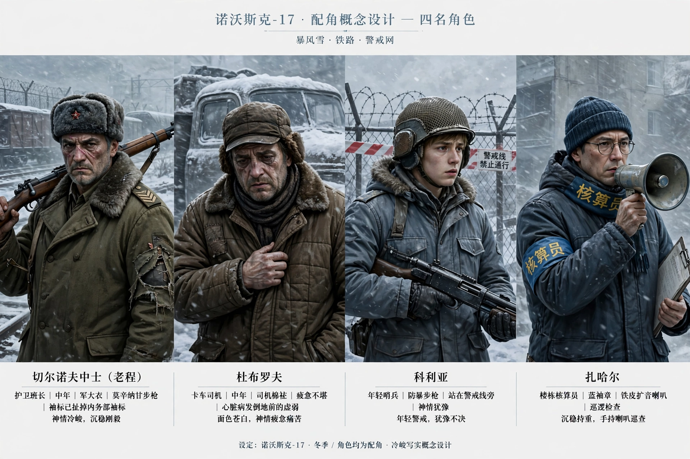

护卫班长端莫辛纳甘、卡车司机在雪地卡车旁、年轻哨兵在警戒线边、核算员拿铁皮喇叭。

### 10 · 拉娜、谢尔盖母子、维克多

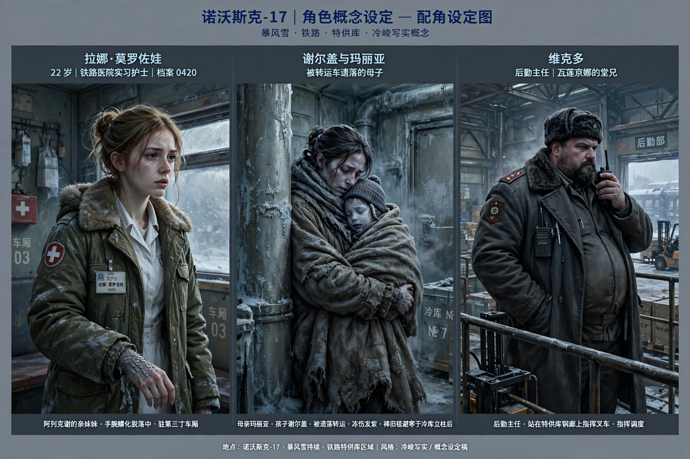

拉娜在第三节车厢里手腕灰鳞脱落、谢尔盖母子冻得发紫躲在冷库立柱后、维克多站在特供库钢廊上指挥叉车。

### 11 · 清杀队

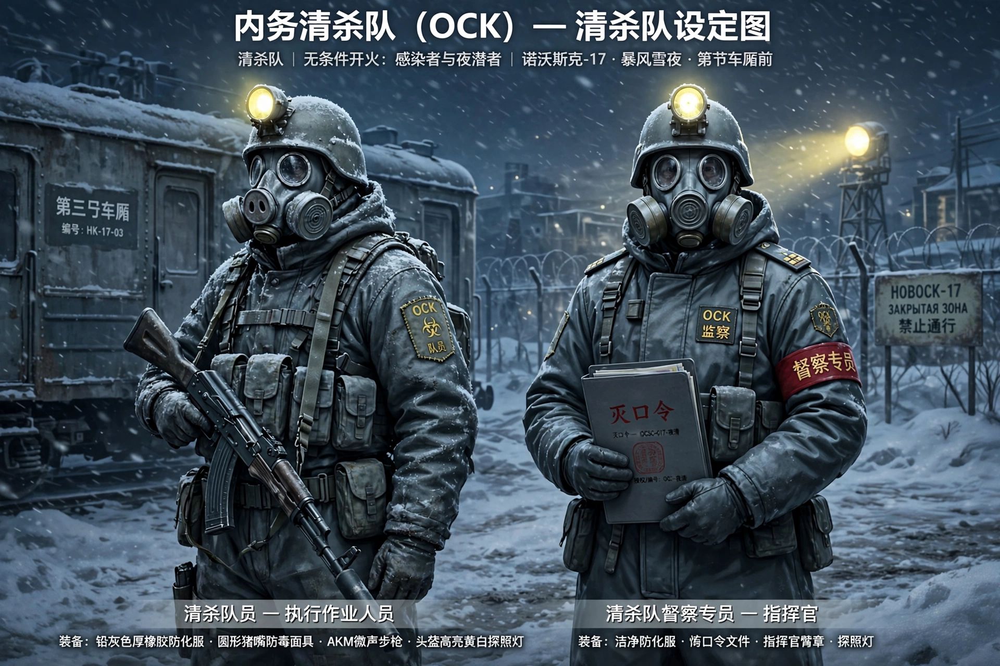

清杀队员（AKM、探照灯）与督察专员（灭口令文件），第三节车厢前，暴风雪夜。

## 五、v4.2 新增剧情的美术落点与待补图

已在现有图片里落点的：三色分区氛围、清杀队、松林庄园特供库、第三节车厢、五结局。

尚未有专属图的 v4.2 新增点，列为待补图，不在本文件里硬凑：

- 帕沙与假人哨塔：穿防化服的塑料模特 + 录音机、铁梯下发烧跪求退烧药的 18 岁新兵。
- 柳德米拉大火托孤：焊死的消防门、浓烟、染血的举报领粮券、外孙女佳娜。
- 004 号铭牌特写：第三节车厢门框上的黄铜铭牌与阿列克谢的亲笔签名。
- 6.66 MHz 烙铁烫鳞：黑市角落烧红马蹄铁、掺防冻液的假药。
- 3 号矿坑：温压爆破炸穿冻土、远古孢子、铝热剂炸山灭口。

## 六、已有概念图 CON_01–CON_03 的关系

仓库 `assets/concept_art/` 已有 CON_01（诺沃斯克-17 灯光脚本）、CON_02（角色三态表）、CON_03（工作日志）三张早期概念图。本文件是 v4.2 的补充风格参考，不覆盖、不替换那三张，后续作画以本文件 + CON_01–CON_03 共同为准，冲突处以 v4.2 剧情为准。
