# 《Z年纪事：凛冬铁轨》全量剧情与过场对白提取

**整理日期：** 2026-11-18  
**用途：** 与[《重塑剧情关系与分支审阅包.md》](重塑剧情关系与分支审阅包.md)配套，供剧情审阅 agent 逐段核对。

## 阅读说明

- 文学主稿场景对白：以 `docs/zh/Z年纪事_全量文学剧本_去AI重排整合版.md` 为角色标签依据，与其生成数据 `godot_project/data/story_dialogue.json` 逐条对照一致；共 **20 个场景、271 条对白/场景文本**。JSON 的 `w` 角色字段会沿用前一段说话人，所以本提取件按主稿中显式的角色标记恢复旁白/角色，避免把叙述误标成上一位角色的对白。
- “文学主稿选择原文”来自同一 JSON 的 `choices_markdown` 字段，只保留对应场景范围。叙事选项和代码选项分开，不代表二者当前完全一致。
- 后半部分抽取当前代码层 `CampaignData.gd`、`CutsceneData.gd`、`CampaignSim.gd` 中的中文对白、选项、结果卡、开场/余波/结局幻灯；不把它们冒充文学主稿。
- 场景叙事正文仍以文学主稿原文件为准；本文件重点保存对白和分支原文，关系综述与版本差异见配套审阅包。

## A. 文学主稿场景对白

### 0-1｜绿灯、车皮与签名

**旁白 / 场景文本**  
调度室里的暖气片半凉不热，铁管里不时传出水垢被冲刷的敲击声。窗外的广轨编组站正被白毛风裹得严严实实，一列刷着防化绿漆的重型装甲车头正在顶推车皮，车顶两挺重机枪在雪里凝成了两个白疙瘩——那是“布拉风号”，站上的老工人都管它叫“铁壳号”。

**旁白 / 场景文本**  
墙上用图钉扎着本周配额进度表，蓝墨水画的折线在末端耷拉下去。红铅笔批注压在末尾：【第17区人员转运编组完成率61%：连续两周不达标，市政供暖降温40%】。

**旁白 / 场景文本**  
调度长用指甲剔了剔牙缝，把一张三联复写单推到阿列克谢面前。单子旁边压着区管委后勤科的一页便签，上面盖着褪色的椭圆章：瑞士 409 批腹膜透析液，超额留用，配额一箱（6袋）。

**旁白 / 场景文本**  
阿列克谢的母亲卡佳在 602 室已经两天没能排出毒素，双腿肿得像泡发的面团，皮肤薄得发亮，一碰就渗黄水。

**调度长**（把印泥盒推过来，铁盒盖在桌面上蹭出一道白印）  
内务部要一节闷罐编进布拉风号。乌拉尔山线。004 号车皮，底单在电传机里。你签个字，本周指标算咱们超额。你妈那一箱药，明早头一班吉斯卡车送进你们楼。

**旁白 / 场景文本**  
阿列克谢扶了扶眼镜。左边镜腿用黑绝缘胶布缠了三圈，胶布脱胶，黏在耳根上发痒。他凑近看了看底单。

**阿列克谢**（钢笔尖悬在纸上，离纸面不到半寸）  
品名……疫区留观人员及陪护，一百七十六名。
……调度长，一百七十六个活人，怎么能按‘零号散货’走账？

**调度长**（眼皮都没抬一下）  
莫罗佐夫，电传机认代码，不认人。你签了，他们是一百七十六个转运编号；你不签，全楼供暖明晚掐掉两截，你妈连明天中午都熬不过去。你自己掂量。

**旁白 / 场景文本**  
门口的皮帘子被掀开，灌进一股刺骨的煤焦油味。“老轨”伊万提着防风信号灯跨进来，身上落满了硬雪碴子。老头吐掉嘴里烧尽的烟蒂，靴底在水泥地上跺得震天响。

**“老轨”伊万**（从阿列克谢背后走过，看都没看桌上的单子）  
小子，装人的车皮，手别太顺。第三节车厢的门框是生铁浇的，上面钉过的单子，几十年雪都冲不干净。

**旁白 / 场景文本**  
伊万掀帘子出去了，穿堂风把桌上的复写纸掀起一个角。

### 1-1｜602 室的呼吸与电传机

**旁白 / 场景文本**  
602 室的空气里混杂着发霉的墙皮味、消毒水味和尿毒症晚期呼出的氨水味。

**旁白 / 场景文本**  
铁架床上，卡佳妈妈盖着两床褪色的红蓝格羊毛毯，露在被子外的双手布满了青紫色的针眼。腹透机每隔四十分钟便发出一次低沉的排液抽吸声。

**旁白 / 场景文本**  
阿列克谢蹲在床边，正用温水擦拭母亲浮肿发亮的小腿。

**卡佳妈妈**（喉咙里泛着痰音，眼睛半睁着）  
……阿廖沙……外头……风停了吗？

**阿列克谢**（动作放轻，拧干毛巾）  
还没呢，妈。今天刮大烟暴。

**卡佳妈妈**  
拉娜……拉娜怎么还没下班？那孩子……出门时只穿了薄棉鞋，脚后跟容易生冻疮……

**旁白 / 场景文本**  
阿列克谢的手停了一下，毛巾上的温水滴在铁盆里，溅出轻微的脆响。他从大衣内袋摸出那张皱巴巴的假便条——那是他前天夜里模仿妹妹字迹写的：“医院封控两周，在宿舍住，勿念。拉娜。”

**阿列克谢**  
铁路医院派她去外地支援医疗了，最近电报也不通。她托人送了信，让您按时用药，等支援结束就回来。

**旁白 / 场景文本**  
卡佳妈妈闭上眼睛，眼眶陷在黑眼圈里。她摸索着抓住儿子的手腕，粗糙的掌心摩挲着阿列克谢手背上的防伪留观蓝印油。

**卡佳妈妈**  
阿廖沙……你手背上的蓝印子，洗不掉吧？……隔壁瓦莲京娜说，手上盖了这个章的人，夜里走路都不能挺胸……

**旁白 / 场景文本**  
墙角那个用铁皮外壳包着的寻呼终端突然剧烈蜂鸣起来。午夜 24:00 整，终端上那颗绿色的信号灯骤然亮起，伴随着打字机般干涩的走纸声：
【第3工人居住区：今日生活必需品及药品配额已全部签收 · 签发人：核算主任 杜布罗夫】

**旁白 / 场景文本**  
整栋楼的管道里，原本微弱的蒸汽哨声噗地断了。为了在系统里换取“全楼保暖评级达标”，核算站强行把所有未送达的配额勾选为“已签收”。

**旁白 / 场景文本**  
阿列克谢站起身，走到厨房窗前。窗缝用旧报纸和胶水糊了三层，依然被风吹得呜呜直响。外面白茫茫一片，两道刺眼的黄白探照灯光柱在远处的铁轨上慢慢交叉切过。

**旁白 / 场景文本**  
他回到门厅，套上那件褪色的铁路厚棉大衣，用麻绳把裤脚扎紧，弯腰从床底下拖出一柄铸铁道钉撬棍。那是旧机车厂的产品，拿在手里沉甸甸的，撬尖磨得雪亮。

### 1-2｜冷库里的账面死人

**旁白 / 场景文本**  
白昼。城北四号铁路冷库。

**旁白 / 场景文本**  
挂满白霜的氨气管道在头顶纵横交错，地面结了一层油污与冰渣混合的黑硬壳。阿列克谢作为征召搬运工，正将一箱箱贴着内务部封条的黄油和咸鱼搬上平板手推车。

**旁白 / 场景文本**  
在南库 3 号水泥柱后面，一个穿着破烂黑棉袄的男人正跪在冰水沟旁，怀里紧紧裹着一个裹在旧军毯里的小孩。小孩的脸色发灰，嘴唇冻得发紫。

**旁白 / 场景文本**  
内务部巡逻队的皮靴声在铁格栅通道上停下。切尔诺夫中士停在柱子前，手里拿着便携手持打卡机，金属探头对准了男人的手背。

**旁白 / 场景文本**  
终端滴地响了一声，红灯闪烁。

**切尔诺夫中士**（语气平直，不带情绪）  
档案 0892，谢尔盖。昨日 22:00 移交单乌拉尔山线。主脑记录：已出清。当前坐标在册人数：0。

**旁白 / 场景文本**  
男人猛地抬起头，眼睛里全是红血丝，干裂的嘴唇裂开血口子。

**谢尔盖**  
长官……机器搞错了！我没上车，我昨天在锅炉房换班，孩子发高烧……我没死，你看，玛丽亚也没死，她还喘气呢！

**切尔诺夫中士**（把终端翻转过来，屏幕对着男人的脸）  
上面写着零。机器只认打孔卡。在册是零，这根柱子底下就没有人。没有人，就没有今天的配给。

**旁白 / 场景文本**  
切尔诺夫伸手推开配给箱的铁盖，锁栓卡嗒一声落进锁槽。男人扑上去抓住中士的裤脚，指甲在硬皮靴上划出刺耳的声响。

**谢尔盖**  
长官！一口，就给玛丽亚一口热汤……

**旁白 / 场景文本**  
切尔诺夫中士往后撤了半步。他没有拔枪，也没有踹人，只是机械地把男人的手指一根根掰开。在转身离开的瞬间，切尔诺夫的脚尖在雪地里微微一滞，踢开了一个碍事的空铁皮盒，低声自言自语般吐出半句话：

**切尔诺夫中士**  
……别在这儿耗着。去西站水塔后头找捡煤渣的，兴许有烂土豆。死在冷库里，连拉尸车都不会来。

**旁白 / 场景文本**  
中士带着两名队员快步走远。

**旁白 / 场景文本**  
阿列克谢站在三米外，手里的板车把手被他捏得咯咯作响。在水泥柱后的阴影里，一只缺了半只耳朵的灰狼犬正趴在废弃收发亭的台阶下。它脖颈上缠着被剪断的锈铁丝；铁丝曾经勒进皮肉，留下了一圈褪不掉的伤痕，周围的毛也长得稀疏。它没有靠近谢尔盖，只安静地看着阿列克谢。

### 1-3｜初入红区与退烧的母亲

**旁白 / 场景文本**  
夜间 01:30。宵禁警报准时在全城回荡。

**旁白 / 场景文本**  
阿列克谢用撬棍顶开 602 楼下一楼锅炉房的生锈通风铁窗，冰冷的夜风瞬间灌满了他的领口。灰烬率先钻出狭窄的窗缝，落入两米深的积雪中，警惕地伏在雪坑里。

**旁白 / 场景文本**  
远处铁轨上传来沉重的钢轨挤压声。高耸的水泥煤水塔顶上，Ⅰ级探照灯的黄白光柱正以极慢的节奏扫过铁丝网外围。

**旁白 / 场景文本**  
阿列克谢紧贴着废弃车厢的生锈侧板前行。前方的铁丝网破口处，忽然传来低沉的呜咽声。

**旁白 / 场景文本**  
借着雪地的反光，阿列克谢看见一个穿着灰色化纤大衣的女人。她的右手背上长满了粗糙的灰白角质硬鳞，左眼的眼白被浑浊的紫黑血翳覆盖——但那片血翳正在以肉眼可见的速度剥落，露出底下深褐色的眼珠。她没有攻击周围的死物，而是死死抓着单元防盗门的铁栅栏，指节被冻得发青。

**回退期的母亲**（声音沙哑，带着干咳）  
……开门啊……科利亚，妈妈退烧了……妈妈不烫了，手背上的鳞掉在雪里了……让我看一眼小安东……

**旁白 / 场景文本**  
沉重的脚步声踩碎积雪。两道雪亮的光柱猛地将女人罩在中央。

**旁白 / 场景文本**  
两名身穿铅灰色厚橡胶防化服的清杀队员从涵洞拐角步出，圆形的猪嘴防毒面具在强光下反射出无机质的冰冷光泽。他们手里的 AKM 步枪下挂红外线瞄准器，红点直接落在了女人的胸口。

**旁白 / 场景文本**  
女人惊恐地抬起手遮挡强光，嘴里还在徒劳地辩解：“我好了……真的好了，我不咬人……”

**旁白 / 场景文本**  
噗。噗。
微声枪口冒出两团极短的蓝焰。

**旁白 / 场景文本**  
女人应声倒下，身体在雪地里抽搐了两下便不再动弹。黑红色的血渗进雪层，迅速冻成硬邦邦的黑冰。其中一名队员面无表情地上前，用靴尖将女人抓在手里的那串家用铜钥匙踢进水沟，按动挂在胸前的电传终端：【红区外围发现异化目标一名，已按规程出清。】

**旁白 / 场景文本**  
阿列克谢死死捂住灰烬的吻部，整个人陷在煤堆的阴影里，心脏在胸膛里疯狂撞击。

**旁白 / 场景文本**  
女人手背上的鳞屑在融雪中一片片脱落。

**旁白 / 场景文本**  
她没有疯。她退烧了。

**旁白 / 场景文本**  
熬过高热的人会好起来。

**旁白 / 场景文本**  
那被装进铁壳号第三节车厢的拉娜……也可能正处在退烧的过程中。

### 1-4｜假人哨塔与新兵帕沙

**旁白 / 场景文本**  
越过第二道铁轨阻拦索，前方出现了一座三米高的木架哨塔。

**旁白 / 场景文本**  
哨塔上伫立着一名端枪的清杀队员，在探照灯的背光下显得异常高大威严。然而灰烬甚至没有压低身子，只是慢吞吞地从塔下走过。

**旁白 / 场景文本**  
阿列克谢贴近铁梯。头顶上传来断续的录音机杂音，一台挂在木栏杆上的开盘机正转动着磁带，用失真的大喇叭嗓音反复播报着《告居民书》。

**旁白 / 场景文本**  
塔上的“哨兵”是用三根杉木条和旧防化服扎起来的假人，空荡荡的风镜里塞着碎棉花。

**旁白 / 场景文本**  
而在铁梯底下的避风背阴处，蜷缩着一个真正的人。

**旁白 / 场景文本**  
那是个年轻得有些过分的士兵，防化服套在他身上显得过于宽大，下摆拖在雪地里。他把防毒面具摘了下来扔在脚边，露出一张被高烧烧得干红的脸，嘴唇起了一层白皮。他手里握着一支玻璃水银体温计，借着雪光反复看着刻度：39.2℃。

**旁白 / 场景文本**  
听见雪地的碎响，士兵吓得一哆嗦，下意识地去抓地上的步枪，但手抖得连枪带都没握住。

**帕沙**（带着浓重的农村口音，吸着鼻涕）  
……别……别过来！我手里有家伙……

**旁白 / 场景文本**  
阿列克谢停在三步外，手里的撬棍微微下垂。

**阿列克谢**  
你的枪栓都没拉开。

**旁白 / 场景文本**  
帕沙愣了一下，低头看了看枪，眼泪突然涌了出来。他吸了吸鼻子，用冻裂的袖口去擦脸。

**帕沙**  
哥……我求你了，你有退烧药吗？阿司匹林、安乃近，什么都行……我体温到了三十九度二。明天清早督察队要用红外枪量额头，要是过了三十八度五，假人哨塔顶上挂的就该是我了……

**阿列克谢**（盯着他身上那件铅灰色的正规军大衣）  
你是内务部的人。你们车队里连阿司匹林都没有？

**帕沙**（蹲在地上，抱住膝盖发抖）  
哪有我们的份啊……那是特勤连的官老爷才有的。我们这种从奥廖尔招来的新兵，发一身大衣服就往铁道上一扔……以前在村里，天旱了怕颗粒无收，涝了怕塌房。穿上这身皮，站在那儿跟木头人一样，队里就管饭，没人问你家里还有几口人。阿廖沙……我听他们这么叫你。当木头人多省心啊，站在塔上一动不动，没人扣你的工分，也没人查你体温……可我一发烧，我就怕……我想我娘腌的酸黄瓜……

### 1-4A｜货场黑账与扎哈尔

**旁白 / 场景文本**  
货场换岗时，阿列克谢从煤水塔后绕过一排待报废的配给箱。一个戴蓝袖章的核算员正把没收来的手套、滤芯和烟草重新分堆，手里那本账簿没有一页写着失主的名字。

**核算员扎哈尔**（把账本合上，先看了看阿列克谢的手，再看向远处的巡逻灯）  
我叫扎哈尔。死人身上多一件，账上就多一件；商人和半人身上也一样。带我走，我知道怎么把东西翻出来。别把这当忠诚，我只跟着能让我多领一份配额的人。

**旁白 / 场景文本**  
阿列克谢问他，如果清杀队愿意拿配额换一份举报，他会怎么做。扎哈尔没有否认，只用拇指擦掉账本封面上的冻泥。

**核算员扎哈尔**  
要是他们给的配额比你给的多，我会把知道的都报上去。账不会替谁讲情。

**旁白 / 场景文本**  
扎哈尔跟随阿列克谢离开货场。此后若阿列克谢多次选择杀戮、出卖同伴或掠夺无抵抗者，扎哈尔会把阿列克谢的行踪交给清杀队，换取冬季配额；这不是突发反转，而是他在入队时已经说清的交易方式。

**旁白 / 场景文本**  
- 关卡代号：L03 – L05
- 场景：白桦林公寓四点整死窗 → 601 室门外楼道 → 东街工人食堂后厨 → 旧传染病疗养院地下室
- 时间：Z 年 11 月 20 日 – 28 日
- 登场人物：阿列克谢、莉莉娅（402 室）、柳德米拉大娘、外孙女佳娜、炊事员费奥多尔老爹、瓦西里、古丽娅医师、梁诺夫医生
- 核心机制：限时卡门阻击、创伤后遗症（干渴耳鸣）、自愈手稿真伪查证

### 2-1｜白桦林公寓东窗与 601 室的算计

**旁白 / 场景文本**  
白桦林公寓原本是一栋纺织女工宿舍，如今整栋楼被四米高的铁丝网和铁皮封板包裹得像一只铁皮棺材。一楼的所有门窗全被厚钢板封死，只在东侧留了一个半米见方的铁抽屉窗口，用于每日下午四点前进行物资交接。

**旁白 / 场景文本**  
15:52。阿列克谢抱着一个用粗布包裹的铁皮奶粉罐冲过铁轨下穿涵洞。那是他在西区旧仓库翻出的深度水解抗敏奶粉，罐身生了锈，但密封完好。

**旁白 / 场景文本**  
东侧交接窗口前，负责消毒的蓝袖章核算员正拿着一把长嘴喷壶，对着铁抽屉喷洒浓烈的来苏尔药水。

**核算员**  
系统词条里只有标准 1 号全脂奶粉，你这个是私货，没有检疫铅封。按规程，就地销毁。

**阿列克谢**（一把按住下坠的铁闸门）  
402 的孩子吃全脂奶粉喉咙水肿快憋死了！你睁开眼看看，这是药房的封条！

**核算员**  
我只看终端。四点整主脑断网平账，多一件无码物品，整栋楼扣除两分信用值。

**旁白 / 场景文本**  
15:59。电动铁闸发出低沉的下压齿轮咬合声。阿列克谢额头青筋暴起，直接将手里的道钉撬棍横着卡进了齿轮槽！火花四溅中，钢铁挤压出令人牙酸的摩擦声。他猛地拉开抽屉，将奶粉罐顺着滑道狠狠推了进去！

**旁白 / 场景文本**  
铁窗内侧，一只布满冻疮的年轻女人的手一把抱住了奶粉罐，窗缝里传来 402 室莉莉娅带着哭腔的抽泣：“……谢谢……谢谢……”

**旁白 / 场景文本**  
然而，当阿列克谢拔出撬棍跌坐在雪地里时，他抬起头，看见对面三楼、四楼好几个被霜花封住的玻璃窗后面，有几双眼睛正冷冷地盯着他。一台老式胶卷相机的镜头在窗帘缝隙里闪了一下。

**旁白 / 场景文本**  
当夜。601 室门外。

**旁白 / 场景文本**  
阿列克谢顺着楼梯间上楼时，看见 601 室的房门开了一条缝。

**旁白 / 场景文本**  
六十三岁的柳德米拉大娘正坐在门口的小马扎上，借着楼道里昏暗的应急灯，手里反复数着两张红色的硬纸片。那是区管委新推行的“加配领粮券”，每张券可以换半斤黑麦粉。纸片边缘沾着几滴已经干涸的红漆。

**旁白 / 场景文本**  
五岁的外孙女佳娜趴在大娘膝盖上，穿着一件极不合身的旧棉袍，正吸吮着一根发黑的空木勺。

**旁白 / 场景文本**  
阿列克谢在楼梯缓台上停住脚。他认出了那张券——今天下午举报 402 室私收走私货的举报箱里，就插着这种信封。

**旁白 / 场景文本**  
柳德米拉大娘听见了脚步声，手一抖，两张券落在了地上。她看清了是阿列克谢，眼神先是一慌，随即迅速板了起来，像一层冻硬了的水泥。

**柳德米拉大娘**（把地上的券捡起来，用袖子蹭干净上面的灰）  
看什么看？阿廖沙，你别用那种眼神看我。我没偷没抢。

**阿列克谢**（扶了扶眼镜，声音低沉）  
402 楼道门刚才被人泼了红漆，莉莉娅连水房都出不去了。

**柳德米拉大娘**（声音猛地拔高，随即又心虚地压低，喉咙里发出粗重的倒气声）  
那人昨天还帮我修过门轴，今天就被拖进冷库了！可我不写那张条子，佳娜拿什么冲奶？你们谁管过她哭？你妈在六楼好歹有透析液挂着，我外孙女两天没屙出一粒屎，肚子里全咽的是被面上的棉花絮！那两罐洋奶粉是她该得的吗？大家都在喝发霉的黑麦糊，凭什么她家孩子能吃洋粉？我给管委写条子，我换了两斤黑麦面，佳娜今晚能喝上一口稠的……我错哪儿了？你说啊，我错哪儿了？！

**旁白 / 场景文本**  
佳娜被姥姥的喊声吓着了，把小脸埋进大娘怀里，小声嘟囔：“姥姥，不吵……佳娜不饿了……”

**旁白 / 场景文本**  
柳德米拉紧紧搂住孩子，眼泪顺着满是褶子的脸颊淌进嘴角的苦纹里。她没有再说一句话，只是砰地一声把防盗门摔上，铁栓咔哒一声反锁了。

**旁白 / 场景文本**  
阿列克谢站在昏暗的楼道里，楼下穿堂风从破损的玻璃缝里吹进来，吹得地上一张废弃的公文纸在水泥地上沙沙作响。

### 2-2｜后厨的砍骨刀与瓦西里的“渴”

**旁白 / 场景文本**  
东街工人食堂。

**旁白 / 场景文本**  
这里早在一个月前就停止了集中供应，整栋建筑被列入“账面清空区”。但阿列克谢知道，独眼老炊事员费奥多尔依然躲在后厨，守着地窖里仅剩的三袋陈化黑麦粒，偷偷给附近滞留的十九个老铁路工熬糊糊。

**旁白 / 场景文本**  
后厨弥漫着酸败的油脂味和发馊的面粉气味。地面积着寸许厚的黑水，水面上浮着薄冰。

**旁白 / 场景文本**  
阿列克谢挑开破烂的布帘跨进后厨。灶台边，费奥多尔老爹正蹲在地上用小煤炉煮雪水，独眼上的黑皮罩磨得发亮。

**费奥多尔**（抬头看了看阿列克谢）  
阿廖沙……你来得不巧。锅里只有雪水。地窖快见底了。

**旁白 / 场景文本**  
话音未落，储藏室那扇用粗铁丝捆着的木门突然发出了一声沉重的闷响。

**旁白 / 场景文本**  
嘭！

**旁白 / 场景文本**  
整扇木门被一股巨大的力量撞得向外凸起，木屑崩落。费奥多尔手里的铁勺当啷一声掉进水盆里，脸色刷地惨白。

**费奥多尔**（声音剧烈发抖）  
瓦西里……是我儿子！他前天夜里冒着大雪去给四楼瘫痪的老钳工送糊糊，半路上冻透了，回来就发起高烧……我把他锁在里头，给他灌了姜水，可他……他手上的皮全硬了……

**旁白 / 场景文本**  
木门在第二下撞击中彻底炸裂开来！

**旁白 / 场景文本**  
一个二十出头的小伙子从黑暗中跌撞着冲了出来。他浑身滚烫，呼出的白气带着刺鼻的酸臭味，右手背到小臂覆盖着一层厚厚的灰白角质硬鳞。他的双眼布满紫黑色的血翳，喉咙里发出类似风箱漏气般的急促喘息，毫无目标地挥舞着双手，一头撞翻了备餐的铁案台！

**旁白 / 场景文本**  
案台上的大铁盆砸在地上，发出震耳欲聋的巨响。瓦西里被巨响刺激，猛地扭过头，浑浊的眼睛锁定了站在门口的阿列克谢，嘶吼着扑了过来！

**旁白 / 场景文本**  
阿列克谢被撞得倒退数步，后背狠狠砸在冷藏柜锋利的铁角上，剧痛让他眼前一黑。瓦西里的力气大得惊人，滚烫的双手死死掐住了阿列克谢的脖子，口水和带血的泡沫滴在阿列克谢的镜片上。

**旁白 / 场景文本**  
空气被一点点抽离。阿列克谢的右手在油腻的砧板上胡乱摸索，手指触到了一个冰冷沉重的木柄——那是费奥多尔砍冻猪肉用的宽背砍骨刀。

**旁白 / 场景文本**  
生死只在一瞬。恐惧彻底压垮了理智。

**旁白 / 场景文本**  
阿列克谢猛地抽出砍骨刀，借着下坠的力量，自下而上用尽全身力气劈了出去！

**旁白 / 场景文本**  
咔嚓！

**旁白 / 场景文本**  
厚重的生锈刀刃准确地楔进了瓦西里的左侧锁骨窝，深陷进骨缝之中。

**旁白 / 场景文本**  
扑击的力量戛然而止。

**旁白 / 场景文本**  
滚烫的血像打开的阀门一样喷涌而出，溅了阿列克谢满脸。瓦西里喉咙里的嘶吼停住了。随着大量鲜血的流失，他眼眶里那层紫黑色的血翳像是退潮一般迅速消散，露出了底下原本清澈明亮的浅蓝色眼珠。

**旁白 / 场景文本**  
那个狂暴的“怪物”在两秒钟之内消失了。靠在阿列克谢肩头的，变成了一个刚满二十岁、眼神里充满惊恐与茫然的年轻木讷工棚小伙。

**旁白 / 场景文本**  
瓦西里看着阿列克谢，嘴唇剧烈颤抖着，喉咙里咕噜作响，用尽最后的力气吐出了一个含混不清的俄语词汇：

**瓦西里**（眼神涣散，瞳孔放大）  
……Пить……（水……渴……）

**旁白 / 场景文本**  
他的头垂了下来，重重地砸在阿列克谢的肩膀上，再也没有动弹。

**旁白 / 场景文本**  
阿列克谢双手握着刀柄，浑身筛糠般发抖。他想把刀拔出来，但刀刃被锁骨死死卡住，稍一用力，就发出令人骨髓发冷的骨头摩擦声。

**旁白 / 场景文本**  
费奥多尔跌跌撞撞地爬过来，噗通一声跪在儿子身边。老人没有扑上来打阿列克谢，只是伸出颤抖的双手，摸了摸儿子渐渐冰凉的脸颊。

**旁白 / 场景文本**  
阿列克谢落下了终生无法痊愈的心理创伤——创伤性干渴耳鸣。每当他在极度紧张或深夜潜行时，耳边便会反复轰鸣着骨裂声，以及那个在血泊中微弱求饶的词句：“Пить……”

### 2-3｜回访后厨与背负的权利

**旁白 / 场景文本**  
两天后的深夜。气温降至零下三十四度。

**旁白 / 场景文本**  
阿列克谢顶着高烧，独自一人重新回到了东街工人食堂的后厨。他的棉大衣内侧藏着他在黑市用两瓶高纯度医用酒精换来的三小袋黑麦粉。

**旁白 / 场景文本**  
后厨的水已经冻成了结实的黑冰。费奥多尔老爹坐在灶台旁，身上披着一件旧羊皮袄。瓦西里的遗体已经被抬到了案台上，盖着一条洗得发白的粗帆布，露出一双穿着破胶鞋的脚。

**旁白 / 场景文本**  
阿列克谢走到老人面前，两腿一软，跪在满是凝固血污的冰面上。

**阿列克谢**（低下头，把装面粉的布袋推到老人脚边，声音沙哑得几乎听不清）  
费奥多尔大叔……打死我吧。瓦西里冲出来的时候脚底下踩滑了……我手里握着撬棍，我本可以砸他的膝盖……可我害怕了，我挑了最省事的砍骨刀。

**旁白 / 场景文本**  
老人很久没有出声。屋子里只有北风灌进烟囱的呜咽声。

**旁白 / 场景文本**  
过了很久，一只粗糙、布满烫伤硬茧的大手落在了阿列克谢被雪打湿的头顶上。老人没有拿刀，也没有把面粉扔出去。他站起身，走到瓦西里的遗体旁，从旁边叠着的衣服堆里拿起了一件带补丁的深灰色厚棉坎肩。那是瓦西里生前干活时常穿的。

**旁白 / 场景文本**  
费奥多尔把坎肩披在了阿列克谢不住发抖的肩膀上。

**费奥多尔**  
他临死前喊渴，你记着这声渴就行。别拿‘他是疯子’来安慰自己，那是我儿子。

**旁白 / 场景文本**  
老人指了指阿列克谢怀里露出一角的工作日志。

**费奥多尔**  
他叫瓦西里·费奥多罗维奇。写进去。写他是个活人，二十岁，机务段的三级司炉工。等全城的门砸开那天，你当着大伙的面，把他的名字念出来。

**旁白 / 场景文本**  
阿列克谢跪在地上，眼泪混着血水砸在冰面上。他翻开日志背面，在谢尔盖的名字下方，一笔一划地写下了瓦西里的全名。

### 2-4｜旧疗养院与《回退手稿》

**旁白 / 场景文本**  
旧传染病疗养院地下二层。

**旁白 / 场景文本**  
这里曾经是结核病隔离病区，阴暗潮湿的水泥墙上结满了白色的硝霜。空气中弥漫着高浓度石炭酸与腐烂组织的怪味。

**旁白 / 场景文本**  
阿列克谢穿过堆满铁架床的走廊，在一间焊着厚铁栏杆的配药室里见到了前铁路医院副院长梁诺夫医生，以及他的学生、流调员古丽娅。

**旁白 / 场景文本**  
在靠墙的一张铁床上，用医用牛皮带死死绑着一个年轻女孩。女孩整整昏迷了三天，手腕被皮带磨得皮开肉绽。但此刻，她身上的高热正在消退，原本硬化如蛇皮的灰白角质正大片大片地从胸口和颈部剥落，露出底下粉红色的新生皮肤。女孩正发出虚弱但均匀的呼吸声。

**旁白 / 场景文本**  
古丽娅医师眼睛通红，手里紧紧攥着三页薄薄的病历纸，纸角浸透了黄褐色的药水污渍。

**古丽娅**（把病历纸塞到阿列克谢眼前，手指由于激动而泛白）  
第三十七例！阿廖沙，这是第三十七例完整记录！只要给他们水，熬过第四天的高热和抽搐，灰鳞就会开始剥落！这不是绝症，他们能自己挺过来！

**旁白 / 场景文本**  
阿列克谢接过那三页《回退临床手稿》。上面的每一行数据、每一个体温曲线，都用蓝黑墨水记录得清清楚楚。但在最后一页的末尾，盖着一个刺眼的红色长方形印章：【退回 · 结论含有动摇防线内容 · 不予归档】。

**梁诺夫医生**（坐在药箱上，用止血钳夹着棉球擦拭眼镜）  
三天前，我把手稿交给了督察专员。他甚至没翻开第二页，直接当着我的面扔进了碎纸炉。他说：‘梁诺夫同志，布拉风号已经拉走了四千人，乌拉尔山线已经平了四千笔账。如果你的报告是真的，那四千个被销账的人算什么？’

**旁白 / 场景文本**  
老医生的手停在半空，眼眶凹陷。

**梁诺夫医生**  
他们不是不知道人能好起来。他们是不能让活着的人好起来。活着的人一退烧，他们手里的枪和单子就全成了杀人罪证。

**旁白 / 场景文本**  
铁床上的女孩突然发出了一声微弱的呻吟。阿列克谢猛地转过头。

**旁白 / 场景文本**  
安娜艰难地睁开眼睛，瞳孔清澈透明。她看着阿列克谢胸前挂着的铁路调度工牌，又看了看阿列克谢大衣口袋里露出的妹妹照片，干裂的嘴唇吃力地开合：

**安娜**  
……我是安娜，档案号 0419……照片……0420……是拉娜护士吗？

**旁白 / 场景文本**  
阿列克谢像触电一样冲到铁床边，单膝跪地。

**阿列克谢**  
你见过她？！拉娜在哪儿？！

**安娜**  
在第三节车厢……三天前，我们在同一个留观站……她帮我把水壶藏在靴筒里……她手上的灰鳞也掉了，她一直在哭，她说她哥在货运站，她哥一定会去接她……然后清杀队就来了，把我们像牲口一样赶上了铁皮车……我因为休克被当成死人扔下了站台……梁医生和古丽娅后来在站台发现我还有气，把我带回疗养院。高烧时我怕伤人，才用皮带把自己绑在床栏上……拉娜还在车里……

### 3-1｜第八章的分水岭

**旁白 / 场景文本**  
极夜的寒潮提前降临，室外气温跌破零下三十八度。

**旁白 / 场景文本**  
市政集中供暖管道在一声巨响后爆裂，高压蒸汽将整条街笼罩在白茫茫的死雾中，随后彻底冷却。赫鲁晓夫楼的铸铁暖气片在半小时内结了一层厚厚的白霜。

**旁白 / 场景文本**  
602 室的透析机由于电压骤降发出尖锐的报警蜂鸣。最后一袋瑞士 409 批腹膜透析液在昨夜用尽。

### 3-2｜黑市 6.66 MHz 与老轨的路线图

**旁白 / 场景文本**  
午夜。废弃机车调车库。

**旁白 / 场景文本**  
这里是诺沃斯克-17 最后的地下黑市。几台锈迹斑斑的蒸汽机车之间，支着几十个低矮的帆布窝棚。几个冻得鼻涕横流的药贩子正围着一台老式矿石收音机，喇叭里正以极其隐蔽的杂音播放着调频 6.66 MHz 的循环暗号：【六六六……土豆换鳞粉……烙铁保平安……】

**旁白 / 场景文本**  
在车厢暗处，一个假药贩正将一根烧得通红的火烙铁按在一个工人的手背上。焦糊的人肉臭味伴随着惨叫声散开，工人原本轻微起鳞的手背被硬生生烫成一片焦黑的烂肉。

**假药贩**（收走工人的手表，冷笑）  
喊什么喊！烫成三级烧伤，清杀队的刮片枪就测不出反应！这就叫‘工业事故’，懂不懂？不然明早直接拉上铁壳号！

**旁白 / 场景文本**  
阿列克谢一把推开帘子，灰烬冲上去露出一口森白的犬齿，吓得药贩子缩进煤堆。

**旁白 / 场景文本**  
机车驾驶室里，老轨伊万正坐在悬空的铁座上，就着一听发绿的腌酸黄瓜喝着烈性工业酒精。

**老轨伊万**（把一张浸透机油的列车时刻表拍在仪表盘上）  
小子，布拉风号今晚二十三点整挂尾车。内务部特勤连压车，第三节闷罐车厢里装了一百七十六个退了烧的活人，终点不是什么疗养所，是乌拉尔鹰嘴崖 3 号废弃矿坑。他们要在那里用铝热剂炸山灭口。你妹妹就在那节车厢里。

**旁白 / 场景文本**  
阿列克谢抓起时刻表，指节发白。

**阿列克谢**  
你怎么混进编组站的？

**老轨伊万**（吐了口浓痰）  
老子在西伯利亚开这趟鬼车开了二十五年！每节车厢的制动气阀在哪儿，老子闭着眼都能摸着。我只能在鹰嘴崖大弯道帮你把紧急制动闸拉下一半。能不能撬开门把人拖出来，看你自己的造化。

### 3-2A｜六点六六兆赫与秘密广播点

**旁白 / 场景文本**  
黑市收音机反复播出的杂音里藏着一串不属于药贩的短波节拍。阿列克谢沿着信号穿过废弃检修巷，在一间封死窗户的旧信号室里找到发射机。电池、手摇发电柄和几张被压在旋钮下的庄园平面图说明，这里有人持续工作了很久。

**旁白 / 场景文本**  
门后的女人没有举枪。她先关掉发射机，再把监听耳机摘下来。她是茹科夫专员的女儿叶莲娜，也是这条秘密广播的架设者。她用低功率信号向城外的医疗救援频道通报退烧者仍然活着；她保留了一条从排污检修管进入松林庄园的路线。

**旁白 / 场景文本**  
叶莲娜留着金色长发，穿着剪裁合身、面料厚实的冬季外套，领口的毛边和袖口都打理得干净。她看起来比外面的人体面许多，但脸上没有庄园里那种安稳。

**叶莲娜**（把频率表推到桌子中央）  
我播了很多次。终于有人回话，我却先把发射机关了。我父亲把账本和第三节的记录锁在庄园里。排污管格栅松了，我带你进去。

**阿列克谢**  
你知道这会让你失去什么吗？

**叶莲娜**  
知道。先把门打开，出去以后再算。

### 3-3｜松林庄园的夜宴与茹科夫的账本

**旁白 / 场景文本**  
松林庄园。这里是铁路局干部特供区。

**旁白 / 场景文本**  
与外面零下三十度的严寒截然相反，四米高压电网阻隔的高墙内，暖气片烧得滚烫，室内温度高达二十六度。

**旁白 / 场景文本**  
阿列克谢穿过排污管潜入二号恒温特供库。刺眼的白炽灯下，码放着整齐划一的瑞士进口 409 批透析液、精制白面粉、整箱的新西兰黄油与带大理石花纹的冷冻牛排。

**旁白 / 场景文本**  
后勤处长维克多正指挥着四个穿白色防化服的工人，将一整推车临期的腹膜透析液和牛排推进熊熊燃烧的工业焚化炉。黑色油腻的焦烟顺着高耸的烟囱排向夜空，化作整座城市上空飘落的焦油黑雪。

**阿列克谢**（从阴影中踏出，手里的道钉撬棍直指维克多）  
全城每天为了半茶匙碎麦子去告密，你们把救命的药往炉子里填？！

**旁白 / 场景文本**  
维克多吓得倒退撞翻了推车。阴影里，松林庄园特权区主管茹科夫专员端着茶杯慢慢走了出来。他穿着剪裁合身的毛呢制服，脸上没有凶恶，只有一种深入骨髓的疲惫与冷淡。

**茹科夫专员**（吹了吹茶水上的浮沫，示意工人继续往炉子里铲）  
莫罗佐夫调度员。你以为我是个贪污犯？还是个以杀人为乐的疯子？

**旁白 / 场景文本**  
茹科夫拉开抽屉，掏出一本盖满公章的配给审计总账，扔在阿列克谢脚下。

**茹科夫专员**  
诺沃斯克-17 的主管道早就烂透了。主脑算得很清楚：煤炭储备只够撑三十天，药品只够供应六百人，而城里焊死在筒子楼里的活人有整整四万。如果不把三万人打成‘已注销’，如果不把他们送进矿坑，全城的蒸汽三天之内就会彻底耗尽。到时候，所有人——包括你、你妈、我和我的女儿，全都会冻死在床板上。三十箱药分给三百人，你信不信今晚半夜他们就能拿菜刀互相把门砸烂？……我不是恶人，莫罗佐夫。恶人早冻死了，留下来的是算账的。把门焊死，牺牲一部分人，剩下的至少能活到开春。

**阿列克谢**（握紧撬棍，声音像从冰缝里挤出来）  
可第三节车厢里的人，他们的烧已经退了！他们是活人！

**茹科夫专员**（冷漠地看着他）  
在电传机里，划掉的名字就是死人。如果他们是活人，那我们过去这一个月算什么？算刽子手？……莫罗佐夫，机器不能犯错。机器一犯错，整座城就会像雪崩一样塌掉。把枪放下，去地下室挑两箱牛排和一箱透析液带走，回你的 602 室去。就当这世上只有你母亲一个人。

### 4-1｜千层糕断面与远古粉尘

**旁白 / 场景文本**  
暴风雪中的 3 号矿坑像大山被剖开的一道流脓的巨口。

**旁白 / 场景文本**  
主斜井深达地下两百米，轨道两侧散落着扭曲变形的矿车和风钻。这里的空气极其浑浊，手电筒的光柱照过去，空气中弥漫着无数微小闪烁的灰黑色荧光粉尘。

**旁白 / 场景文本**  
阿列克谢换上了帕沙给的滤毒罐，面罩内侧立刻传来粗重闷热的呼吸声。灰烬走在前面，尾巴紧紧夹在两腿之间，它对着岩壁低声呜咽——那粉尘里有一种令人窒息的死寂，但没有任何狂暴的气息。

**旁白 / 场景文本**  
下潜到作业面最深处，一座被温压炸药炸开的巨大地质断面横亘在眼前。

**旁白 / 场景文本**  
断面如同被切开的千层糕：上面是黑色的煤系地层，中间是冻结了数万年的淡蓝永冻冰层，而在永冻层最深处，一道宽达数米的暗红色脉络被炸得粉碎，灰白色的丝状物从岩缝中渗出。

**旁白 / 场景文本**  
岩壁上用红油漆刷着巨大的庆功标语：【向十月献礼：深层冻土温压爆破掘进贯通！】

**旁白 / 场景文本**  
在贯通作业面的岩壁脚下，凌乱地刻满了矿工用凿子凿出的简短字句：
“瓦尼亚，别管我，带你弟跑。”
“打穿了。山里冒灰烟了。”
“不是煤，是粉。吸进去心口发烧。”

**旁白 / 场景文本**  
阿列克谢伸出戴着胶皮手套的手指，在断面边缘捻了捻那层粉末。

**旁白 / 场景文本**  
病根本不是境外敌对势力的生化袭击，也不是什么天降的神罚。

**旁白 / 场景文本**  
阿列克谢用手套捻起一点粉末，没能认出它是什么。录音里的咳嗽、断面上的灰尘、台账上的爆破日期，都挨在一起。它们足以证明爆破后矿井出了事，却不足以说明粉尘是什么、病又是怎么来的。

### 4-2｜博伊科的起爆器与净账

**旁白 / 场景文本**  
运输大巷拐角的调度硐室里，电石灯发出刺啦刺啦的暗黄光线。

**旁白 / 场景文本**  
十几箱军用铝热剂燃烧装药整整齐齐地码放在轨道两侧，起爆电缆一直连接到工作台上一台绿色的十路手摇起爆器上。

**旁白 / 场景文本**  
留守技术员博伊科正瘫坐在起爆器旁。他扯开了领口，脖颈上布满了大片正在剥落的灰白角质硬鳞，胸口剧烈起伏，伴随着撕心裂肺的呛咳。他的手背通红，体温计摔碎在脚边，水银珠滚进了煤渣里。

**旁白 / 场景文本**  
看见背着莫辛纳甘的阿列克谢，博伊科没有去摸手枪，只是疲倦地把额头抵在冰冷的铁桌面上。

**博伊科**（咳出一口带血的黑痰）  
……你也是被逼着来装药的？……别费劲了，电缆我已经接过来了。

**阿列克谢**（用手电照向墙上的工程图纸）  
内务部下令炸山？

**博伊科**（惨笑了一声，声音虚弱嘶哑）  
上面说……只要炸塌这条巷道，把爆破面彻底封死，矿上就没事了，外面的人也不用天天查体温了。任务代号叫‘净账’……多好听的名词啊。只要山一塌，把里面的一百七十六个人一起埋在里头，账面上的人数和实存人数就彻底‘闭合’了。可我儿子就在里头的掘进二队……他才十九岁，昨天他的高烧刚退下去，他还隔着铁门管我要烟抽……阿廖沙……我按不下去这颗雷管，可我也拆不掉它。巡逻队还有十五分钟交班，我要是没按，他们进来就会把我和我儿子一起当成感染者用喷火器烧死……

### 5-1｜焊死的单元门与大火托孤

**旁白 / 场景文本**  
出城决战的前夜。第 3 工人居住区一楼配电室发生严重过载短路，引燃了堆积在走廊里的废弃木料和废防化服。

**旁白 / 场景文本**  
刺鼻的黑烟迅速顺着电梯井和楼梯通道向上倒灌，整栋赫鲁晓夫筒子楼化作一座封闭的炉膛。

**旁白 / 场景文本**  
底楼唯一的消防出口外面，横焊着一根重达半吨的工字钢横梁——那是七天前为了“确保封控严密”由工程队焊死的。

**旁白 / 场景文本**  
上百名居民被困在浓烟滚滚的楼梯缓台上，女人和孩子的尖叫声几乎撕裂夜空。墙上的应急对讲机里，区管委的电传系统依然在机械地循环播报：【火警破拆申请已受理 · 当前审批流转序号：47 · 请全体居民在户内就地等待】。

**旁白 / 场景文本**  
浓烟中，六十三岁的柳德米拉大娘被人群踩倒在三楼台阶上。她满脸黑灰，怀里死死护着五岁的外孙女佳娜。

**旁白 / 场景文本**  
阿列克谢用湿毛巾捂住口鼻冲上楼梯，一把抓住了老人的胳膊。

**旁白 / 场景文本**  
柳德米拉剧烈咳嗽着，用力推开阿列克谢，把浑身发抖的小女孩硬生生推进了阿列克谢怀里。同时塞过来的，还有那张被大火熏黑的举报领粮券，上面的“告密者”三个黑字只剩下了半个残角。

**柳德米拉大娘**（把佳娜的棉袄领子死死系紧，身子缩在烟火里，喘不上气）  
阿廖沙……带佳娜走！我吸进太多烟，腿已经使不上劲了，走不出去。这张券你替我留着，等她长大了告诉她：我没想害人，那时候只想让孩子吃上一口东西。快带她走！

**旁白 / 场景文本**  
老人转身扑向倒塌的木栏杆，用自己的后背挡住了上方滚落的一截燃烧木梁。

**旁白 / 场景文本**  
佳娜趴在阿列克谢的颈窝里，小脸被烟熏得黝黑，小手紧紧拽着阿列克谢的衣领，眼泪在黑灰里冲出两道白痕。她没有哭喊，只是用极细微的声音在阿列克谢耳边呢喃：

**佳娜**  
姥姥说把门焊上就不漏风了……可楼道里都是烟。叔叔，门还能打开吗？

**旁白 / 场景文本**  
阿列克谢把佳娜护在胸前，另一只手拔下墙边的消防斧，劈开堵在楼梯上的燃烧木板，冲向底楼。

**旁白 / 场景文本**  
底楼大门前，七级老钳工帕维尔老爹正半跪在地上，手持剧烈喷射蓝白火舌的高压乙炔切割枪，顶着滚滚浓烟疯狂灼烧着焊死横梁的钢骨！

**旁白 / 场景文本**  
哧——！！

**旁白 / 场景文本**  
火星四溅，最后一块焊点在铁锤的猛击下断裂。上百名满脸黑灰的居民终于撞开铁门，像潮水一样跌滚进室外的暴风雪中。灰烬在雪地里迎上去，一口咬住佳娜的棉袄后摆，将女孩安全拖到了避风处。

**旁白 / 场景文本**  
没人欢呼。有人把伤者扶到背风处，有人一遍遍叫邻居的名字，确认没人留在楼里。其余人抬头看着赫鲁晓夫楼烧起来。那是他们住了多年的地方；火沿楼道一层层往上爬，熟悉的窗子先亮，接着黑下去。一个女人认出了自家的窗，往前走了半步，又停住。阿列克谢手里攥着那张熏黑的领粮券，纸边被汗和雪揉成了灰。没人说话，只有孩子的咳嗽和玻璃在火里炸裂的声音。

**旁白 / 场景文本**  
有人从门房抱出一台旧电台，旋钮刚转过内务部频段，喇叭里便炸出一串急促的呼叫：布拉风号在鹰嘴崖脱轨，押运目标未清点。附近肃清小队立即集合，封锁检修线；发现幸存者，就地清除。

**旁白 / 场景文本**  
阿列克谢把莫辛纳甘的背带收紧，检查了一遍枪机。伤员被安置在门房，愿意跟去的人从废墟边捡起手电和铁管。等最后一个孩子被交到邻居怀里，他们才沿着铁路灯影朝鹰嘴崖出发。

**帕维尔老爹**  
电台说他们要封检修线，押运的人还没清点。阿列克谢，我跟你去。能走的都跟上，别落在后头。

### 5-2｜脱轨的铁壳号与 004 原罪铭牌

**旁白 / 场景文本**  
鹰嘴崖三十米深的倒木雪谷。

**旁白 / 场景文本**  
装甲列车“布拉风号”像一条被开膛破肚的钢铁巨蟒横卧在谷底。黑烟从破碎的车窗中翻滚而出，沉重的铸铁转向架断成数截，高压气刹管道发出嘶嘶的漏气绝鸣。

**旁白 / 场景文本**  
莫辛纳甘斜背在肩后，阿列克谢滑下雪坡，踩着齐膝深的积雪走向侧翻的第三节闷罐车厢。

**旁白 / 场景文本**  
阿列克谢没有放下肩上的莫辛纳甘。他招呼几个还站得住的人，在翻倒的转向架旁找来一截折断的制动拉杆，楔进门缝，众人一齐压下去！

**旁白 / 场景文本**  
嘎吱——砰！

**旁白 / 场景文本**  
生锈的门闩崩飞出去。

**旁白 / 场景文本**  
手电筒光柱扫进车门的瞬间，光线扫过了门框上方——一块被风雪磨得发亮的黄铜铭牌在手电光下骤然刺痛了他的眼睛。

**旁白 / 场景文本**  
透明工业清漆底下，压着一张发脆的复写纸调拨单，上面是他再熟悉不过的签名：
【车皮调拨单第 004 号 · 转运单位：内务部疫区人员转运计划 · 调拨签发：货运中心三级调度员 阿·莫罗佐夫】

**旁白 / 场景文本**  
第零幕那个温暖的午后在脑海里疯狂闪回。
“签了它，本周指标算超额……你妈那一箱药明早送进你们楼……”

**旁白 / 场景文本**  
莫辛纳甘的背带勒进肩头。阿列克谢盯着那道熟悉的签名，手停在半空，片刻后才把门框上松动的黄铜铭牌取下来。

**旁白 / 场景文本**  
原来没有别的刽子手。从十天前在调度室里为了母亲低头签字的那一刻起，亲手把妹妹送上这趟死车、亲手给这扇门钉上铁锁的人，就是他自己。

**旁白 / 场景文本**  
灰烬走上前，用湿漉漉的鼻头顶了顶阿列克谢无力下垂的手指。

**旁白 / 场景文本**  
三秒钟的死寂。车门撞歪时，铭牌一侧的铆钉已经崩开。阿列克谢伸手掰下那片摇摇欲坠的黄铜，塞进胸口内袋，贴着妹妹的一寸黑白登记照。

**旁白 / 场景文本**  
手电光终于照亮了车厢内部。

**旁白 / 场景文本**  
没有血肉模糊的怪物，没有丧失理智的丧尸。

**旁白 / 场景文本**  
车厢里挤坐着一百多个人。他们的棉袄破烂不堪，脸上布满冻疮。但他们手背上的灰鳞全部蜕落干净，露出了正常人的皮肤。他们三三两两依偎在一起取暖，母亲在给孩子擦眼泪，年轻的工人用铝饭盒接着车顶化开的雪水。

**旁白 / 场景文本**  
他们全是从高烧中挺过来的、活生生的人。

**旁白 / 场景文本**  
在车厢最里侧靠通风缝的一角，一个瘦得脱相的年轻女孩艰难地抬起了头。她身上裹着一件满是机油污渍的男式厚坎肩，左手腕上还留着最后一小片正在脱落的干燥鳞屑。

**旁白 / 场景文本**  
女孩看着门口那个戴着胶布缠腿眼镜、浑身挂满冰霜的男人，苍白的嘴唇颤抖着，发出了一声轻微却无比清晰的呼唤：

**拉娜**  
……阿廖沙？……哥！！

**旁白 / 场景文本**  
眼泪瞬间从女孩凹陷的眼眶中决堤而出。她不顾一切地向车门爬过来，在雪地里伸出那双满是冻疮和划痕的手：

**拉娜**  
哥！我的烧退了……我不是怪物！哥，带我回家……

**旁白 / 场景文本**  
车厢外的雪崖高坡上，两道冰冷刺眼的探照灯骤然打下！

**旁白 / 场景文本**  
身穿重型黑色防化服的清杀队督察专员站在履带装甲车顶端，手持扩音器，声音如同齿轮般不带任何人类感情：

**督察专员**  
莫罗佐夫，认得 004 上的签名吗？放下枪，把底单交出来。我可以把你那笔调拨改成戴罪立功，给你和拉娜两张过卡证，让你们活着离开这条线。你不肯？那就和车里的人一起算：你会被登记成盗枪、劫车的叛乱者；这 176 个已经销账的人，天亮前一个也不会剩下。各肃清小队就位！核对第三节车厢档案号 0401 至 0576！准备投掷铝热剂燃烧弹，就地清除！

**旁白 / 场景文本**  
崖顶的高架机枪发出拉栓的脆响。

### 6-1｜帕维尔老爹的血肉闸刀

**旁白 / 场景文本**  
302 高地广播发射塔。

**旁白 / 场景文本**  
狂暴的暴风雪拍打着机房巨大的弧形防爆玻璃。外围防线上，装甲运兵车的柴油发动机在低沉咆哮，清杀队的加重穿甲弹将配电室的水泥砖打得碎屑横飞。

**旁白 / 场景文本**  
轰！

**旁白 / 场景文本**  
一发穿甲弹打穿了外墙，瞬间击碎了主配电盘的绝缘高压瓷瓶！粗大的铜闸刀在高压短路中断开，跳出一团爆燃的蓝白火球！机房中央那两排两米高的巨型电子管发射机红灯骤灭，全城广播网络陷入死寂！

**旁白 / 场景文本**  
突击队的防寒靴声已经逼近楼梯拐角。

**旁白 / 场景文本**  
七级老钳工帕维尔老爹抹了一把嘴角的血沫子，一把抄起他用了四十年的重型绝缘包胶管钳，猛地卡进了铜闸刀断开的触点之间！

**帕维尔老爹**（扭过头，用充血的眼睛盯着阿列克谢和浑身发抖的拉娜）  
阿廖沙！去台子前面！把麦克风拧开！

**旁白 / 场景文本**  
老人吸了一口气，将全身一百六十斤的体重狠狠压在管钳手柄上，用自己的胸膛和肩膀压住铜闸，硬生生将断开的万伏电闸压回了通电触槽！

**旁白 / 场景文本**  
呲啦——轰！！

**旁白 / 场景文本**  
万伏高压电弧顺着管钳炸开，狂暴的电流在老人的双臂和胸口爆出焦糊的青烟。帕维尔的双脚死死蹬在水泥机座的边缘，脖颈上的青筋暴起如铁丝，浑身剧烈颤抖，像一尊铸死在配电盘前的乌拉尔钢铁雕塑！

**旁白 / 场景文本**  
电子管发射机在一秒钟内重新亮起刺眼的血红光芒！

**旁白 / 场景文本**  
全城二十四个工人居住区、三千个锈迹斑斑的铁皮高音喇叭，在午夜的风雪中被同时接通！

### 6-2｜碎裂的自白与实名点名

**旁白 / 场景文本**  
拉娜与安娜冲到老式碳精麦克风前。两个刚刚死里逃生的女孩握着被汗水湿透的麦克风，把带着哭腔的证言直接吼进了全市所有人的耳朵里：

**拉娜**  
诺沃斯克的人听着！我是拉娜·莫罗佐娃！档案号 0420！

**安娜**  
我是安娜！档案号 0419！我们的高烧退了！灰鳞掉了！人不会变成怪物！第三节车厢里拉去矿坑的一百七十六个人全活着！！

**旁白 / 场景文本**  
突击队的撞门木撞裂了机房木门。阿列克谢跃出掩体，莫辛纳甘的枪托砸偏了冲锋枪的枪口，左肩中弹。他单膝跪在发射台前，一把扯过麦克风。

**旁白 / 场景文本**  
没有冗长的讲稿，没有四字成语的排比。他嘴里呛着血沫，每呼吸一口，肺部都发出破风箱般的嘶鸣：

**阿列克谢**（喘着粗气，声音嘶哑而坚决）  
……我是货运站调度员阿列克谢。我怀里揣着一块铜铭牌……第 004 号车皮调拨单……十天前，为了给我妈换一箱透析液，我亲手签的字……

**旁白 / 场景文本**  
阿列克谢从怀里掏出那块带血的黄铜铭牌，狠狠贴在麦克风的铁丝网上。金属碰撞发出刺耳的啸叫：

**阿列克谢**  
就是这块单子，把我妹妹锁进了车厢……他们从来不要你们服从，他们要你们跟他们一样，手也沾上血，变成共犯！可我现在把底账念给你们听——

**旁白 / 场景文本**  
阿列克谢翻开那本被血染透的《工作日志》背面，用沾满血迹的手指指着上面每一个亲手记下的名字：

**阿列克谢**  
南库 3 号柱，谢尔盖、玛丽亚！活人！
白桦林 402 室，莉莉娅！活人！
东街食堂，瓦西里！死前喊的是渴！不是怪物，是活人！
601 室，柳德米拉！她为了外孙女告密，换来的券连门都出不去！

**旁白 / 场景文本**（若取得【矿坑核心证物 E1】）  
阿列克谢把断面岩样举到电台信号灯下。样本上沾着灰黑粉末，没人能说清它是什么。

**阿列克谢**  
还有——你们说矿工发病是外面带进来的，可工程台账上写着：事故那天，3 号矿坑用了温压炸药，炸穿了冻土。录音里的人紧接着咳起来，喊那不是煤粉。是谁下的命令，谁就该出来解释。内务部却把一百七十六个人写成销账数字，还要用铝热剂把矿坑封死。他们想把人和记录一块埋了。灰粉是什么，我不知道；我只知道他们明明有记录，却要把人和记录一起烧掉。

**旁白 / 场景文本**  
高音喇叭的声浪回荡在整座西伯利亚冰城的夜空下。

**旁白 / 场景文本**  
赫鲁晓夫楼的走廊里，一个个原本反锁的防盗门被从内侧拉开。人们走出家门，手里握着修铁轨的撬棍、大锤、砍柴的斧头和铁皮扳手。

**旁白 / 场景文本**  
年轻的清杀哨兵科利亚端着步枪站在高墙上，看着潮水般涌上铁轨的工人，手里的枪慢慢垂了下去。

**旁白 / 场景文本**  
广播结束后，同伴会根据阿列克谢一路上的选择回应他。若他多次杀戮、出卖同伴或掠夺无抵抗者，安娜、古丽娅、伊万和帕维尔仍承认他救出了车厢里的人，却不再把后背交给他；若他持续救助他人且没有留下杀戮划痕，他们会主动留下来与他一起守住发射台。角色观感由已经发生的行动改变，不用一段突兀的台词把所有人改成同一种反应。

**旁白 / 场景文本**  
若扎哈尔仍在队伍中，且阿列克谢达到灭绝人性的路线判定（卌划痕不少于 2，或良知不高于 25），扎哈尔会趁广播塔遭到围攻时把阿列克谢的位置报给清杀队，换取冬季配额。他此前在货场已经说过这笔账。举报引来下一轮搜捕，扎哈尔离队；其他同伴会把这次背叛记在阿列克谢的选择上。

## B. 文学主稿分支原文

### 0-1｜绿灯、车皮与签名

**【抉择 E0 · 签字时刻】**
- **E0-1（低头签字）**：阿列克谢闭了闭眼，钢笔在第三联末尾划下“阿·莫罗佐夫”。复写纸背面洇出紫黑色的笔迹。电传终端绿灯亮起，打印针咔嗒作响：`【004号车皮调拨单已受理 · 随车联发运】`。
- **E0-2（迟疑核对）**：阿列克谢核对了三个名字，直到调度长伸手去抽那张透析液批条。他一把按住批条，在单据上按下了带血手印的私章。
- **E0-3（试图划掉陪护栏）**：调度长夺过钢笔，直接在上面盖上公章：“别犯蠢，少一个数字，全车皮都走不了。”阿列克谢最终默许了公章落下。

工人提着铆钉枪走过站台。随车联被锁进一块厚黄铜夹板，四枚铆钉结结实实打进 004 号闷罐车厢的铁门框上，随后刷上了一层防冻清漆。在风雪里，黄铜铭牌上阿列克谢的签名透着冰冷的反光。

汽笛拉响，铁轨在脚底下震颤。阿列克谢把那张透析液批条塞进大衣内袋，贴着胸口。隔着粗呢子布，纸片像冰块一样硌着肋骨。

十天后。妹妹拉娜去药局给母亲换碘伏帽，在红区外围排队做第三轮刮片筛查，被划入红码。她被清杀队带走塞进的车厢，正是这节挂在铁壳号车尾的 004 号。

### 1-2｜冷库里的账面死人

**【抉择 · 冷库的留痕】**
- **coldstore-01（救人并喂灰犬）**：阿列克谢背过身，用冻裂的食指掏出钢笔，在工作日志背面写下：*“谢尔盖，玛丽亚。活人。”* 他先把半块黑麦饼递给谢尔盖，让玛丽亚吃下几口；剩下的掰成小块，放在灰犬鼻尖前。灰犬迟疑片刻，叼走了面包。阿列克谢蹲下剪断它颈上的锈铁丝，伤痕完整地露出来。他没有把狗拽走，只把手掌摊开，等它自己跟上。灰烬站起身，抖掉背上的雪，从此跟在阿列克谢身后。**灰烬仅在此选择后入队。**
- **coldstore-02（低头推车）**：阿列克谢把头埋得更低，推着重车从他们身边走过。他没有救下谢尔盖父女，也没有喂那只灰犬。灰犬留在废弃收发亭旁，颈上的断铁丝仍勒着旧伤；之后不会跟随阿列克谢。

### 1-4｜假人哨塔与新兵帕沙

**【抉择 A′ · 帕沙的 39 度 2】**
- **A′1（给出退烧片）**：阿列克谢在怀里摸索了很久，掏出一个小纸包，里面是他在黑市花两袋面粉换来的三片退烧药。他倒出一片，递给帕沙。帕沙像接圣餐一样把药片吞了下去，连雪水都没来得及嚼。少年感激地从防化服内侧摸出一枚崭新的未拆封滤毒罐塞给阿列克谢：“哥，这个给你！巡逻队查得严，红区起烟的时候，这个能顶四十分钟……明天要是我的哨，我把探照灯往天顶上打。”（**良知▲**，获得道具【帕沙的滤毒罐】；后续红区潜行警觉度积累速度减半；终局崖顶帕沙枪口抬高一寸）。
- **A′2（绕开不理）**：阿列克谢看了看他，一言不发地退回阴影中。十分钟后，身后传来换岗巡逻队的脚步声，接着是一声沉闷的微声枪响。木头人多了一个，省心的人少了一个。
- **A′3（夺取补给）**：阿列克谢用撬棍顶住少年的喉咙，扒下了他身上的备用滤毒罐和口袋里仅剩的半条压缩饼干。少年绝望地瘫在雪里。工作日志背面，阿列克谢用钢笔划下了第一道深重的竖痕：“|”。

### 2-4｜旧疗养院与《回退手稿》

**【抉择 B · 手稿的归宿】**
- **B1（上交督察组）**：阿列克谢在巨大的恐惧下，把手稿交给了内务巡逻队换取两瓶腹透液。真相被彻底掩埋。日志背面划下血痕“|”。（**良知▼**，真结局关闭）。
- **B2（贴身保存）**：阿列克谢将三页手稿折好，缝进了自己棉大衣内胆贴近心口的位置：“老院长，只要我阿廖沙还有一口气，这几页纸就不会变成灰。”（**真相存活**，**良知▲**）。
- **B3（交老轨伊万）**：阿列克谢带手稿潜往黑市，交给老伊万通过铁路秘密线路翻印扩散。（**真相存活**）。

### 3-1｜第八章的分水岭

**【剧情分水岭判定：母亲的生死】**

- **分支 α（卡佳妈妈存活线）**：
  若玩家在前七章成功保住了至少三袋透析液并维持了室内临时煤炉供暖。阿列克谢在凌晨将换来的透析液接上管道。卡佳妈妈虽然极度虚弱，但呼吸逐渐平稳。她握住儿子的手：“去吧，阿廖沙……去把拉娜找回来……妈看着炉子，妈等你。”阿列克谢将家门钥匙贴身收好，转身踏入风雪。（进入**家园线**）。

- **分支 β（卡佳妈妈去世 · 失母荒原线）**：
  若透析液断供超过四十八小时。当阿列克谢推开门时，透析机已经显示长鸣的红字。床上的母亲蜷缩成一团，体重在尿毒症与极寒中消耗得只剩下七十二斤。卡佳妈妈在临终前拔掉了腹部的插管，把那床旧羊毛毯整整齐齐地叠在床头，留下一张被铅笔字擦花的硬纸片：*“阿廖沙，别换药了，换车票。带拉娜去南边。”*
  阿列克谢在冻得如铁板一样的床前跪了整整两个小时。他没有哭，只是默默脱下大衣，将母亲抱下六楼，安放在废弃洗车库避风的雪坑里。他用撬棍把 602 室的铁门彻底反锁，拔出钥匙扔进暴风雪中。心死之人的夜潜，变成了一场无所顾忌的复仇与寻死。

### 3-2A｜六点六六兆赫与秘密广播点

**【抉择 3-2A：接过频率表】**
- **带叶莲娜同行**：阿列克谢接过频率表。叶莲娜加入队伍；她可以命令最近且视线可达的 OSK 停步 8 秒，冷却 25 秒。她给出的排污路线解锁松林庄园。
- **拒绝她的帮助**：阿列克谢只抄下排污路线，不让叶莲娜同行。松林庄园仍可进入，但她不会成为伙伴。

### 3-3｜松林庄园的夜宴与茹科夫的账本

**【抉择 C · 庄园的审判】**
- **C1（砸碎终端，抢药突围）**：阿列克谢一撬棍砸碎了焚化炉的温控电闸，抓起两袋急救透析液和药品样本，在警报声中跳窗遁入黑夜。（**良知▲**，获得关键证物【特供调拨底册】）。
- **C2（背叛逃民，妥协交换）**：阿列克谢接受了茹科夫的交易，指出地下室躲藏的老谢苗藏匿点以换取长期特供药配额。（**良知大跌**，日志划下一道深划痕“|”，真结局关闭）。
- **C3（破坏高压阀）**：阿列克谢拧开高压蒸汽排气阀制造大规模蒸汽爆炸，在浓烟中救走被囚禁的工人。（**良知▲**）。

### 4-2｜博伊科的起爆器与净账

**【抉择 E · 矿坑的证物与起爆线】**
- **E1（带走断面岩样与台账）**：阿列克谢用地质锤取下一块灰白丝状物附近的岩样，翻拍并装走爆破工程台账。录音、样本和作业日期能证明官方隐瞒了矿井事故，却不能替病因下结论。（**获得【矿坑核心证物】**）。
- **E2（破坏起爆电路，救助博伊科）**：阿列克谢切断了总起爆电缆，将抗生素分给博伊科，背着他从通风天井转移。清杀队未能按计划炸山，被迫在第五幕改用常规步枪和燃烧弹在谷底强攻。（**良知▲**，改变第五幕战场形态）。
- **E3（只取炸药，不救博伊科）**：阿列克谢没有把抗生素递过去，也没替博伊科剪断引线。他盯着那只接过起爆电缆的手：「内务部的狗。你替他们接线时，车厢里的人也在发烧。我不原谅你。」他把抗生素收回口袋，只装走能带的炸药，转身离开。（不承担证物负重。）

### 5-2｜脱轨的铁壳号与 004 原罪铭牌

**【终局闸 D（Endgame Gate D）· 灵魂的最终决断】**

- **👉 D1【砸锁抢人，杀上 302 高地广播塔】**
  阿列克谢一把将拉娜拉进怀里，背在背上。切尔诺夫中士扯下内务部白袖标；阿列克谢抬起莫辛纳甘，一枪击碎主探照灯。崖顶陷入黑暗，车厢里的人趁机冲出。突围队伍沿检修线直扑 302 广播高地。（进入第六幕，通往隐藏真结局或结局 B。）

- **👉 D2【顺从挂锁，闭合账面】**
  在极度的崩溃与恐惧下，阿列克谢放下莫辛纳甘，松开妹妹的手。他听从督察专员的命令退后三步，亲手替车厢拉上粗铁栓。铝热剂燃烧弹在车厢内炸开，火光将雪谷照得通红。（直接进入**结局 A · 击毙仁慈**。）

- **👉 D3【独自逃离，隐入极夜】**
  面对重机枪的火网，阿列克谢丧失了所有勇气。他把莫辛纳甘丢进雪里，松开拉娜，顺着排污涵洞独自爬回城市地窖。（直接进入**结局 C · 荒诞麻木**。）

## C. 当前游戏剧情节点、选项与结果卡

代码以 `CampaignData.STORY` 维护触发节拍和选择后果。对已映射的 7 个节点，中文模式优先播放上面文学主稿 JSON 的完整场景；本节保留代码里的按钮文案与选择结果。未映射节点则保留其当前实际使用的对白。

### `coldstore`｜文学场景 1-2

**当前游戏选项：**

1. **救下谢尔盖父女，喂灰犬并写下他们的名字**
   - 结果提示：良知 ▲ · 谢尔盖与玛丽亚获救 · 灰烬入队
   - 选择后文本：你把饼分给谢尔盖父女，又把剩下的碎块放到灰犬鼻尖前。它吃完后，你剪断勒住脖子的锈铁丝；灰烬自己站起来，踩着你的脚印跟上。谢尔盖和玛丽亚的名字也留在了纸上。
2. **不救他们，低头搬你的箱子**
   - 结果提示：不获得灰烬 · 谢尔盖父女仍被注销
   - 选择后文本：你低头推车，没有救谢尔盖父女，也没有喂那只灰犬。它留在收发亭旁，颈上的旧伤还在。灰烬没有跟上。

### `yard`｜文学场景 1-4A

**当前游戏选项：**

1. **收好编组单（+1 情报）**
   - 结果提示：主线推进
   - 选择后文本：那张冰凉的编组单隔着衬衣紧贴着你的肋骨，像一块烧红的烙铁。0420，你的亲妹妹，此刻正在第三节闷罐车厢里等着被抹去。扎哈尔扯下蓝臂章，把扩音器塞进棉袄，跟上了你。

### `canteen`｜文学场景 2-2

**当前游戏选项：**

1. **一刀劈进左锁骨窝**
   - 结果提示：自卫击杀，不记划痕
   - 选择后文本：钝重的刀刃卡进骨缝，瓦西里眼里的紫黑血翳却在临死前退去了：「……Пить（水/渴）……」系统没有给你记上杀戮划痕，可那个词从此在你耳膜里嗡嗡作响。两天后的深夜，你高烧着重返东街食堂。费奥多尔没有逃，正用温水擦洗儿子锁骨上的伤口，脚边还摆着你上次送来的黑麦糊。你本可以躲在阴影里，却推开门，跪进结冰的血水：「打死我吧，费奥多尔大叔！他冲出来时已经滑倒了，我本可以用撬棍柄砸他的腿……可我太害怕，只想快点脱身，挑了最省事的砍骨刀！」独眼老爹久久没有说话，最后只用满是老茧的手摸了摸你的头，把瓦西里生前的厚棉坎肩披到你肩上：「孩子，我们都在地狱里。你替我把他还活着的名字，写进你的本子里吧。」他没有原谅那致命的一刀，也没有把你变成一个凶手；他只是把继续背负这条命的权利，交还给了你。

### `market`｜文学场景 3-2

**当前游戏选项：**

1. **C1 公平交易：付 2 废钢买路线（中立）**
   - 结果提示：情报 +1 · 获得 6.66 MHz 广播信号
   - 选择后文本：伊万收下废钢。油纸背面还多了一串短波坐标：6.66 MHz。那不是庄园路线，而是一处藏在市场里的信号源。
2. **C3 倾囊相助：把抗生素分给这里冻伤的人（良知▲）**
   - 结果提示：良知 ▲▲ · 伊万入队 · 获得 6.66 MHz 广播信号
   - 选择后文本：看着你把救命的药塞进冻烂脚趾的苦人手里，伊万把一只烤热的厚帆布手套塞进你怀里。他还在油纸上圈出短波频率 6.66 MHz，告诉你去市场最深的电台棚找信号源。
3. **C2 背叛：趁他引开哨兵，锁死铁门拿走磁卡（良知▼·卌+1）**
   - 结果提示：物资暴涨 · 卌 +1
   - 选择后文本：沉重的铁门被你从外头死死落了锁。门后先是一声难以置信的闷哼，紧接着是微声步枪短促得像踩碎冰碴似的点射声。你的背包被抢来的物资撑得满满当当，可你的灵魂却在日志背面多了一道洗不掉的血痕。

### `market_refuge`｜当前代码补充节点

**当前节点对白/叙述：**

**阿列克谢**  
废信号室的门在身后合上。炉子没烧起来，桌上只有一台还能收到微弱短波的旧电台。至少这里没有巡逻靴声。
**老轨伊万**  
别把这儿当家，阿廖沙。就当一段临时站台。等你缓过来，再回 602 把该带的东西拿上。
**阿列克谢**  
我会回来。妈妈的围巾还在床边，维京娜说过的那份底单也还没找到。先活过今晚，再继续找拉娜。

**当前游戏选项：**

1. **锁好门，在短波声里歇一会儿**
   - 结果提示：临时栖身处已找到
   - 选择后文本：黑市栖身处能暂时躲开清杀队。602 室仍保留为母亲的纪念地和物资据点。

### `broadcast`｜文学场景 3-2A

**当前游戏选项：**

1. **带叶莲娜同行，按她的路线进入松林庄园**
   - 结果提示：叶莲娜入队 · 解锁松林庄园
   - 选择后文本：叶莲娜把频率表和排污路线交给你，背起自己的监听设备，跟你一起离开信号室。松林庄园的路线现在开放。
2. **只记下排污路线，不带叶莲娜同行**
   - 结果提示：解锁松林庄园 · 叶莲娜不入队
   - 选择后文本：你记下排污管路线，没有接过她的监听设备。叶莲娜留在信号室，松林庄园的入口已经找到。

### `sanitarium`｜文学场景 2-4

**当前游戏选项：**

1. **撬开铁笼，带她们走（消耗 1 份救援药品）**
   - 结果提示：安娜 + 古丽娅 入队 · 解锁西站调车场
   - 选择后文本：你用撬棍崩开了生锈的笼锁，替她解开了嵌进肉里的皮带。安娜（0419）与古丽娅医师搀扶着跟上了你，铁笼门轴在极夜的风雪里发出一声长长的、如释重负的悲鸣。

### `manor`｜文学场景 3-3

**当前游戏选项：**

1. **拍下焚毁台账，带走腹透液**
   - 结果提示：目标：带回台账照片与腹透液
   - 选择后文本：你检查了相机。等到炉口再拍，取到药就立刻撤。

### `marshalling`｜当前代码补充节点

**当前节点对白/叙述：**

**旁白 / 场景文本**  
西站调度室外的防寒铁皮板上，孤零零地钉着一张还没来得及撕毁的绝密发车令，上面内务部的红章新鲜得发黏，像一滩刚刚凝固的血：
**旁白 / 场景文本**  
【特别运输指令 · 严禁悬挂车次牌 · 发车时刻：23:00 · 行车区间：鹰嘴崖死线 · 第三节车厢核载：176 人 · 死令：实毁数与账面数必须绝对闭合】
**旁白 / 场景文本**  
你拍下那个鲜红的印鉴。报废守车的工具箱底躺着一支拆开的旧莫辛纳甘。枪托裂了，枪机抹着黄油。你把它装好；枪膛里还剩三发。

**当前游戏选项：**

1. **带走莫辛纳甘，抄下车次时刻**
   - 结果提示：莫辛纳甘入手 · 情报 +1 · 终局预告
   - 选择后文本：午夜 23:00。乌拉尔鹰嘴崖。一百七十六条退了烧的性命。所有的数字、所有的罪孽与最后的审判时刻，终于在你的脑海里严丝合缝地扣上了。

### `station_buran_yard`｜当前代码补充节点

**当前节点对白/叙述：**

**老轨伊万**  
这儿的表格只写了发车，没有写到站。铁壳号的车尾留着一份交接底单——不盖销账章，就不能说车里的人已经死了。
**阿列克谢**  
那就把底单带到鹰嘴崖。今晚不再让一串數字替我回答。

**当前游戏选项：**

1. **先去检修柜查交接底单**
   - 结果提示：搜查底单并返回后开放鹰嘴崖
   - 选择后文本：底单还在检修柜里。你记下位置，准备去抄。

### `eagle_beak_cliff`｜当前代码补充节点

**当前节点对白/叙述：**

**阿列克谢**  
车轮停了。门上还留着 0420——拉娜就在里面。
**拉娜**  
先把门撬开！车里还有人，崖顶的灯已经照过来了！

**当前游戏选项：**

1. **先带所有能走的人撤离**
   - 结果提示：鹰嘴崖撤离路线确认 · 良知 +5
   - 选择后文本：你决定带上所有还能走的人。先去打开第三节车厢，再走检修路。
2. **只救拉娜和证据，立即撤退**
   - 结果提示：鹰嘴崖路线确认 · 卌 +1
   - 选择后文本：你决定只带拉娜和底单走。先去打开第三节车厢。

### `broadcast_tower_302`｜当前代码补充节点

**当前节点对白/叙述：**

**叶莲娜**  
把底单和庄园照片都接进播音台。别只念数字——说出他们的名字。
**阿列克谢**  
如果塔门守不住呢？
**帕维尔**  
那就让发射机多响一分钟。够全城听见，就够了。

**当前游戏选项：**

1. **完整播出证词和幸存者名单**
   - 结果提示：守住发射机 · 良知 +5
   - 选择后文本：帕维尔接通了发射机。你们必须守住南门，直到名单传完。
2. **只播罪证，切断个人姓名**
   - 结果提示：守住发射机 · 卌 +1
   - 选择后文本：你决定只播照片和档案编号。到播音台后，等证据发完再走。

## D. 开场过场幻灯原文（CutsceneData.PROLOGUE）

**开场页 1**  
Z 年，凛冬。西伯利亚铁路枢纽诺沃斯克-17，封城的第十个月。
一种叫「灰鳞病」的高烧在城里蔓延。发病的人被叫作「狂暴者」，装进车皮拉走，再也没有回来。

**开场页 2**  
你是阿列克谢·莫罗佐夫，货运调度员。602 室里，母亲卡佳靠腹膜透析活着。
透析液由区配给委员会发放——每一袋，都要拿「听话」去换。

**开场页 3**  
十天前，你在 004 号车皮的调拨单上签了字。作为奖励，母亲领到了下一批腹透液。
你没有问，那节车皮里装的是什么。

**开场页 4**  
十天后的筛查里，妹妹拉娜被带走了。档案编号 0420。
她被推上装甲列车「铁壳号」的第三节闷罐车厢——和你签过字的那种车皮，一模一样。

**开场页 5**  
卡佳：阿廖沙……拉娜还没回电报吗？
你把转运单折好，塞进大衣内袋。
阿列克谢：妈，铁路医院派她去外地支援医疗了。等忙完这阵，她就回来。

**开场页 6**  
清杀队：封楼！所有人退回室内，天亮之前不许出门！
焊枪封死了单元门。白天你替台账搬运物资；夜里，整栋楼只剩探照灯还醒着。

**开场页 7**  
只有锅炉房那扇锈死的通风口，还通向外面。每一夜只够去一个地方，天亮之前必须回来。
你在心里对自己说：先把药带回家，再找到拉娜。

## E. 抉择余波幻灯原文（CutsceneData.AFTERMATH）

### `coldstore:0`

钢笔尖刺破了纸背：谢尔盖、玛丽亚。
电传机判了他们「零」。可在这张纸上，他们还在喘气。

柱子后面，谢尔盖把袄子往玛丽亚肩上又拉了一点。他们还不知道，有人把这两个名字记了下来。

那只脖子上嵌着断铁丝的灰狼犬无声地走上前，把冻湿的前爪按在你的靴面上。
你叫它「灰烬」。

### `coldstore:1`

你低下头，数清了公家的箱子，却唯独不敢去数近在咫尺的活人。

身后，配给箱的电子锁又响了一声。账本上写着「零」，没有人会来纠正它。

收发亭旁，那只灰狼犬仍缩在风雪里。你没有剪断锈铁丝，也没有把黑麦饼递过去；它留在原地，颈上的旧伤仍清晰可见。

### `yard:0`

铁壳号 · 第 7 次特别运输 · 闷罐车厢 03 · 档案 0401—0576。
0420 不偏不倚，夹在这串数字的中间。

你把编组单折好，贴着肋骨收进内袋。它冰得像铁，又烫得像一块烙铁。

探照灯扫过第三节车厢。拉娜就在那层铁皮后面。
终到销账点：乌拉尔，鹰嘴崖。

### `canteen:0`

刀刃卡进骨缝的那一瞬，瓦西里眼里的紫黑褪去了。
他只说了一个词：「……Пить。」——渴。

两天后的深夜，你发着高烧回到东街食堂，跪在费奥多尔面前：
你选了刀，只是因为恐惧让它最快。

老人没有抬手。他把儿子的旧袄披在你肩上：
「把他活着时候的名字，写进你的本子里。」

### `market:0`

伊万冷冷地收下废钢，用粗黑的指甲在油纸上划出一道线：
「顺着西站水塔底下的排污检修沟摸过去。」

「记住——第三根冻裂的枕木底下埋着雷。不想死，就别往上踩。」

一笔公平的买卖，谁也不欠谁。
松林庄园的方向，在油纸上亮了起来。

### `market:1`

你把救命的抗生素，塞进那些冻烂了脚趾的苦人手里。
没有人道谢——他们只是不敢相信。

「老轨」伊万浑浊的眼底狠狠颤了一下。他没有再提废钢的事。

他把一只烤热了的厚帆布手套塞进你怀里，一言不发，跟上了你的脚步。

### `market:2`

他替你引开了哨兵。
而你，从外面落下了铁门的锁。

门后先是一声难以置信的闷哼，紧接着是微声步枪的点射——短促得像踩碎了冰碴。

背包被抢来的物资撑得满满当当。
《工作日志》的背面，多了一道洗不掉的划痕。

### `broadcast:0`

短波信号的尽头，金发的叶莲娜关掉发射机。厚实、剪裁合身的冬衣让她看起来比棚外的人体面；她摘下耳机，主动把频率表递给你。

你选择带她同行。叶莲娜背起监听设备，交出进入松林庄园的排污路线；她也能用无线电命令一名 OSK 暂停行动。

### `broadcast:1`

叶莲娜把发射机的频率留给你，却没有交出自己的监听设备。你记下排污路线，庄园入口已经找到。

她留在秘密广播点继续监听。你独自离开，松林庄园已经解锁，但叶莲娜不会加入队伍。

### `sanitarium:0`

撬棍崩开了生锈的笼锁。你替她解开嵌进肉里的皮带——
那是她怕自己伤人，亲手勒上去的。

「拉娜的烧退了，三十六度八！昨晚他们把她锁进了铁壳号——第三节车厢！」

安娜（0419）与古丽娅医师搀扶着跟上了你。
笼门的轴在极夜的风雪里，发出一声长长的、如释重负的悲鸣。

### `manor:0`

快门「咔嚓」一响，在轰鸣的炉口旁清脆得像一发顶上膛的子弹。

焚毁台账、409 批腹透液、落满全城窗台的焦油黑雪——
现在，它们都在你胸口的那卷胶卷里。

你把两袋还烫手的腹透液塞进了背包。
602 室的那盏灯，可以多亮几天了。

### `marshalling:0`

23:00。鹰嘴崖死线。第三节车厢，核载 176 人。
死令：实毁数与账面数必须绝对闭合。

报废守车的工具箱底，躺着一支拆开的旧莫辛纳甘。枪托裂了，枪机抹着黄油。
你把枪重新装好，枪膛里还剩三发。

所有的数字终于严丝合缝地扣上了。
一百七十六条退了烧的性命——其中一个，叫拉娜。

### `market_refuge:0`

电台里传来一串断续的调度呼号。阿列克谢把频率抄进工作日志，随后关掉发射机——这间废信号室只供暂住一夜。

天亮后，他会回 602 看望母亲留下的东西，再沿着维京娜无心说出的线索寻找拉娜。黑市的门只暂时关上，追查还要继续。

### `station_buran_yard:0`

交接底单上没有销账章。只要那枚红印没有落下，车里的人就还没有被账本判死。

你把底单折进内袋，在地图上标出通往鹰嘴崖的检修线。数字之外，终于有了一条能走的路。

### `eagle_beak_cliff:0`

阿列克谢扳开变形的门闩，侧翻的第三节车厢终于露出一道缝。能走的人一个接一个踏上检修路，崖顶的灯追在身后。

拉娜在人群里认出了你。最后一批人翻过护坡时，302 台的灯在远处亮了起来。

### `eagle_beak_cliff:1`

你只带走了拉娜和底单。车门在身后重新合拢，车厢里的人没有等到你第二次回来。

底单上的 0420 还在，多出来的姓名却被你留在了崖下。《工作日志》的背面又添了一道划痕。

### `broadcast_tower_302:0`

名单一个名字一个名字地念下去。全城的收音机里，第一次有了他们的姓名，不再只是编号。

南门守住了。天亮时 302 台的发射机还在响；有人在信里写下了听到的第一个名字。

### `broadcast_tower_302:1`

照片和编号上了频率，姓名却没有。帕维尔把发射机又撑了一分钟，雪落进了打开的塔门。

城市听见了罪证，却不知道该为谁记下名字。名单留在你口袋里，仍旧只是一张纸。

## F. 602 室及黑市栖身处对白（CutsceneData.ROOM_DIALOGUE）

### `mother`

卡佳：阿廖沙，手怎么这么凉？把手套放到炉边吧。
阿列克谢：我没事，妈。今晚我会把背包里的东西理好。

卡佳：别总想着替所有人扛事。先坐下喝口热水，让我看看你有没有伤着。
她说得很轻，像怕惊动透析机。

### `mother_waiting`

卡佳：机器还能撑一阵。别为了我一个人，把自己也搭进去。
阿列克谢看了看透析机旁空着的位置，没有回答。

### `mother_memory`

屋里只剩透析机停下后的静默。你把母亲留下的围巾叠好，放在床边。

### `fluid_given`

阿列克谢把一袋透析液放到机器旁。
卡佳：这一袋先留着，明早再换。你总算肯让我也替你省着点力气了。

### `vikina_lead`

楼道里，邻居维京娜隔着半掩的门和人说话。她正抱怨电报局把一份旧底单退回了档案馆。

维京娜：封面写着 0420，底下还铅笔记了“第三节”。谁会把这种旧名单当回事？我只想找回配给单。
她没意识到自己说出了什么。

阿列克谢：0420……拉娜的档案号。
名单被退回档案馆，底单就在电报局。今晚我去找它。

追问维京娜，确认底单去向

维京娜的笑意淡了下去。她只确认底单已经退回档案馆，随后把门轻轻合上。阿列克谢没有再问，把这句话记进日志。

记下线索，暂不惊动她

阿列克谢没有敲门。他把 0420 和“第三节”记在手套内侧，转身朝档案馆电报局走去。维京娜仍不知道自己递出了一条线索。

### `market_refuge`

废信号室的短波机还活着。阿列克谢把门栓扣上，在炉边留下一盏遮光灯。这里不安全，却能让他在黑市搜捕间隙喘口气。

这不是家。他还会回 602 看一眼母亲留下的东西，再沿着维京娜无心说出的线索去找拉娜。

## G. 当前代码结局幻灯原文（CutsceneData.ENDING_SCENES）

### `ENDING_A_RETURN_HOME`

阿列克谢决定停止追查，回到 602 室陪母亲。

夜深时，阿列克谢仍坐在母亲床边。窗外雪压住封存车厢的方向，屋里的灯没有熄。

### `ENDING_B_FLAWED_LIBERATION`

第三节车门被打开，幸存者冲向 302 高地。拉娜活了下来，却没能认出留下满页划痕的哥哥。

302 高地的破晓里，获释者继续向前。拉娜望向人群，没认出站在身旁的阿列克谢；他没有追问。

### `ENDING_C_NUMBNESS`

他独自从排污涵洞爬回空地窖。雪盖住名字，也盖住了最后一点反抗。

地窖里只剩滴水声和一盏空灯。阿列克谢没有点炉火，也没有再翻那本名单。

### `TRUE_ALPHA_HELLO_LANA`

拉娜回到了 602。母亲还在床边等他们，三个人终于重新站在同一盏灯下。

晨光照进 602 室。拉娜替母亲捧起热水，阿列克谢守在窗边；三个人暂时不必再分开。

### `TRUE_BETA_OUTLAND_FIRE`

真相和拉娜都带出了城，母亲却没能等到他们。荒原的火烧过漫长一夜。

城外铁轨消失在雪原。拉娜与阿列克谢带着档案继续向前，远处的火光留在身后，母亲没有走出那座城。

**TRUE β 且母亲仍在的条件字幕/余波变体：**

母亲还活着。真相已经传开，出卖他们的人也把消息送到了清杀队。

城外火光下，拉娜和阿列克谢分着守夜。他们等天亮，再找路回去。

## H. 当前游戏结局预览文案（CampaignSim.ending_preview）

**ENDING_A_RETURN_HOME**  
【结局 A · 留在 602】你回到母亲床边，决定到此为止。全城的收音机没有播出你找到的线索。

**TRUE_ALPHA_HELLO_LANA**  
【真结局 α · 你好，拉娜】真相在手、划痕少于 5、母亲存活且未背叛——鹰嘴崖的第三节车厢门被撬开；划痕为 0 时追加奖励对白与分镜。

**TRUE_BETA_OUTLAND_FIRE**  
【真结局 β · 荒原之火】你带走了真相，却没能带回母亲；火在荒原上烧了整夜。

**ENDING_B_FLAWED_LIBERATION**  
【结局 B · 荒诞解放】车厢门开了，但《工作日志》背面的划痕让拉娜认不出你。

**ENDING_C_NUMBNESS**  
【结局 C · 麻木】你没有留下真相。第二天，诺沃斯克-17 的雪把一切都盖平了。

## I. 当前游戏追加余波：帕沙终局段落

鹰嘴崖谷底，十八岁的清杀队新兵帕沙在崖顶反戈，替你和拉娜挡下督察队的机枪，随后顺着雪坡滚到一具从闷罐车厢摔出的无名女尸旁。他知道自己快死了，却仍用满是血的手解那件铅灰色防化服，执意把厚重的衣服套在早已冻僵的女人身上：「大哥……帮我把扣子系上……她穿着单衣，雪太大了……督察官说防化服是公家财产，少一件要枪毙……可她也是个人啊，不能光着身子见上帝……」他的最后一息没有救活任何人，也没有改变一张台账。可在整座城都计算一件衣服能换几发子弹时，这个连字也认不全的少年偏要把最后一寸温暖送给死人；正是这毫无用处的举动，使所有精明的生存账忽然显得比死亡更加贫穷。

来源：`godot_project/scripts/CampaignData.gd` 的 `PASHA_EPILOGUE_ZH`；`CampaignSim.ending_preview()` 在 `broadcast_complete` 时追加。它不属于上述文学主稿 20 个场景的 JSON 对白。

## J. 当前代码按状态追加或替换的剧情对白

以下文本由 `CampaignSim.story_lines()` 或 `_route_reaction_lines()` 按状态生成，不会出现在静态文学场景 JSON 中。

### 疗养院：灰烬未入队时的替换旁白

**触发条件：** `sanitarium` 节拍中没有携带灰烬。代码会替换包含“灰烬”和“鼻尖”的原场景句子。

> 阿列克谢走到床边，轻敲铁栏。姑娘抬起头，眼里的紫黑充血已经退了。

### 黑市：母亲已离世且尚未找到栖身处

**触发条件：** `market` 节拍中 `mother_alive=false` 且 `market_refuge_found=false`。

**阿列克谢：** 母亲走后，602 室只剩那台停下来的机器。今晚我得找到一张床，哪怕只够躲过清杀队的搜查。

**老轨伊万：** 市场最里面有间废信号室，门后能睡人。先活着找到它，别问是谁把钥匙留在那儿。

### 调车场：同行伙伴按路线状态变化的反应

**触发条件：** `marshalling` 节拍后按伙伴名单追加。残酷路线为卌划痕 ≥2 或良知 ≤25；同情路线为卌划痕=0 且良知 ≥65；其余为中间路线。只对当前在队伍中的伙伴生效。

- 灰烬：灰烬贴着你的靴边低低呜咽，项圈下那圈旧伤被炉火照得发白。
- 安娜/古丽娅/伊万/帕维尔/叶莲娜（残酷路线）：`[伙伴名]看着你，仍记得你救过车厢里的人；可你一路把其他人当成东西，他/她不会再把后背交给你。`
- 同一组伙伴（同情路线）：`[伙伴名]把手搭上你的肩。你一路留下的名字和救过的人，让他/她愿意与你一起守住广播。`
- 同一组伙伴（中间路线）：`[伙伴名]没有靠近也没有离开，只说：先把这一夜撑过去，之后再谈信任。`
- 扎哈尔（残酷路线）：清杀队答应给我冬季配额。你把我带到这里，我就把你的坐标报给他们。
- 扎哈尔（其余路线）：只要配额还比不上活命，我就跟着你。别把这当忠诚。

## K. 当前夜潜常驻抉择 A 的对白

**触发地点：** 夜潜中遇到高烧半人时；当前由 `CampaignHUD.gd` 展示选择描述，`RaidSim.gd` 结算结果。文学主稿 1-3 没有这组三选一，主稿附录却提到 A3，需按配套审阅包第七节核对编号归属。

**选择框说明：** 暖气井里蜷着一个半人。他的瞳孔还映着灯，身体却被高烧烧得发抖；对面楼顶的红外点正慢慢移过来。你若承认他是人，接下来每一个动作都要付出代价。

- **A1：** 冒险喂阿司匹林与温水，等他醒来（各消耗 1）。
  - 没带齐物品时：你没带阿司匹林和热水。/ 你翻遍口袋：没有阿司匹林，也没有热水。/ 抉择 A1 失败：没带药。他还在烧。
  - 成功后：他眼底的紫黑血翳一点点退去，瞳孔重新聚起了人的光彩：“……谢谢你没拿撬棍砸死我……去西站水塔底下，找那个戴蓝毛线帽的老列车长……”
- **A2：** 贴墙绕行，把他的哭声留给黑暗（良知 −2）。结算文本：身后传来三声微声点射。你没有回头，仿佛只要不回头，那三枪便与你无关。
- **A3：** 一撬棍让他安静，再搜走罐头（良知 −10 · 卌 +1）。结算文本：你在日志背面划下一道血痕。罐头很沉，那道划痕却比罐头更沉。

---

**原文来源索引：** `docs/zh/Z年纪事_全量文学剧本_去AI重排整合版.md`；`godot_project/data/story_dialogue.json`；`godot_project/scripts/CampaignData.gd`；`godot_project/scripts/CampaignSim.gd`；`godot_project/scripts/data/CutsceneData.gd`。

---

## L. 全量文学主稿原文（逐字副本）

以下为文学主稿逐字副本，供审阅者在本材料中连续阅读；权威原件仍为 `docs/zh/Z年纪事_全量文学剧本_去AI重排整合版.md`。

---

# 《Z年纪事：凛冬铁轨》全量文学剧本（去 AI 重排整合版 · Definitive Literary Master）

> **审校与创作依据**：
> - 核心设定唯一真源：《Z年纪事_魔幻现实主义游戏剧本.md》（v4.2 Definitive Master）与《铁冬_全量对话剧本_Gemini.md》
> - 审校原则：严格落实《剧情重排与去 AI 化清理方案》——清除嘴替式哲学宣讲、消除机械对称数字、化解圣人式瞬间反转、口语彻底去概念化、剔除翻译腔与排比式 AI 句式。
> - 核心命题：在零下三十度的诺沃斯克-17，活人被写成数字，而数字比活人的呼吸更有分量。你为了至亲签下的一张单子，正是锁死另一位至亲的铁门。

---

## 目录索引

- [第零幕：《第 004 号车皮调拨单》（原罪之夜）](#第零幕第-004-号车皮调拨单原罪之夜)
- [第一幕：黑洞与绿灯（适应夜潜与红区假人）](#第一幕黑洞与绿灯适应夜潜与红区假人)
- [第二幕：裂缝与《回退手稿》（寻找、瓦西里与邻里账）](#第二幕裂缝与回退手稿寻找瓦西里与邻里账)
- [第三幕：断管分水岭与松林庄园的夜宴（双线分流与大审判官）](#第三幕断管分水岭与松林庄园的夜宴双线分流与大审判官)
- [第四幕：3 号矿坑：温压爆破与灰黑粉尘（山体真相与净账）](#第四幕3-号矿坑温压爆破与灰黑粉尘山体真相与净账)
- [第五幕：夜闸与鹰嘴崖底的第三节车厢（大火托孤与终局闸 D）](#第五幕夜闸与鹰嘴崖底的第三节车厢大火托孤与终局闸-d)
- [第六幕：天光、血肉闸刀与全城破门（广播死守与五结局收束）](#第六幕天光血肉闸刀与全城破门广播死守与五结局收束)
- [附录：分支判定逻辑与五结局闭环总表](#附录分支判定逻辑与五结局闭环总表)

---

## 第零幕：《第 004 号车皮调拨单》（原罪之夜）

- **关卡代号**：L00
- **场景**：乌拉尔铁路货运中心三级调度室 / 电传签单台
- **时间**：Z 年 11 月 7 日 · 白昼风雪
- **登场人物**：阿列克谢·莫罗佐夫（31 岁，三级调度员）、调度长、“老轨”伊万（途经）
- **核心意象**：复写纸、蓝印泥、电传机绿灯、防化绿漆装甲列车剪影、004 号黄铜调拨铭牌

---

### 【场次 0-1：绿灯、车皮与签名】

调度室里的暖气片半凉不热，铁管里不时传出水垢被冲刷的敲击声。窗外的广轨编组站正被白毛风裹得严严实实，一列刷着防化绿漆的重型装甲车头正在顶推车皮，车顶两挺重机枪在雪里凝成了两个白疙瘩——那是“布拉风号”，站上的老工人都管它叫“铁壳号”。

墙上用图钉扎着本周配额进度表，蓝墨水画的折线在末端耷拉下去。红铅笔批注压在末尾：`【第17区人员转运编组完成率61%：连续两周不达标，市政供暖降温40%】`。

调度长用指甲剔了剔牙缝，把一张三联复写单推到阿列克谢面前。单子旁边压着区管委后勤科的一页便签，上面盖着褪色的椭圆章：**瑞士 409 批腹膜透析液，超额留用，配额一箱（6袋）**。

阿列克谢的母亲卡佳在 602 室已经两天没能排出毒素，双腿肿得像泡发的面团，皮肤薄得发亮，一碰就渗黄水。

**调度长**  
（把印泥盒推过来，铁盒盖在桌面上蹭出一道白印）  
内务部要一节闷罐编进布拉风号。乌拉尔山线。004 号车皮，底单在电传机里。你签个字，本周指标算咱们超额。你妈那一箱药，明早头一班吉斯卡车送进你们楼。

阿列克谢扶了扶眼镜。左边镜腿用黑绝缘胶布缠了三圈，胶布脱胶，黏在耳根上发痒。他凑近看了看底单。

**阿列克谢**  
品名……疫区留观人员及陪护，一百七十六名。  
（钢笔尖悬在纸上，离纸面不到半寸）  
……调度长，一百七十六个活人，怎么能按‘零号散货’走账？

**调度长**  
（眼皮都没抬一下）  
莫罗佐夫，电传机认代码，不认人。你签了，他们是一百七十六个转运编号；你不签，全楼供暖明晚掐掉两截，你妈连明天中午都熬不过去。你自己掂量。

门口的皮帘子被掀开，灌进一股刺骨的煤焦油味。“老轨”伊万提着防风信号灯跨进来，身上落满了硬雪碴子。老头吐掉嘴里烧尽的烟蒂，靴底在水泥地上跺得震天响。

**“老轨”伊万**  
（从阿列克谢背后走过，看都没看桌上的单子）  
小子，装人的车皮，手别太顺。第三节车厢的门框是生铁浇的，上面钉过的单子，几十年雪都冲不干净。

伊万掀帘子出去了，穿堂风把桌上的复写纸掀起一个角。

**【抉择 E0 · 签字时刻】**
- **E0-1（低头签字）**：阿列克谢闭了闭眼，钢笔在第三联末尾划下“阿·莫罗佐夫”。复写纸背面洇出紫黑色的笔迹。电传终端绿灯亮起，打印针咔嗒作响：`【004号车皮调拨单已受理 · 随车联发运】`。
- **E0-2（迟疑核对）**：阿列克谢核对了三个名字，直到调度长伸手去抽那张透析液批条。他一把按住批条，在单据上按下了带血手印的私章。
- **E0-3（试图划掉陪护栏）**：调度长夺过钢笔，直接在上面盖上公章：“别犯蠢，少一个数字，全车皮都走不了。”阿列克谢最终默许了公章落下。

工人提着铆钉枪走过站台。随车联被锁进一块厚黄铜夹板，四枚铆钉结结实实打进 004 号闷罐车厢的铁门框上，随后刷上了一层防冻清漆。在风雪里，黄铜铭牌上阿列克谢的签名透着冰冷的反光。

汽笛拉响，铁轨在脚底下震颤。阿列克谢把那张透析液批条塞进大衣内袋，贴着胸口。隔着粗呢子布，纸片像冰块一样硌着肋骨。

十天后。妹妹拉娜去药局给母亲换碘伏帽，在红区外围排队做第三轮刮片筛查，被划入红码。她被清杀队带走塞进的车厢，正是这节挂在铁壳号车尾的 004 号。

---

## 第一幕：黑洞与绿灯（适应夜潜与红区假人）

- **关卡代号**：L01 – L02
- **场景**：赫鲁晓夫筒子楼 602 室 → 单元楼梯间 → 城北四号铁路冷库（昼）→ 夜间广轨货场与外围防线（夜）
- **时间**：Z 年 11 月 17 日 – 19 日
- **登场人物**：阿列克谢、卡佳妈妈、切尔诺夫中士、谢尔盖母子、灰烬（狼犬）、年轻新兵帕沙
- **核心机制**：夜潜视线、听声辨位、探照灯Ⅰ级巡弋、三色声音波纹、良知“卌”字记账

---

### 【场次 1-1：602 室的呼吸与电传机】

602 室的空气里混杂着发霉的墙皮味、消毒水味和尿毒症晚期呼出的氨水味。

铁架床上，卡佳妈妈盖着两床褪色的红蓝格羊毛毯，露在被子外的双手布满了青紫色的针眼。腹透机每隔四十分钟便发出一次低沉的排液抽吸声。

阿列克谢蹲在床边，正用温水擦拭母亲浮肿发亮的小腿。

**卡佳妈妈**  
（喉咙里泛着痰音，眼睛半睁着）  
……阿廖沙……外头……风停了吗？

**阿列克谢**  
（动作放轻，拧干毛巾）  
还没呢，妈。今天刮大烟暴。

**卡佳妈妈**  
拉娜……拉娜怎么还没下班？那孩子……出门时只穿了薄棉鞋，脚后跟容易生冻疮……

阿列克谢的手停了一下，毛巾上的温水滴在铁盆里，溅出轻微的脆响。他从大衣内袋摸出那张皱巴巴的假便条——那是他前天夜里模仿妹妹字迹写的：*“医院封控两周，在宿舍住，勿念。拉娜。”*

**阿列克谢**  
铁路医院派她去外地支援医疗了，最近电报也不通。她托人送了信，让您按时用药，等支援结束就回来。

卡佳妈妈闭上眼睛，眼眶陷在黑眼圈里。她摸索着抓住儿子的手腕，粗糙的掌心摩挲着阿列克谢手背上的防伪留观蓝印油。

**卡佳妈妈**  
阿廖沙……你手背上的蓝印子，洗不掉吧？……隔壁瓦莲京娜说，手上盖了这个章的人，夜里走路都不能挺胸……

墙角那个用铁皮外壳包着的寻呼终端突然剧烈蜂鸣起来。午夜 24:00 整，终端上那颗绿色的信号灯骤然亮起，伴随着打字机般干涩的走纸声：  
`【第3工人居住区：今日生活必需品及药品配额已全部签收 · 签发人：核算主任 杜布罗夫】`

整栋楼的管道里，原本微弱的蒸汽哨声噗地断了。为了在系统里换取“全楼保暖评级达标”，核算站强行把所有未送达的配额勾选为“已签收”。

阿列克谢站起身，走到厨房窗前。窗缝用旧报纸和胶水糊了三层，依然被风吹得呜呜直响。外面白茫茫一片，两道刺眼的黄白探照灯光柱在远处的铁轨上慢慢交叉切过。

他回到门厅，套上那件褪色的铁路厚棉大衣，用麻绳把裤脚扎紧，弯腰从床底下拖出一柄铸铁道钉撬棍。那是旧机车厂的产品，拿在手里沉甸甸的，撬尖磨得雪亮。

---

### 【场次 1-2：冷库里的账面死人】

白昼。城北四号铁路冷库。

挂满白霜的氨气管道在头顶纵横交错，地面结了一层油污与冰渣混合的黑硬壳。阿列克谢作为征召搬运工，正将一箱箱贴着内务部封条的黄油和咸鱼搬上平板手推车。

在南库 3 号水泥柱后面，一个穿着破烂黑棉袄的男人正跪在冰水沟旁，怀里紧紧裹着一个裹在旧军毯里的小孩。小孩的脸色发灰，嘴唇冻得发紫。

内务部巡逻队的皮靴声在铁格栅通道上停下。切尔诺夫中士停在柱子前，手里拿着便携手持打卡机，金属探头对准了男人的手背。

终端滴地响了一声，红灯闪烁。

**切尔诺夫中士**  
（语气平直，不带情绪）  
档案 0892，谢尔盖。昨日 22:00 移交单乌拉尔山线。主脑记录：已出清。当前坐标在册人数：0。

男人猛地抬起头，眼睛里全是红血丝，干裂的嘴唇裂开血口子。

**谢尔盖**  
长官……机器搞错了！我没上车，我昨天在锅炉房换班，孩子发高烧……我没死，你看，玛丽亚也没死，她还喘气呢！

**切尔诺夫中士**  
（把终端翻转过来，屏幕对着男人的脸）  
上面写着零。机器只认打孔卡。在册是零，这根柱子底下就没有人。没有人，就没有今天的配给。

切尔诺夫伸手推开配给箱的铁盖，锁栓卡嗒一声落进锁槽。男人扑上去抓住中士的裤脚，指甲在硬皮靴上划出刺耳的声响。

**谢尔盖**  
长官！一口，就给玛丽亚一口热汤……

切尔诺夫中士往后撤了半步。他没有拔枪，也没有踹人，只是机械地把男人的手指一根根掰开。在转身离开的瞬间，切尔诺夫的脚尖在雪地里微微一滞，踢开了一个碍事的空铁皮盒，低声自言自语般吐出半句话：

**切尔诺夫中士**  
……别在这儿耗着。去西站水塔后头找捡煤渣的，兴许有烂土豆。死在冷库里，连拉尸车都不会来。

中士带着两名队员快步走远。

阿列克谢站在三米外，手里的板车把手被他捏得咯咯作响。在水泥柱后的阴影里，一只缺了半只耳朵的灰狼犬正趴在废弃收发亭的台阶下。它脖颈上缠着被剪断的锈铁丝；铁丝曾经勒进皮肉，留下了一圈褪不掉的伤痕，周围的毛也长得稀疏。它没有靠近谢尔盖，只安静地看着阿列克谢。

**【抉择 · 冷库的留痕】**
- **coldstore-01（救人并喂灰犬）**：阿列克谢背过身，用冻裂的食指掏出钢笔，在工作日志背面写下：*“谢尔盖，玛丽亚。活人。”* 他先把半块黑麦饼递给谢尔盖，让玛丽亚吃下几口；剩下的掰成小块，放在灰犬鼻尖前。灰犬迟疑片刻，叼走了面包。阿列克谢蹲下剪断它颈上的锈铁丝，伤痕完整地露出来。他没有把狗拽走，只把手掌摊开，等它自己跟上。灰烬站起身，抖掉背上的雪，从此跟在阿列克谢身后。**灰烬仅在此选择后入队。**
- **coldstore-02（低头推车）**：阿列克谢把头埋得更低，推着重车从他们身边走过。他没有救下谢尔盖父女，也没有喂那只灰犬。灰犬留在废弃收发亭旁，颈上的断铁丝仍勒着旧伤；之后不会跟随阿列克谢。

---

### 【场次 1-3：初入红区与退烧的母亲】

夜间 01:30。宵禁警报准时在全城回荡。

阿列克谢用撬棍顶开 602 楼下一楼锅炉房的生锈通风铁窗，冰冷的夜风瞬间灌满了他的领口。灰烬率先钻出狭窄的窗缝，落入两米深的积雪中，警惕地伏在雪坑里。

远处铁轨上传来沉重的钢轨挤压声。高耸的水泥煤水塔顶上，Ⅰ级探照灯的黄白光柱正以极慢的节奏扫过铁丝网外围。

阿列克谢紧贴着废弃车厢的生锈侧板前行。前方的铁丝网破口处，忽然传来低沉的呜咽声。

借着雪地的反光，阿列克谢看见一个穿着灰色化纤大衣的女人。她的右手背上长满了粗糙的灰白角质硬鳞，左眼的眼白被浑浊的紫黑血翳覆盖——但那片血翳正在以肉眼可见的速度剥落，露出底下深褐色的眼珠。她没有攻击周围的死物，而是死死抓着单元防盗门的铁栅栏，指节被冻得发青。

**回退期的母亲**  
（声音沙哑，带着干咳）  
……开门啊……科利亚，妈妈退烧了……妈妈不烫了，手背上的鳞掉在雪里了……让我看一眼小安东……

沉重的脚步声踩碎积雪。两道雪亮的光柱猛地将女人罩在中央。

两名身穿铅灰色厚橡胶防化服的清杀队员从涵洞拐角步出，圆形的猪嘴防毒面具在强光下反射出无机质的冰冷光泽。他们手里的 AKM 步枪下挂红外线瞄准器，红点直接落在了女人的胸口。

女人惊恐地抬起手遮挡强光，嘴里还在徒劳地辩解：“我好了……真的好了，我不咬人……”

*噗。噗。*  
微声枪口冒出两团极短的蓝焰。

女人应声倒下，身体在雪地里抽搐了两下便不再动弹。黑红色的血渗进雪层，迅速冻成硬邦邦的黑冰。其中一名队员面无表情地上前，用靴尖将女人抓在手里的那串家用铜钥匙踢进水沟，按动挂在胸前的电传终端：`【红区外围发现异化目标一名，已按规程出清。】`

阿列克谢死死捂住灰烬的吻部，整个人陷在煤堆的阴影里，心脏在胸膛里疯狂撞击。

女人手背上的鳞屑在融雪中一片片脱落。

她没有疯。她退烧了。

**熬过高热的人会好起来。**

那被装进铁壳号第三节车厢的拉娜……也可能正处在退烧的过程中。

---

### 【场次 1-4：假人哨塔与新兵帕沙】

越过第二道铁轨阻拦索，前方出现了一座三米高的木架哨塔。

哨塔上伫立着一名端枪的清杀队员，在探照灯的背光下显得异常高大威严。然而灰烬甚至没有压低身子，只是慢吞吞地从塔下走过。

阿列克谢贴近铁梯。头顶上传来断续的录音机杂音，一台挂在木栏杆上的开盘机正转动着磁带，用失真的大喇叭嗓音反复播报着《告居民书》。

塔上的“哨兵”是用三根杉木条和旧防化服扎起来的假人，空荡荡的风镜里塞着碎棉花。

而在铁梯底下的避风背阴处，蜷缩着一个真正的人。

那是个年轻得有些过分的士兵，防化服套在他身上显得过于宽大，下摆拖在雪地里。他把防毒面具摘了下来扔在脚边，露出一张被高烧烧得干红的脸，嘴唇起了一层白皮。他手里握着一支玻璃水银体温计，借着雪光反复看着刻度：**39.2℃**。

听见雪地的碎响，士兵吓得一哆嗦，下意识地去抓地上的步枪，但手抖得连枪带都没握住。

**帕沙**  
（带着浓重的农村口音，吸着鼻涕）  
……别……别过来！我手里有家伙……

阿列克谢停在三步外，手里的撬棍微微下垂。

**阿列克谢**  
你的枪栓都没拉开。

帕沙愣了一下，低头看了看枪，眼泪突然涌了出来。他吸了吸鼻子，用冻裂的袖口去擦脸。

**帕沙**  
哥……我求你了，你有退烧药吗？阿司匹林、安乃近，什么都行……我体温到了三十九度二。明天清早督察队要用红外枪量额头，要是过了三十八度五，假人哨塔顶上挂的就该是我了……

**阿列克谢**  
（盯着他身上那件铅灰色的正规军大衣）  
你是内务部的人。你们车队里连阿司匹林都没有？

**帕沙**  
（蹲在地上，抱住膝盖发抖）  
哪有我们的份啊……那是特勤连的官老爷才有的。我们这种从奥廖尔招来的新兵，发一身大衣服就往铁道上一扔……以前在村里，天旱了怕颗粒无收，涝了怕塌房。穿上这身皮，站在那儿跟木头人一样，队里就管饭，没人问你家里还有几口人。阿廖沙……我听他们这么叫你。当木头人多省心啊，站在塔上一动不动，没人扣你的工分，也没人查你体温……可我一发烧，我就怕……我想我娘腌的酸黄瓜……

**【抉择 A′ · 帕沙的 39 度 2】**
- **A′1（给出退烧片）**：阿列克谢在怀里摸索了很久，掏出一个小纸包，里面是他在黑市花两袋面粉换来的三片退烧药。他倒出一片，递给帕沙。帕沙像接圣餐一样把药片吞了下去，连雪水都没来得及嚼。少年感激地从防化服内侧摸出一枚崭新的未拆封滤毒罐塞给阿列克谢：“哥，这个给你！巡逻队查得严，红区起烟的时候，这个能顶四十分钟……明天要是我的哨，我把探照灯往天顶上打。”（**良知▲**，获得道具【帕沙的滤毒罐】；后续红区潜行警觉度积累速度减半；终局崖顶帕沙枪口抬高一寸）。
- **A′2（绕开不理）**：阿列克谢看了看他，一言不发地退回阴影中。十分钟后，身后传来换岗巡逻队的脚步声，接着是一声沉闷的微声枪响。木头人多了一个，省心的人少了一个。
- **A′3（夺取补给）**：阿列克谢用撬棍顶住少年的喉咙，扒下了他身上的备用滤毒罐和口袋里仅剩的半条压缩饼干。少年绝望地瘫在雪里。工作日志背面，阿列克谢用钢笔划下了第一道深重的竖痕：“|”。

### 【场次 1-4A：货场黑账与扎哈尔】

货场换岗时，阿列克谢从煤水塔后绕过一排待报废的配给箱。一个戴蓝袖章的核算员正把没收来的手套、滤芯和烟草重新分堆，手里那本账簿没有一页写着失主的名字。

**核算员扎哈尔**  
（把账本合上，先看了看阿列克谢的手，再看向远处的巡逻灯）  
我叫扎哈尔。死人身上多一件，账上就多一件；商人和半人身上也一样。带我走，我知道怎么把东西翻出来。别把这当忠诚，我只跟着能让我多领一份配额的人。

阿列克谢问他，如果清杀队愿意拿配额换一份举报，他会怎么做。扎哈尔没有否认，只用拇指擦掉账本封面上的冻泥。

**核算员扎哈尔**  
要是他们给的配额比你给的多，我会把知道的都报上去。账不会替谁讲情。

扎哈尔跟随阿列克谢离开货场。此后若阿列克谢多次选择杀戮、出卖同伴或掠夺无抵抗者，扎哈尔会把阿列克谢的行踪交给清杀队，换取冬季配额；这不是突发反转，而是他在入队时已经说清的交易方式。

---

## 第二幕：裂缝与《回退手稿》（寻找、瓦西里与邻里账）

- **关卡代号**：L03 – L05
- **场景**：白桦林公寓四点整死窗 → 601 室门外楼道 → 东街工人食堂后厨 → 旧传染病疗养院地下室
- **时间**：Z 年 11 月 20 日 – 28 日
- **登场人物**：阿列克谢、莉莉娅（402 室）、柳德米拉大娘、外孙女佳娜、炊事员费奥多尔老爹、瓦西里、古丽娅医师、梁诺夫医生
- **核心机制**：限时卡门阻击、创伤后遗症（干渴耳鸣）、自愈手稿真伪查证

---

### 【场次 2-1：白桦林公寓东窗与 601 室的算计】

白桦林公寓原本是一栋纺织女工宿舍，如今整栋楼被四米高的铁丝网和铁皮封板包裹得像一只铁皮棺材。一楼的所有门窗全被厚钢板封死，只在东侧留了一个半米见方的铁抽屉窗口，用于每日下午四点前进行物资交接。

**15:52**。阿列克谢抱着一个用粗布包裹的铁皮奶粉罐冲过铁轨下穿涵洞。那是他在西区旧仓库翻出的深度水解抗敏奶粉，罐身生了锈，但密封完好。

东侧交接窗口前，负责消毒的蓝袖章核算员正拿着一把长嘴喷壶，对着铁抽屉喷洒浓烈的来苏尔药水。

**核算员**  
系统词条里只有标准 1 号全脂奶粉，你这个是私货，没有检疫铅封。按规程，就地销毁。

**阿列克谢**  
（一把按住下坠的铁闸门）  
402 的孩子吃全脂奶粉喉咙水肿快憋死了！你睁开眼看看，这是药房的封条！

**核算员**  
我只看终端。四点整主脑断网平账，多一件无码物品，整栋楼扣除两分信用值。

**15:59**。电动铁闸发出低沉的下压齿轮咬合声。阿列克谢额头青筋暴起，直接将手里的道钉撬棍横着卡进了齿轮槽！火花四溅中，钢铁挤压出令人牙酸的摩擦声。他猛地拉开抽屉，将奶粉罐顺着滑道狠狠推了进去！

铁窗内侧，一只布满冻疮的年轻女人的手一把抱住了奶粉罐，窗缝里传来 402 室莉莉娅带着哭腔的抽泣：“……谢谢……谢谢……”

然而，当阿列克谢拔出撬棍跌坐在雪地里时，他抬起头，看见对面三楼、四楼好几个被霜花封住的玻璃窗后面，有几双眼睛正冷冷地盯着他。一台老式胶卷相机的镜头在窗帘缝隙里闪了一下。

当夜。601 室门外。

阿列克谢顺着楼梯间上楼时，看见 601 室的房门开了一条缝。

六十三岁的柳德米拉大娘正坐在门口的小马扎上，借着楼道里昏暗的应急灯，手里反复数着两张红色的硬纸片。那是区管委新推行的“加配领粮券”，每张券可以换半斤黑麦粉。纸片边缘沾着几滴已经干涸的红漆。

五岁的外孙女佳娜趴在大娘膝盖上，穿着一件极不合身的旧棉袍，正吸吮着一根发黑的空木勺。

阿列克谢在楼梯缓台上停住脚。他认出了那张券——今天下午举报 402 室私收走私货的举报箱里，就插着这种信封。

柳德米拉大娘听见了脚步声，手一抖，两张券落在了地上。她看清了是阿列克谢，眼神先是一慌，随即迅速板了起来，像一层冻硬了的水泥。

**柳德米拉大娘**  
（把地上的券捡起来，用袖子蹭干净上面的灰）  
看什么看？阿廖沙，你别用那种眼神看我。我没偷没抢。

**阿列克谢**  
（扶了扶眼镜，声音低沉）  
402 楼道门刚才被人泼了红漆，莉莉娅连水房都出不去了。

**柳德米拉大娘**  
（声音猛地拔高，随即又心虚地压低，喉咙里发出粗重的倒气声）  
那人昨天还帮我修过门轴，今天就被拖进冷库了！可我不写那张条子，佳娜拿什么冲奶？你们谁管过她哭？你妈在六楼好歹有透析液挂着，我外孙女两天没屙出一粒屎，肚子里全咽的是被面上的棉花絮！那两罐洋奶粉是她该得的吗？大家都在喝发霉的黑麦糊，凭什么她家孩子能吃洋粉？我给管委写条子，我换了两斤黑麦面，佳娜今晚能喝上一口稠的……我错哪儿了？你说啊，我错哪儿了？！

佳娜被姥姥的喊声吓着了，把小脸埋进大娘怀里，小声嘟囔：“姥姥，不吵……佳娜不饿了……”

柳德米拉紧紧搂住孩子，眼泪顺着满是褶子的脸颊淌进嘴角的苦纹里。她没有再说一句话，只是砰地一声把防盗门摔上，铁栓咔哒一声反锁了。

阿列克谢站在昏暗的楼道里，楼下穿堂风从破损的玻璃缝里吹进来，吹得地上一张废弃的公文纸在水泥地上沙沙作响。

---

### 【场次 2-2：后厨的砍骨刀与瓦西里的“渴”】

东街工人食堂。

这里早在一个月前就停止了集中供应，整栋建筑被列入“账面清空区”。但阿列克谢知道，独眼老炊事员费奥多尔依然躲在后厨，守着地窖里仅剩的三袋陈化黑麦粒，偷偷给附近滞留的十九个老铁路工熬糊糊。

后厨弥漫着酸败的油脂味和发馊的面粉气味。地面积着寸许厚的黑水，水面上浮着薄冰。

阿列克谢挑开破烂的布帘跨进后厨。灶台边，费奥多尔老爹正蹲在地上用小煤炉煮雪水，独眼上的黑皮罩磨得发亮。

**费奥多尔**  
（抬头看了看阿列克谢）  
阿廖沙……你来得不巧。锅里只有雪水。地窖快见底了。

话音未落，储藏室那扇用粗铁丝捆着的木门突然发出了一声沉重的闷响。

*嘭！*

整扇木门被一股巨大的力量撞得向外凸起，木屑崩落。费奥多尔手里的铁勺当啷一声掉进水盆里，脸色刷地惨白。

**费奥多尔**  
（声音剧烈发抖）  
瓦西里……是我儿子！他前天夜里冒着大雪去给四楼瘫痪的老钳工送糊糊，半路上冻透了，回来就发起高烧……我把他锁在里头，给他灌了姜水，可他……他手上的皮全硬了……

木门在第二下撞击中彻底炸裂开来！

一个二十出头的小伙子从黑暗中跌撞着冲了出来。他浑身滚烫，呼出的白气带着刺鼻的酸臭味，右手背到小臂覆盖着一层厚厚的灰白角质硬鳞。他的双眼布满紫黑色的血翳，喉咙里发出类似风箱漏气般的急促喘息，毫无目标地挥舞着双手，一头撞翻了备餐的铁案台！

案台上的大铁盆砸在地上，发出震耳欲聋的巨响。瓦西里被巨响刺激，猛地扭过头，浑浊的眼睛锁定了站在门口的阿列克谢，嘶吼着扑了过来！

阿列克谢被撞得倒退数步，后背狠狠砸在冷藏柜锋利的铁角上，剧痛让他眼前一黑。瓦西里的力气大得惊人，滚烫的双手死死掐住了阿列克谢的脖子，口水和带血的泡沫滴在阿列克谢的镜片上。

空气被一点点抽离。阿列克谢的右手在油腻的砧板上胡乱摸索，手指触到了一个冰冷沉重的木柄——那是费奥多尔砍冻猪肉用的宽背砍骨刀。

生死只在一瞬。恐惧彻底压垮了理智。

阿列克谢猛地抽出砍骨刀，借着下坠的力量，自下而上用尽全身力气劈了出去！

*咔嚓！*

厚重的生锈刀刃准确地楔进了瓦西里的左侧锁骨窝，深陷进骨缝之中。

扑击的力量戛然而止。

滚烫的血像打开的阀门一样喷涌而出，溅了阿列克谢满脸。瓦西里喉咙里的嘶吼停住了。随着大量鲜血的流失，他眼眶里那层紫黑色的血翳像是退潮一般迅速消散，露出了底下原本清澈明亮的浅蓝色眼珠。

那个狂暴的“怪物”在两秒钟之内消失了。靠在阿列克谢肩头的，变成了一个刚满二十岁、眼神里充满惊恐与茫然的年轻木讷工棚小伙。

瓦西里看着阿列克谢，嘴唇剧烈颤抖着，喉咙里咕噜作响，用尽最后的力气吐出了一个含混不清的俄语词汇：

**瓦西里**  
（眼神涣散，瞳孔放大）  
……Пить……（水……渴……）

他的头垂了下来，重重地砸在阿列克谢的肩膀上，再也没有动弹。

阿列克谢双手握着刀柄，浑身筛糠般发抖。他想把刀拔出来，但刀刃被锁骨死死卡住，稍一用力，就发出令人骨髓发冷的骨头摩擦声。

费奥多尔跌跌撞撞地爬过来，噗通一声跪在儿子身边。老人没有扑上来打阿列克谢，只是伸出颤抖的双手，摸了摸儿子渐渐冰凉的脸颊。

阿列克谢落下了终生无法痊愈的心理创伤——**创伤性干渴耳鸣**。每当他在极度紧张或深夜潜行时，耳边便会反复轰鸣着骨裂声，以及那个在血泊中微弱求饶的词句：*“Пить……”*

---

### 【场次 2-3：回访后厨与背负的权利】

两天后的深夜。气温降至零下三十四度。

阿列克谢顶着高烧，独自一人重新回到了东街工人食堂的后厨。他的棉大衣内侧藏着他在黑市用两瓶高纯度医用酒精换来的三小袋黑麦粉。

后厨的水已经冻成了结实的黑冰。费奥多尔老爹坐在灶台旁，身上披着一件旧羊皮袄。瓦西里的遗体已经被抬到了案台上，盖着一条洗得发白的粗帆布，露出一双穿着破胶鞋的脚。

阿列克谢走到老人面前，两腿一软，跪在满是凝固血污的冰面上。

**阿列克谢**  
（低下头，把装面粉的布袋推到老人脚边，声音沙哑得几乎听不清）  
费奥多尔大叔……打死我吧。瓦西里冲出来的时候脚底下踩滑了……我手里握着撬棍，我本可以砸他的膝盖……可我害怕了，我挑了最省事的砍骨刀。

老人很久没有出声。屋子里只有北风灌进烟囱的呜咽声。

过了很久，一只粗糙、布满烫伤硬茧的大手落在了阿列克谢被雪打湿的头顶上。老人没有拿刀，也没有把面粉扔出去。他站起身，走到瓦西里的遗体旁，从旁边叠着的衣服堆里拿起了一件带补丁的深灰色厚棉坎肩。那是瓦西里生前干活时常穿的。

费奥多尔把坎肩披在了阿列克谢不住发抖的肩膀上。

**费奥多尔**  
他临死前喊渴，你记着这声渴就行。别拿‘他是疯子’来安慰自己，那是我儿子。

老人指了指阿列克谢怀里露出一角的工作日志。

**费奥多尔**  
他叫瓦西里·费奥多罗维奇。写进去。写他是个活人，二十岁，机务段的三级司炉工。等全城的门砸开那天，你当着大伙的面，把他的名字念出来。

阿列克谢跪在地上，眼泪混着血水砸在冰面上。他翻开日志背面，在谢尔盖的名字下方，一笔一划地写下了瓦西里的全名。

---

### 【场次 2-4：旧疗养院与《回退手稿》】

旧传染病疗养院地下二层。

这里曾经是结核病隔离病区，阴暗潮湿的水泥墙上结满了白色的硝霜。空气中弥漫着高浓度石炭酸与腐烂组织的怪味。

阿列克谢穿过堆满铁架床的走廊，在一间焊着厚铁栏杆的配药室里见到了前铁路医院副院长梁诺夫医生，以及他的学生、流调员古丽娅。

在靠墙的一张铁床上，用医用牛皮带死死绑着一个年轻女孩。女孩整整昏迷了三天，手腕被皮带磨得皮开肉绽。但此刻，她身上的高热正在消退，原本硬化如蛇皮的灰白角质正大片大片地从胸口和颈部剥落，露出底下粉红色的新生皮肤。女孩正发出虚弱但均匀的呼吸声。

古丽娅医师眼睛通红，手里紧紧攥着三页薄薄的病历纸，纸角浸透了黄褐色的药水污渍。

**古丽娅**  
（把病历纸塞到阿列克谢眼前，手指由于激动而泛白）  
第三十七例！阿廖沙，这是第三十七例完整记录！只要给他们水，熬过第四天的高热和抽搐，灰鳞就会开始剥落！这不是绝症，他们能自己挺过来！

阿列克谢接过那三页《回退临床手稿》。上面的每一行数据、每一个体温曲线，都用蓝黑墨水记录得清清楚楚。但在最后一页的末尾，盖着一个刺眼的红色长方形印章：`【退回 · 结论含有动摇防线内容 · 不予归档】`。

**梁诺夫医生**  
（坐在药箱上，用止血钳夹着棉球擦拭眼镜）  
三天前，我把手稿交给了督察专员。他甚至没翻开第二页，直接当着我的面扔进了碎纸炉。他说：‘梁诺夫同志，布拉风号已经拉走了四千人，乌拉尔山线已经平了四千笔账。如果你的报告是真的，那四千个被销账的人算什么？’

老医生的手停在半空，眼眶凹陷。

**梁诺夫医生**  
他们不是不知道人能好起来。他们是不能让活着的人好起来。活着的人一退烧，他们手里的枪和单子就全成了杀人罪证。

铁床上的女孩突然发出了一声微弱的呻吟。阿列克谢猛地转过头。

安娜艰难地睁开眼睛，瞳孔清澈透明。她看着阿列克谢胸前挂着的铁路调度工牌，又看了看阿列克谢大衣口袋里露出的妹妹照片，干裂的嘴唇吃力地开合：

**安娜**  
……我是安娜，档案号 0419……照片……0420……是拉娜护士吗？

阿列克谢像触电一样冲到铁床边，单膝跪地。

**阿列克谢**  
你见过她？！拉娜在哪儿？！

**安娜**  
在第三节车厢……三天前，我们在同一个留观站……她帮我把水壶藏在靴筒里……她手上的灰鳞也掉了，她一直在哭，她说她哥在货运站，她哥一定会去接她……然后清杀队就来了，把我们像牲口一样赶上了铁皮车……我因为休克被当成死人扔下了站台……梁医生和古丽娅后来在站台发现我还有气，把我带回疗养院。高烧时我怕伤人，才用皮带把自己绑在床栏上……拉娜还在车里……

**【抉择 B · 手稿的归宿】**
- **B1（上交督察组）**：阿列克谢在巨大的恐惧下，把手稿交给了内务巡逻队换取两瓶腹透液。真相被彻底掩埋。日志背面划下血痕“|”。（**良知▼**，真结局关闭）。
- **B2（贴身保存）**：阿列克谢将三页手稿折好，缝进了自己棉大衣内胆贴近心口的位置：“老院长，只要我阿廖沙还有一口气，这几页纸就不会变成灰。”（**真相存活**，**良知▲**）。
- **B3（交老轨伊万）**：阿列克谢带手稿潜往黑市，交给老伊万通过铁路秘密线路翻印扩散。（**真相存活**）。

---

## 第三幕：断管分水岭与松林庄园的夜宴（双线分流与大审判官）

- **关卡代号**：L06 – L07
- **场景**：602 室分水岭（白昼）→ 废弃铁路黑市（夜）→ 叶莲娜的秘密广播点 → 松林庄园二号恒温特供库（黑区）
- **时间**：Z 年 12 月初
- **登场人物**：阿列克谢、卡佳妈妈、老轨伊万、黑市假药贩、茹科夫专员、后勤处长维克多、特勤队员
- **核心机制**：腹膜透析极限倒计时、供暖断绝严寒惩罚、黑区警戒与焚化炉环境隐蔽

---

### 【场次 3-1：第八章的分水岭】

极夜的寒潮提前降临，室外气温跌破零下三十八度。

市政集中供暖管道在一声巨响后爆裂，高压蒸汽将整条街笼罩在白茫茫的死雾中，随后彻底冷却。赫鲁晓夫楼的铸铁暖气片在半小时内结了一层厚厚的白霜。

602 室的透析机由于电压骤降发出尖锐的报警蜂鸣。最后一袋瑞士 409 批腹膜透析液在昨夜用尽。

**【剧情分水岭判定：母亲的生死】**

- **分支 α（卡佳妈妈存活线）**：
  若玩家在前七章成功保住了至少三袋透析液并维持了室内临时煤炉供暖。阿列克谢在凌晨将换来的透析液接上管道。卡佳妈妈虽然极度虚弱，但呼吸逐渐平稳。她握住儿子的手：“去吧，阿廖沙……去把拉娜找回来……妈看着炉子，妈等你。”阿列克谢将家门钥匙贴身收好，转身踏入风雪。（进入**家园线**）。

- **分支 β（卡佳妈妈去世 · 失母荒原线）**：
  若透析液断供超过四十八小时。当阿列克谢推开门时，透析机已经显示长鸣的红字。床上的母亲蜷缩成一团，体重在尿毒症与极寒中消耗得只剩下七十二斤。卡佳妈妈在临终前拔掉了腹部的插管，把那床旧羊毛毯整整齐齐地叠在床头，留下一张被铅笔字擦花的硬纸片：*“阿廖沙，别换药了，换车票。带拉娜去南边。”*
  阿列克谢在冻得如铁板一样的床前跪了整整两个小时。他没有哭，只是默默脱下大衣，将母亲抱下六楼，安放在废弃洗车库避风的雪坑里。他用撬棍把 602 室的铁门彻底反锁，拔出钥匙扔进暴风雪中。心死之人的夜潜，变成了一场无所顾忌的复仇与寻死。

---

### 【场次 3-2：黑市 6.66 MHz 与老轨的路线图】

午夜。废弃机车调车库。

这里是诺沃斯克-17 最后的地下黑市。几台锈迹斑斑的蒸汽机车之间，支着几十个低矮的帆布窝棚。几个冻得鼻涕横流的药贩子正围着一台老式矿石收音机，喇叭里正以极其隐蔽的杂音播放着调频 6.66 MHz 的循环暗号：`【六六六……土豆换鳞粉……烙铁保平安……】`

在车厢暗处，一个假药贩正将一根烧得通红的火烙铁按在一个工人的手背上。焦糊的人肉臭味伴随着惨叫声散开，工人原本轻微起鳞的手背被硬生生烫成一片焦黑的烂肉。

**假药贩**  
（收走工人的手表，冷笑）  
喊什么喊！烫成三级烧伤，清杀队的刮片枪就测不出反应！这就叫‘工业事故’，懂不懂？不然明早直接拉上铁壳号！

阿列克谢一把推开帘子，灰烬冲上去露出一口森白的犬齿，吓得药贩子缩进煤堆。

机车驾驶室里，老轨伊万正坐在悬空的铁座上，就着一听发绿的腌酸黄瓜喝着烈性工业酒精。

**老轨伊万**  
（把一张浸透机油的列车时刻表拍在仪表盘上）  
小子，布拉风号今晚二十三点整挂尾车。内务部特勤连压车，第三节闷罐车厢里装了一百七十六个退了烧的活人，终点不是什么疗养所，是乌拉尔鹰嘴崖 3 号废弃矿坑。他们要在那里用铝热剂炸山灭口。你妹妹就在那节车厢里。

阿列克谢抓起时刻表，指节发白。

**阿列克谢**  
你怎么混进编组站的？

**老轨伊万**  
（吐了口浓痰）  
老子在西伯利亚开这趟鬼车开了二十五年！每节车厢的制动气阀在哪儿，老子闭着眼都能摸着。我只能在鹰嘴崖大弯道帮你把紧急制动闸拉下一半。能不能撬开门把人拖出来，看你自己的造化。

---

### 【场次 3-2A：六点六六兆赫与秘密广播点】

黑市收音机反复播出的杂音里藏着一串不属于药贩的短波节拍。阿列克谢沿着信号穿过废弃检修巷，在一间封死窗户的旧信号室里找到发射机。电池、手摇发电柄和几张被压在旋钮下的庄园平面图说明，这里有人持续工作了很久。

门后的女人没有举枪。她先关掉发射机，再把监听耳机摘下来。她是茹科夫专员的女儿叶莲娜，也是这条秘密广播的架设者。她用低功率信号向城外的医疗救援频道通报退烧者仍然活着；她保留了一条从排污检修管进入松林庄园的路线。

叶莲娜留着金色长发，穿着剪裁合身、面料厚实的冬季外套，领口的毛边和袖口都打理得干净。她看起来比外面的人体面许多，但脸上没有庄园里那种安稳。

**叶莲娜**  
（把频率表推到桌子中央）  
我播了很多次。终于有人回话，我却先把发射机关了。我父亲把账本和第三节的记录锁在庄园里。排污管格栅松了，我带你进去。

**阿列克谢**  
你知道这会让你失去什么吗？

**叶莲娜**  
知道。先把门打开，出去以后再算。

**【抉择 3-2A：接过频率表】**
- **带叶莲娜同行**：阿列克谢接过频率表。叶莲娜加入队伍；她可以命令最近且视线可达的 OSK 停步 8 秒，冷却 25 秒。她给出的排污路线解锁松林庄园。
- **拒绝她的帮助**：阿列克谢只抄下排污路线，不让叶莲娜同行。松林庄园仍可进入，但她不会成为伙伴。

---

### 【场次 3-3：松林庄园的夜宴与茹科夫的账本】

松林庄园。这里是铁路局干部特供区。

与外面零下三十度的严寒截然相反，四米高压电网阻隔的高墙内，暖气片烧得滚烫，室内温度高达二十六度。

阿列克谢穿过排污管潜入二号恒温特供库。刺眼的白炽灯下，码放着整齐划一的瑞士进口 409 批透析液、精制白面粉、整箱的新西兰黄油与带大理石花纹的冷冻牛排。

后勤处长维克多正指挥着四个穿白色防化服的工人，将一整推车临期的腹膜透析液和牛排推进熊熊燃烧的工业焚化炉。黑色油腻的焦烟顺着高耸的烟囱排向夜空，化作整座城市上空飘落的焦油黑雪。

**阿列克谢**  
（从阴影中踏出，手里的道钉撬棍直指维克多）  
全城每天为了半茶匙碎麦子去告密，你们把救命的药往炉子里填？！

维克多吓得倒退撞翻了推车。阴影里，松林庄园特权区主管**茹科夫专员**端着茶杯慢慢走了出来。他穿着剪裁合身的毛呢制服，脸上没有凶恶，只有一种深入骨髓的疲惫与冷淡。

**茹科夫专员**  
（吹了吹茶水上的浮沫，示意工人继续往炉子里铲）  
莫罗佐夫调度员。你以为我是个贪污犯？还是个以杀人为乐的疯子？

茹科夫拉开抽屉，掏出一本盖满公章的配给审计总账，扔在阿列克谢脚下。

**茹科夫专员**  
诺沃斯克-17 的主管道早就烂透了。主脑算得很清楚：煤炭储备只够撑三十天，药品只够供应六百人，而城里焊死在筒子楼里的活人有整整四万。如果不把三万人打成‘已注销’，如果不把他们送进矿坑，全城的蒸汽三天之内就会彻底耗尽。到时候，所有人——包括你、你妈、我和我的女儿，全都会冻死在床板上。三十箱药分给三百人，你信不信今晚半夜他们就能拿菜刀互相把门砸烂？……我不是恶人，莫罗佐夫。恶人早冻死了，留下来的是算账的。把门焊死，牺牲一部分人，剩下的至少能活到开春。

**阿列克谢**  
（握紧撬棍，声音像从冰缝里挤出来）  
可第三节车厢里的人，他们的烧已经退了！他们是活人！

**茹科夫专员**  
（冷漠地看着他）  
在电传机里，划掉的名字就是死人。如果他们是活人，那我们过去这一个月算什么？算刽子手？……莫罗佐夫，机器不能犯错。机器一犯错，整座城就会像雪崩一样塌掉。把枪放下，去地下室挑两箱牛排和一箱透析液带走，回你的 602 室去。就当这世上只有你母亲一个人。

**【抉择 C · 庄园的审判】**
- **C1（砸碎终端，抢药突围）**：阿列克谢一撬棍砸碎了焚化炉的温控电闸，抓起两袋急救透析液和药品样本，在警报声中跳窗遁入黑夜。（**良知▲**，获得关键证物【特供调拨底册】）。
- **C2（背叛逃民，妥协交换）**：阿列克谢接受了茹科夫的交易，指出地下室躲藏的老谢苗藏匿点以换取长期特供药配额。（**良知大跌**，日志划下一道深划痕“|”，真结局关闭）。
- **C3（破坏高压阀）**：阿列克谢拧开高压蒸汽排气阀制造大规模蒸汽爆炸，在浓烟中救走被囚禁的工人。（**良知▲**）。

---

## 第四幕：3 号矿坑：温压爆破与灰黑粉尘（山体真相与净账）

- **关卡代号**：L07M
- **场景**：乌拉尔山脉支线 3 号废弃矿坑主斜井 → 爆破作业面 → 铝热剂起爆硐室
- **时间**：Z 年 12 月 3 日 · 特大暴风雪
- **登场人物**：阿列克谢、留守技术员博伊科、清杀队换岗小队
- **核心机制**：粉尘区屏息倒计时、滤毒罐磨损机制、环境塌方、铝热剂起爆总线拆除

---

### 【场次 4-1：千层糕断面与远古粉尘】

暴风雪中的 3 号矿坑像大山被剖开的一道流脓的巨口。

主斜井深达地下两百米，轨道两侧散落着扭曲变形的矿车和风钻。这里的空气极其浑浊，手电筒的光柱照过去，空气中弥漫着无数微小闪烁的灰黑色荧光粉尘。

阿列克谢换上了帕沙给的滤毒罐，面罩内侧立刻传来粗重闷热的呼吸声。灰烬走在前面，尾巴紧紧夹在两腿之间，它对着岩壁低声呜咽——那粉尘里有一种令人窒息的死寂，但没有任何狂暴的气息。

下潜到作业面最深处，一座被温压炸药炸开的巨大地质断面横亘在眼前。

断面如同被切开的千层糕：上面是黑色的煤系地层，中间是冻结了数万年的淡蓝永冻冰层，而在永冻层最深处，一道宽达数米的暗红色脉络被炸得粉碎，灰白色的丝状物从岩缝中渗出。

岩壁上用红油漆刷着巨大的庆功标语：`【向十月献礼：深层冻土温压爆破掘进贯通！】`

在贯通作业面的岩壁脚下，凌乱地刻满了矿工用凿子凿出的简短字句：  
*“瓦尼亚，别管我，带你弟跑。”*  
*“打穿了。山里冒灰烟了。”*  
*“不是煤，是粉。吸进去心口发烧。”*

阿列克谢伸出戴着胶皮手套的手指，在断面边缘捻了捻那层粉末。

病根本不是境外敌对势力的生化袭击，也不是什么天降的神罚。

阿列克谢用手套捻起一点粉末，没能认出它是什么。录音里的咳嗽、断面上的灰尘、台账上的爆破日期，都挨在一起。它们足以证明爆破后矿井出了事，却不足以说明粉尘是什么、病又是怎么来的。

---

### 【场次 4-2：博伊科的起爆器与净账】

运输大巷拐角的调度硐室里，电石灯发出刺啦刺啦的暗黄光线。

十几箱军用铝热剂燃烧装药整整齐齐地码放在轨道两侧，起爆电缆一直连接到工作台上一台绿色的十路手摇起爆器上。

留守技术员博伊科正瘫坐在起爆器旁。他扯开了领口，脖颈上布满了大片正在剥落的灰白角质硬鳞，胸口剧烈起伏，伴随着撕心裂肺的呛咳。他的手背通红，体温计摔碎在脚边，水银珠滚进了煤渣里。

看见背着莫辛纳甘的阿列克谢，博伊科没有去摸手枪，只是疲倦地把额头抵在冰冷的铁桌面上。

**博伊科**  
（咳出一口带血的黑痰）  
……你也是被逼着来装药的？……别费劲了，电缆我已经接过来了。

**阿列克谢**  
（用手电照向墙上的工程图纸）  
内务部下令炸山？

**博伊科**  
（惨笑了一声，声音虚弱嘶哑）  
上面说……只要炸塌这条巷道，把爆破面彻底封死，矿上就没事了，外面的人也不用天天查体温了。任务代号叫‘净账’……多好听的名词啊。只要山一塌，把里面的一百七十六个人一起埋在里头，账面上的人数和实存人数就彻底‘闭合’了。可我儿子就在里头的掘进二队……他才十九岁，昨天他的高烧刚退下去，他还隔着铁门管我要烟抽……阿廖沙……我按不下去这颗雷管，可我也拆不掉它。巡逻队还有十五分钟交班，我要是没按，他们进来就会把我和我儿子一起当成感染者用喷火器烧死……

**【抉择 E · 矿坑的证物与起爆线】**
- **E1（带走断面岩样与台账）**：阿列克谢用地质锤取下一块灰白丝状物附近的岩样，翻拍并装走爆破工程台账。录音、样本和作业日期能证明官方隐瞒了矿井事故，却不能替病因下结论。（**获得【矿坑核心证物】**）。
- **E2（破坏起爆电路，救助博伊科）**：阿列克谢切断了总起爆电缆，将抗生素分给博伊科，背着他从通风天井转移。清杀队未能按计划炸山，被迫在第五幕改用常规步枪和燃烧弹在谷底强攻。（**良知▲**，改变第五幕战场形态）。
- **E3（只取炸药，不救博伊科）**：阿列克谢没有把抗生素递过去，也没替博伊科剪断引线。他盯着那只接过起爆电缆的手：「内务部的狗。你替他们接线时，车厢里的人也在发烧。我不原谅你。」他把抗生素收回口袋，只装走能带的炸药，转身离开。（不承担证物负重。）

---

## 第五幕：夜闸与鹰嘴崖底的第三节车厢（大火托孤与终局闸 D）

- **关卡代号**：L08 – L09
- **场景**：第 3 工人居住区大火楼道 → 乌拉尔山线鹰嘴崖脱轨深谷 → 侧翻的第三节车厢
- **时间**：决战之夜 · 极寒暴雪
- **登场人物**：阿列克谢、拉娜（妹妹）、柳德米拉大娘、外孙女佳娜、老钳工帕维尔、切尔诺夫中士、老轨伊万、清杀督察专员
- **核心机制**：浓烟限时救援、乙炔切门破拆、侧翻车厢“无 UI 沉浸交互”、004 铭牌直面、终局闸 D 三向抉择

---

### 【场次 5-1：焊死的单元门与大火托孤】

出城决战的前夜。第 3 工人居住区一楼配电室发生严重过载短路，引燃了堆积在走廊里的废弃木料和废防化服。

刺鼻的黑烟迅速顺着电梯井和楼梯通道向上倒灌，整栋赫鲁晓夫筒子楼化作一座封闭的炉膛。

底楼唯一的消防出口外面，横焊着一根重达半吨的工字钢横梁——那是七天前为了“确保封控严密”由工程队焊死的。

上百名居民被困在浓烟滚滚的楼梯缓台上，女人和孩子的尖叫声几乎撕裂夜空。墙上的应急对讲机里，区管委的电传系统依然在机械地循环播报：`【火警破拆申请已受理 · 当前审批流转序号：47 · 请全体居民在户内就地等待】`。

浓烟中，六十三岁的柳德米拉大娘被人群踩倒在三楼台阶上。她满脸黑灰，怀里死死护着五岁的外孙女佳娜。

阿列克谢用湿毛巾捂住口鼻冲上楼梯，一把抓住了老人的胳膊。

柳德米拉剧烈咳嗽着，用力推开阿列克谢，把浑身发抖的小女孩硬生生推进了阿列克谢怀里。同时塞过来的，还有那张被大火熏黑的举报领粮券，上面的“告密者”三个黑字只剩下了半个残角。

**柳德米拉大娘**  
（把佳娜的棉袄领子死死系紧，身子缩在烟火里，喘不上气）  
阿廖沙……带佳娜走！我吸进太多烟，腿已经使不上劲了，走不出去。这张券你替我留着，等她长大了告诉她：我没想害人，那时候只想让孩子吃上一口东西。快带她走！

老人转身扑向倒塌的木栏杆，用自己的后背挡住了上方滚落的一截燃烧木梁。

佳娜趴在阿列克谢的颈窝里，小脸被烟熏得黝黑，小手紧紧拽着阿列克谢的衣领，眼泪在黑灰里冲出两道白痕。她没有哭喊，只是用极细微的声音在阿列克谢耳边呢喃：

**佳娜**  
姥姥说把门焊上就不漏风了……可楼道里都是烟。叔叔，门还能打开吗？

阿列克谢把佳娜护在胸前，另一只手拔下墙边的消防斧，劈开堵在楼梯上的燃烧木板，冲向底楼。

底楼大门前，七级老钳工帕维尔老爹正半跪在地上，手持剧烈喷射蓝白火舌的高压乙炔切割枪，顶着滚滚浓烟疯狂灼烧着焊死横梁的钢骨！

*哧——！！*

火星四溅，最后一块焊点在铁锤的猛击下断裂。上百名满脸黑灰的居民终于撞开铁门，像潮水一样跌滚进室外的暴风雪中。灰烬在雪地里迎上去，一口咬住佳娜的棉袄后摆，将女孩安全拖到了避风处。

**旁白 / 场景文本**  
没人欢呼。有人把伤者扶到背风处，有人一遍遍叫邻居的名字，确认没人留在楼里。其余人抬头看着赫鲁晓夫楼烧起来。那是他们住了多年的地方；火沿楼道一层层往上爬，熟悉的窗子先亮，接着黑下去。一个女人认出了自家的窗，往前走了半步，又停住。阿列克谢手里攥着那张熏黑的领粮券，纸边被汗和雪揉成了灰。没人说话，只有孩子的咳嗽和玻璃在火里炸裂的声音。

**旁白 / 场景文本**  
有人从门房抱出一台旧电台，旋钮刚转过内务部频段，喇叭里便炸出一串急促的呼叫：布拉风号在鹰嘴崖脱轨，押运目标未清点。附近肃清小队立即集合，封锁检修线；发现幸存者，就地清除。

**旁白 / 场景文本**  
阿列克谢把莫辛纳甘的背带收紧，检查了一遍枪机。伤员被安置在门房，愿意跟去的人从废墟边捡起手电和铁管。等最后一个孩子被交到邻居怀里，他们才沿着铁路灯影朝鹰嘴崖出发。

帕维尔抹了一把脸上的焦油，扛起管钳看着阿列克谢。

**帕维尔老爹**  
电台说他们要封检修线，押运的人还没清点。阿列克谢，我跟你去。能走的都跟上，别落在后头。

---

### 【场次 5-2：脱轨的铁壳号与 004 原罪铭牌】

鹰嘴崖三十米深的倒木雪谷。

装甲列车“布拉风号”像一条被开膛破肚的钢铁巨蟒横卧在谷底。黑烟从破碎的车窗中翻滚而出，沉重的铸铁转向架断成数截，高压气刹管道发出嘶嘶的漏气绝鸣。

莫辛纳甘斜背在肩后，阿列克谢滑下雪坡，踩着齐膝深的积雪走向侧翻的**第三节闷罐车厢**。

车厢铁门被撞得严重扭曲变形。阿列克谢没有放下肩上的莫辛纳甘。他招呼几名还站得住的人，在翻倒的转向架旁找到一截折断的制动拉杆，楔进门缝。众人一齐压下去，锈死的门闩终于崩开。

手电筒光柱扫进车门的瞬间，光线扫过了门框上方——一块被风雪磨得发亮的黄铜铭牌在手电光下骤然刺痛了他的眼睛。

透明工业清漆底下，压着一张发脆的复写纸调拨单，上面是他再熟悉不过的签名：  
`【车皮调拨单第 004 号 · 转运单位：内务部疫区人员转运计划 · 调拨签发：货运中心三级调度员 阿·莫罗佐夫】`

第零幕那个温暖的午后在脑海里疯狂闪回。  
*“签了它，本周指标算超额……你妈那一箱药明早送进你们楼……”*

莫辛纳甘的背带勒进肩头。阿列克谢盯着那道熟悉的签名，手停在半空，片刻后才把门框上松动的黄铜铭牌取下来。

原来没有别的刽子手。从十天前在调度室里为了母亲低头签字的那一刻起，亲手把妹妹送上这趟死车、亲手给这扇门钉上铁锁的人，就是他自己。

灰烬走上前，用湿漉漉的鼻头顶了顶阿列克谢无力下垂的手指。

三秒钟的死寂。车门撞歪时，铭牌一侧的铆钉已经崩开。阿列克谢伸手掰下那片摇摇欲坠的黄铜，塞进胸口内袋，贴着妹妹的一寸黑白登记照。

手电光终于照亮了车厢内部。

没有血肉模糊的怪物，没有丧失理智的丧尸。

车厢里挤坐着一百多个人。他们的棉袄破烂不堪，脸上布满冻疮。但他们手背上的灰鳞全部蜕落干净，露出了正常人的皮肤。他们三三两两依偎在一起取暖，母亲在给孩子擦眼泪，年轻的工人用铝饭盒接着车顶化开的雪水。

他们全是从高烧中挺过来的、**活生生的人**。

在车厢最里侧靠通风缝的一角，一个瘦得脱相的年轻女孩艰难地抬起了头。她身上裹着一件满是机油污渍的男式厚坎肩，左手腕上还留着最后一小片正在脱落的干燥鳞屑。

女孩看着门口那个戴着胶布缠腿眼镜、浑身挂满冰霜的男人，苍白的嘴唇颤抖着，发出了一声轻微却无比清晰的呼唤：

**拉娜**  
……阿廖沙？……哥！！

眼泪瞬间从女孩凹陷的眼眶中决堤而出。她不顾一切地向车门爬过来，在雪地里伸出那双满是冻疮和划痕的手：

**拉娜**  
哥！我的烧退了……我不是怪物！哥，带我回家……

车厢外的雪崖高坡上，两道冰冷刺眼的探照灯骤然打下！

身穿重型黑色防化服的清杀队督察专员站在履带装甲车顶端，手持扩音器，声音如同齿轮般不带任何人类感情：

**督察专员**  
莫罗佐夫，认得 004 上的签名吗？放下枪，把底单交出来。我可以把你那笔调拨改成戴罪立功，给你和拉娜两张过卡证，让你们活着离开这条线。你不肯？那就和车里的人一起算：你会被登记成盗枪、劫车的叛乱者；这 176 个已经销账的人，天亮前一个也不会剩下。各肃清小队就位！核对第三节车厢档案号 0401 至 0576！准备投掷铝热剂燃烧弹，就地清除！

崖顶的高架机枪发出拉栓的脆响。

**【终局闸 D（Endgame Gate D）· 灵魂的最终决断】**

- **👉 D1【砸锁抢人，杀上 302 高地广播塔】**  
  阿列克谢一把将拉娜拉进怀里，背在背上。切尔诺夫中士扯下内务部白袖标；阿列克谢抬起莫辛纳甘，一枪击碎主探照灯。崖顶陷入黑暗，车厢里的人趁机冲出。突围队伍沿检修线直扑 302 广播高地。（进入第六幕，通往隐藏真结局或结局 B。）

- **👉 D2【顺从挂锁，闭合账面】**  
  在极度的崩溃与恐惧下，阿列克谢放下莫辛纳甘，松开妹妹的手。他听从督察专员的命令退后三步，亲手替车厢拉上粗铁栓。铝热剂燃烧弹在车厢内炸开，火光将雪谷照得通红。（直接进入**结局 A · 击毙仁慈**。）

- **👉 D3【独自逃离，隐入极夜】**  
  面对重机枪的火网，阿列克谢丧失了所有勇气。他把莫辛纳甘丢进雪里，松开拉娜，顺着排污涵洞独自爬回城市地窖。（直接进入**结局 C · 荒诞麻木**。）

---

## 第六幕：天光、血肉闸刀与全城破门（广播死守与五结局收束）

- **关卡代号**：L10（仅 D1 触发）
- **场景**：302 高地苏联广播发射塔顶层机房 → 诺沃斯克-17 第一安全区主关卡
- **时间**：午夜 23:50 – 极夜破晓
- **登场人物**：阿列克谢、拉娜、帕维尔老爹、安娜、古丽娅、梁诺夫、切尔诺夫中士、全城铁路工人与居民
- **核心机制**：180 秒发射台阵地防守、帕维尔血肉压闸 QTE、短句喘息式实名点名、五结局终末演出

---

### 【场次 6-1：帕维尔老爹的血肉闸刀】

302 高地广播发射塔。

狂暴的暴风雪拍打着机房巨大的弧形防爆玻璃。外围防线上，装甲运兵车的柴油发动机在低沉咆哮，清杀队的加重穿甲弹将配电室的水泥砖打得碎屑横飞。

*轰！*

一发穿甲弹打穿了外墙，瞬间击碎了主配电盘的绝缘高压瓷瓶！粗大的铜闸刀在高压短路中断开，跳出一团爆燃的蓝白火球！机房中央那两排两米高的巨型电子管发射机红灯骤灭，全城广播网络陷入死寂！

突击队的防寒靴声已经逼近楼梯拐角。

七级老钳工帕维尔老爹抹了一把嘴角的血沫子，一把抄起他用了四十年的重型绝缘包胶管钳，猛地卡进了铜闸刀断开的触点之间！

**帕维尔老爹**  
（扭过头，用充血的眼睛盯着阿列克谢和浑身发抖的拉娜）  
阿廖沙！去台子前面！把麦克风拧开！

老人吸了一口气，将全身一百六十斤的体重狠狠压在管钳手柄上，用自己的胸膛和肩膀压住铜闸，硬生生将断开的万伏电闸压回了通电触槽！

*呲啦——轰！！*

万伏高压电弧顺着管钳炸开，狂暴的电流在老人的双臂和胸口爆出焦糊的青烟。帕维尔的双脚死死蹬在水泥机座的边缘，脖颈上的青筋暴起如铁丝，浑身剧烈颤抖，像一尊铸死在配电盘前的乌拉尔钢铁雕塑！

电子管发射机在一秒钟内重新亮起刺眼的血红光芒！

全城二十四个工人居住区、三千个锈迹斑斑的铁皮高音喇叭，在午夜的风雪中被同时接通！

---

### 【场次 6-2：碎裂的自白与实名点名】

拉娜与安娜冲到老式碳精麦克风前。两个刚刚死里逃生的女孩握着被汗水湿透的麦克风，把带着哭腔的证言直接吼进了全市所有人的耳朵里：

**拉娜**  
诺沃斯克的人听着！我是拉娜·莫罗佐娃！档案号 0420！

**安娜**  
我是安娜！档案号 0419！我们的高烧退了！灰鳞掉了！人不会变成怪物！第三节车厢里拉去矿坑的一百七十六个人全活着！！

突击队的撞门木撞裂了机房木门。阿列克谢跃出掩体，莫辛纳甘的枪托砸偏了冲锋枪的枪口，左肩中弹。他单膝跪在发射台前，一把扯过麦克风。

没有冗长的讲稿，没有四字成语的排比。他嘴里呛着血沫，每呼吸一口，肺部都发出破风箱般的嘶鸣：

**阿列克谢**  
（喘着粗气，声音嘶哑而坚决）  
……我是货运站调度员阿列克谢。我怀里揣着一块铜铭牌……第 004 号车皮调拨单……十天前，为了给我妈换一箱透析液，我亲手签的字……

阿列克谢从怀里掏出那块带血的黄铜铭牌，狠狠贴在麦克风的铁丝网上。金属碰撞发出刺耳的啸叫：

**阿列克谢**  
就是这块单子，把我妹妹锁进了车厢……他们从来不要你们服从，他们要你们跟他们一样，手也沾上血，变成共犯！可我现在把底账念给你们听——

阿列克谢翻开那本被血染透的《工作日志》背面，用沾满血迹的手指指着上面每一个亲手记下的名字：

**阿列克谢**  
南库 3 号柱，谢尔盖、玛丽亚！活人！  
白桦林 402 室，莉莉娅！活人！  
东街食堂，瓦西里！死前喊的是渴！不是怪物，是活人！  
601 室，柳德米拉！她为了外孙女告密，换来的券连门都出不去！

（若取得【矿坑核心证物 E1】）  
阿列克谢把断面岩样举到电台信号灯下。样本上沾着灰黑粉末，没人能说清它是什么。

**阿列克谢**  
还有——你们说矿工发病是外面带进来的，可工程台账上写着：事故那天，3 号矿坑用了温压炸药，炸穿了冻土。录音里的人紧接着咳起来，喊那不是煤粉。是谁下的命令，谁就该出来解释。内务部却把一百七十六个人写成销账数字，还要用铝热剂把矿坑封死。他们想把人和记录一块埋了。灰粉是什么，我不知道；我只知道他们明明有记录，却要把人和记录一起烧掉。

高音喇叭的声浪回荡在整座西伯利亚冰城的夜空下。

赫鲁晓夫楼的走廊里，一个个原本反锁的防盗门被从内侧拉开。人们走出家门，手里握着修铁轨的撬棍、大锤、砍柴的斧头和铁皮扳手。

年轻的清杀哨兵科利亚端着步枪站在高墙上，看着潮水般涌上铁轨的工人，手里的枪慢慢垂了下去。

广播结束后，同伴会根据阿列克谢一路上的选择回应他。若他多次杀戮、出卖同伴或掠夺无抵抗者，安娜、古丽娅、伊万和帕维尔仍承认他救出了车厢里的人，却不再把后背交给他；若他持续救助他人且没有留下杀戮划痕，他们会主动留下来与他一起守住发射台。角色观感由已经发生的行动改变，不用一段突兀的台词把所有人改成同一种反应。

若扎哈尔仍在队伍中，且阿列克谢达到灭绝人性的路线判定（**卌划痕不少于 2，或良知不高于 25**），扎哈尔会趁广播塔遭到围攻时把阿列克谢的位置报给清杀队，换取冬季配额。他此前在货场已经说过这笔账。举报引来下一轮搜捕，扎哈尔离队；其他同伴会把这次背叛记在阿列克谢的选择上。

---

## 附录：分支判定逻辑与五结局闭环总表

### 核心状态变量矩阵

1. **【真相存活】**：第二幕是否保留或扩散了古丽娅的手稿（B2 或 B3）。
2. **【真结局门槛与零划痕奖励】**：D1 后，真相仍在且划痕少于 5（0–4）即可进入真结局分流；母亲状态与背叛标记决定 α 或 β。划痕为 0 时，额外解锁对应结局的奖励对白与分镜。A3、B1、C2 等选择仍会留下划痕，并影响扎哈尔举报、同伴态度与结局余波；累计到 5 道才会落入结局 B。
3. **【队伍观感与扎哈尔举报】**：灭绝人性路线判定为卌划痕不少于 2 或良知不高于 25；扎哈尔在广播塔剧情中举报并离队，换取冬季配额。其他同伴根据玩家已作出的救助或伤害选择显示相应态度。
4. **【母亲存亡】**：第三幕分水岭卡佳妈妈是否存活。
5. **【矿坑铁证】**：第四幕是否带回了断面岩样与爆破台账（E1）。

---

### 五大结局终幕演出与原罪闭环

```mermaid
flowchart TD
    D["终局闸 D（鹰嘴崖侧翻车厢）"] -->|D2: 顺从清杀| EndA["结局 A · 击毙仁慈<br/>(功勋名单与 0420 销账)"]
    D -->|D3: 沉默逃离| EndC["结局 C · 荒诞麻木<br/>(地下室供奉铭牌)"]
    D -->|D1: 救人突围| Broad["302 广播塔死守"]
    Broad -->|划痕达到 5| EndB["结局 B · 荒诞解放<br/>(城门已开 / 妹妹死于流弹)"]
    Broad -->|划痕少于 5| TrueCheck{"母亲状态与背叛标记"}
    TrueCheck -->|卡佳妈妈存活| TrueA["隐藏真结局 α · 再见拉娜<br/>(家园线 / 众人合力掀闸)"]
    TrueCheck -->|母亲去世或 α 条件不成立| TrueB["隐藏真结局 β · 荒原之火<br/>(兄妹北行)"]
    TrueA -->|划痕为 0| BonusA["α 零划痕奖励对白与分镜"]
    TrueB -->|划痕为 0| BonusB["β 零划痕奖励对白与分镜"]
```

#### 结局 A：【击毙仁慈 · 功勋名单】
- **触发条件**：终局闸选 **D2**（配合清杀队锁死并烧毁三号车厢）。
- **终幕演出**：  
  阿列克谢顺从地挂上了外锁。大火在谷底烧了整整一夜。次日清晨，暴风雪停歇，整座城市笼罩在一片惨白的光晕中。阿列克谢穿上了内务部发放的新款双层毛呢防寒服，走在寂静无声的中央大道上。灰烬站在白桦林边缘，死死盯着他身上的新制服，发出一声凄厉的哀鸣后，转身跑进雪原深处。  
  阿列克谢走进区管委大厅，在三号窗口领到了两箱带铅封的牛肉罐头，以及一份盖着红印泥的《零号肃清功勋销账表》。阿列克谢低下头，目光落在第 14 行油印的小字上：  
  `【档案编号：0420 · 姓名：莫罗佐娃·拉娜 · 亲属关系：胞妹 · 销账方式：物理闭合】`  
  004 号铭牌随第三节车厢被熔铸进谷底的黑焦土里。他为了救母亲所签署的顺从之单，最终以他亲手执行妹妹的死刑画上了句号。

#### 结局 B：【荒诞解放 · 空荡的开门】
- **触发条件**：终局闸选 **D1** ＋ **良知未达标**（日志背面留有至少一道血划痕）。
- **终幕演出**：  
  广播震醒了全城。成千上万的饥饿工人挥舞着铁锤砸开了各小区的封控大门，清杀队在海啸般的人潮前放下了武器。然而在突围的混乱中，因前期阿列克谢为求自保向同类挥动撬棍引发的连锁防线溃散，一颗流弹击中了背上的妹妹。  
  极夜的破晓照亮了城门。拉娜躺在雪地上，手腕上的灰鳞完全褪尽，身体却已经凉透。阿列克谢跪在敞开的城门口，颤抖着翻开那本染血的工作日志。上面一道道用钢笔划下的血红“卌”字在晨光下刺目惊心。城门大开，阳光洒在雪原上，远处又传来了另一趟铁壳号沉重的汽笛声。他救了全城，却用自己的自私杀死了最想保护的人。

#### 结局 C：【荒诞麻木 · 永恒的广播】
- **触发条件**：终局闸选 **D3**（鹰嘴崖逃离，或向庄园妥协）。
- **终幕演出**：  
  阿列克谢没有冲上广播塔。他像老鼠一样爬回了 602 室的地下室。面前堆着妥协换来的黑麦罐头。城市半死不活地继续运转着，门窗依然焊死。街角的铁皮喇叭里，依然日复一日播放着官样文章。每当他端起瓷碗喝水，耳边便会回响起后厨里瓦西里断骨时的喀嚓声，以及妹妹微弱的呼喊：*“哥，带我回家……”* 他把 004 号黄铜铭牌钉在了地下室潮湿的墙壁上，像供奉神龛一样看着它，直至余生在无休止的耳鸣中老去。

#### 隐藏真结局 α：【极夜破晓 · 再见拉娜】（家园线）
- **触发条件**：终局闸选 **D1** ＋ **真相仍在** ＋ **划痕少于 5** ＋ **卡佳妈妈存活且未触发背叛**。划痕为 0 时另有奖励对白与分镜。
- **终幕演出**：  
  极夜终于迎来了第一缕真正的晨光。第一安全区主铁闸前，数万名手持空饭盒、钢钎与《回退自愈手稿》的铁路工人筑成了不可逾越的人墙。年轻哨兵科利亚扔掉了头盔。  
  左肩缠着渗血绷带的阿列克谢走到升降铁闸旁，把莫辛纳甘交给切尔诺夫看管，俯身去转锈死的手轮。轮子纹丝不动。帕维尔将管钳套上轴头，拉娜站到哥哥身旁，双手压住横杆；卡佳妈妈的轮椅抵住齿轮箱，古丽娅和安娜扶稳车轮。梁诺夫医生与上百名工人陆续伸手，挤在同一根横杆上。  
  轮子终于转了半圈。齿轮发出一声闷响，锁闸松开。  
  *咔嚓——轰隆！！*  
  重达数吨的防暴铁闸缓缓抬起。晨光照进这座被封锁了一冬的工业城市。拉娜拿出塑料物证袋，把 004 号黄铜铭牌和阿列克谢那支旧钢笔装在一起。罪证留了下来，门也开了。

#### 隐藏真结局 β：【荒原之火 · 兄妹北行】（流浪线）
- **触发条件**：终局闸选 **D1** ＋ **真相仍在** ＋ **划痕少于 5**，且 α 条件不成立（母亲离世，或触发背叛）。划痕为 0 时另有奖励对白与分镜。
- **终幕演出**：  
  城门被工人们砸塌。城外白桦林中，卡佳妈妈简陋的雪坟前，阿列克谢用火柴点燃了内务部送来的《撤销留观特赦令》。蓝黑色的灰烬在风中打着旋飞散。  
  他替妹妹拉娜裹紧了母亲生前留下的那条旧蓝格羊毛围巾，揉了揉灰烬的耳朵。兄妹二人跨上了帕维尔留下的那辆焊满防弹钢板的重型乌拉尔卡车。阿列克谢把那面 004 号黄铜铭牌用铁丝牢牢绑在卡车前保险杠的正中央。  
  卡车发动机爆发出狂暴的轰鸣，车轮卷起两米高的雪浪，背对着这座正在苏醒的重工业城市，顺着没有尽头的广轨铁道，全速驶向北方苍茫的无垠雪原。**“妈不用再守那个格子了。拉娜，北边的矿区还有很多门被锁着。我们去把它们挨个撬开。”**

#### 零划痕专属余页（仅真结局且划痕为 0 时追加）

**α · 602 室的灯**  
母亲睡下后，拉娜翻到工作日志背面。纸页空白，台灯把纸边照得发黄。  
**拉娜**：你没往这儿写。  
**阿列克谢**：有些事，我还记得。  
她把日志合上，放回床头灯下：那就记着。明天还要把名字补完。

**β · 城外的火**  
火堆只剩一圈暗红。拉娜翻到工作日志背面，空白纸页映着火光。  
**拉娜**：一笔也没留下。  
**阿列克谢**：空白不是清白。  
拉娜把本子递回来：我知道。可你把它带出了城。明天，我们把那些名字送到北边。

---
*(全剧终 · 剧本版本：Definitive Literary Master · 遵循去 AI 化全量重排规范)*

